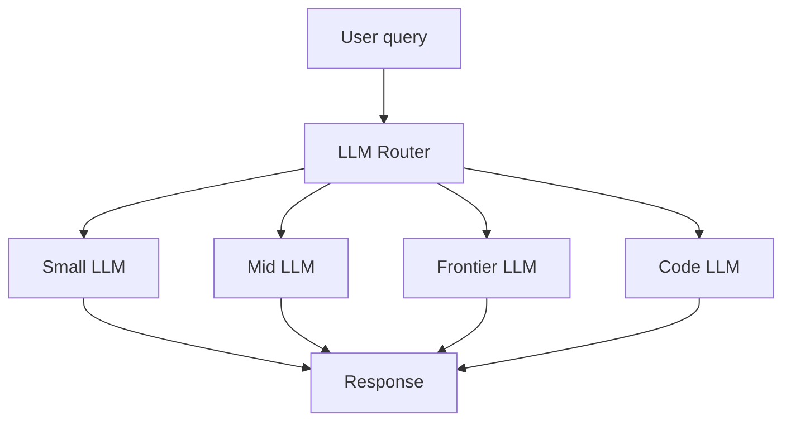
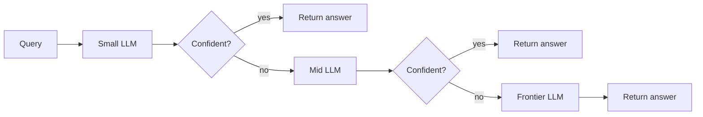

# What is LLM Routing? How to Send Each Query to the Right LLM

> **Step 16: AI Infrastructure, Deployment, and System Design** · ⏱️ 16 min read · [Read original](https://outcomeschool.com/blog/llm-routing)

## TL;DR
LLM Routing is a layer in front of many LLMs that picks the right one per query: easy queries go to small, cheap, fast LLMs; hard ones go to big, smart, expensive LLMs. This saves cost (frontier vs small can be about 30x apart) without losing quality. Strategies: rule-based, classifier, embedding, LLM-as-router, cascade.

## Key Concepts
- **LLM Routing** — choosing the right LLM for each query (LLM + Routing = decide the path).
- **Analogy** — receptionist (router) sends patient (query) to the right doctor (LLM).
- **LLM pool** — frontier, mid-size, small, task-specific (code, math, vision) LLMs.
- **Router** — small, fast component: rules, classifier, embedding lookup, or small LLM.
- **Cascade** — try cheapest first, escalate if not confident.
- **Mixture of Experts (MoE)** — token-level routing among expert sub-networks inside one LLM.

## How It Works

### Why we need it
LLMs differ in cost, latency, quality. Example: frontier about USD 15 per 1M output tokens vs small about USD 0.50 (30x gap). Most queries are simple ("What is 2 + 2?"), so sending all to a frontier LLM wastes cost and time.

### Anatomy
1. Query (only thing the router sees).
2. Router (rules, classifier, embedding lookup, small LLM).
3. LLM Pool.
4. Selected LLM: query forwarded, response returned.

Router latency rule: under 10% of chosen LLM latency (1 s LLM -> router at most 100 ms).

### Routing strategies
1. **Rule-based** — keywords, length, patterns (e.g. "code/function/bug" -> code-llm; length <50 small, <200 mid, else frontier). + very fast, cheap, no model call. - brittle ("Why is my Python script broken?" misses keywords), new patterns break rules.
2. **Classifier-based** — train on (query, best-LLM) pairs; logistic regression on embeddings, small NN, or a System One model like Jev with calibrated probability. + learns real patterns. - needs labelled data and retraining. Example: Sakana's Fugu (selection head scores each model).
3. **Embedding-based** — embed query; compare with one reference embedding per LLM; nearest wins. + no training, easy to add an LLM. - depends on reference quality. Embedding cache removes repeated embedding cost.
4. **LLM-as-Router** — small cheap LLM prompted with options returns one name. + flexible, no training, change rules by editing the prompt. - one extra LLM call; keep it small.
5. **Cascade** — cheapest first, escalate when not confident (self-rating, verifier model, or heuristics like answer length / "I do not know"). + biggest savings. - hard queries pay 2-3 calls, slow.

| Strategy | Speed | Cost | Flexibility | Needs training |
|---|---|---|---|---|
| Rule-based | Very fast | Very low | Low | No |
| Classifier | Fast | Low | Medium | Yes |
| Embedding | Fast | Low | Medium | No |
| LLM-as-Router | Medium | Medium | High | No |
| Cascade | Slow on hard queries | Lowest on average | High | No |

No clear winner: few clear query types -> rules; large mixed product -> cascade or LLM-as-router.

### Full trace (rule-based, 4 LLMs)
| Query | Decision | Cost / latency |
|---|---|---|
| "What is 2 + 2?" | small-llm | very low, about 100 ms |
| Summarize 3-line email | mid-llm | low, about 500 ms |
| Fix bug in Python Fibonacci function | code-llm (bug, function) | low, about 700 ms |
| Design multi-agent medical diagnosis system | frontier-llm (long) | high, about 3 s |

Without routing all four hit frontier; with routing only one does.

### Routing vs Mixture of Experts
| Aspect | LLM Routing | MoE |
|---|---|---|
| Lives | Outside LLMs, application layer | Inside one LLM, model layer |
| Routes | Full query | One token at a time |
| Picks | One full LLM | A few expert sub-networks |
| Controlled by | App developer | Model architecture |

## When it is worth it
- High query volume (thousands/day rarely justify; millions/day almost always).
- Mixed difficulty (uniform difficulty -> one LLM suffices).
- Cost pressure.
- Already using multiple LLMs (cleans ad-hoc logic).
- Otherwise a single mid-size LLM may be better.

## Trade-offs & Pitfalls (common mistakes)
1. Heavy router (frontier LLM as router can cost more than it saves) -> tiny LLM, classifier, rules.
2. No fallback path -> always keep a fallback LLM (small fails -> mid).
3. Router too slow -> rules in microseconds, classifiers few ms, small LLMs under 200 ms; 500 ms kills UX.
4. Mixing routing with orchestration -> routing picks one LLM for one query; orchestration coordinates many LLMs across steps.
5. No observability -> log LLM chosen, cost, latency, quality.
6. Wrong signal -> length alone misleads ("Prove the Riemann hypothesis" is short but hard; a long polite email summary is easy); use intent and difficulty.

## Key Takeaways
- Routing = pick the right LLM per query for cost, latency, quality.
- Pipeline: Query -> Router -> LLM pool -> selected LLM -> response.
- Five strategies: rule, classifier, embedding, LLM-as-router, cascade (most cost saving).
- Router must be fast (under about 10% of chosen LLM latency) and cheap.
- Routing is system-level and query-level; MoE is model-internal and token-level.
- Worth it with high volume, mixed difficulty, cost pressure, or multiple LLMs.
- Always add fallbacks and logging; route on intent/difficulty, not length alone.
