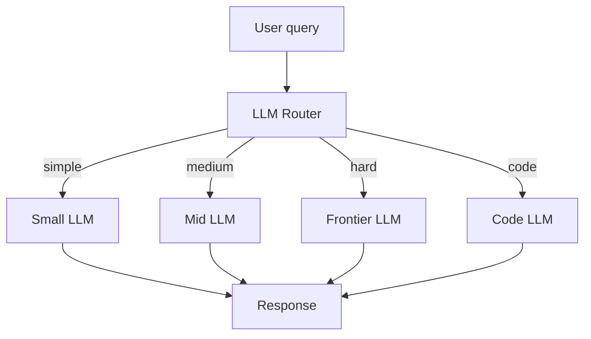

# What is LLM Routing? How to Send Each Query to the Right LLM

> **Step 16: AI Infrastructure, Deployment, and System Design** · ⏱️ 16 min read · [Read original](https://outcomeschool.com/blog/llm-routing)

## TL;DR
LLM Routing is a layer in front of several LLMs that picks the best one for each query based on cost, latency, and quality. Easy queries go to small cheap models, hard ones to frontier models, saving cost without losing quality.

## Key Concepts
- **Router** — small, fast component (rules, classifier, embeddings, or a small LLM) choosing the target LLM.
- **LLM pool** — small, mid, frontier, and specialist (e.g., code) models.
- **Cascade** — try cheapest first, escalate if not confident.
- **Why** — frontier about $15 per 1M output tokens vs small about $0.50, a 30x gap, while most queries are simple.
- **Analogy** — receptionist (router) sends patients (queries) to the right doctor (LLM).

## How It Works
Rule of thumb: router latency under 10% of the chosen LLM's latency.

### Five strategies
1. **Rule-based** — keywords, length, patterns. Very fast, cheap; brittle (e.g., "Why is my Python script broken?" misses code keywords).
2. **Classifier-based** — train on (query, best-LLM) pairs. Learns patterns; needs labeled data and retraining.
3. **Embedding-based** — nearest reference embedding per LLM. No training, easy to add models; depends on reference quality.
4. **LLM-as-router** — a small LLM picks the target via a prompt. Flexible; adds an extra LLM call.
5. **Cascade** — small, then mid, then frontier, escalating on low confidence (self-rating, verifier, or heuristic). Biggest savings; hard queries pay for 2 to 3 calls.

| Strategy | Speed | Cost | Flexibility | Training |
|---|---|---|---|---|
| Rule-based | Very fast | Very low | Low | No |
| Classifier | Fast | Low | Medium | Yes |
| Embedding | Fast | Low | Medium | No |
| LLM-as-router | Medium | Medium | High | No |
| Cascade | Slow on hard | Lowest avg | High | No |

### Routing vs Mixture of Experts
| Aspect | LLM Routing | MoE |
|---|---|---|
| Where | Application layer | Inside one model |
| Routes | Full query | Single token |
| Picks | One full LLM | A few experts |

### When worth it
High volume, mixed difficulty, cost pressure, or multiple LLMs already in use.

### Common mistakes
Heavy router, no fallback, slow router, confusing routing with orchestration, no logging, routing on the wrong signal (length alone is poor: "Prove the Riemann hypothesis" is short but hard).

## Diagram

## Key Takeaways
- Route each query to the cheapest LLM that can answer it well.
- Keep the router tiny and fast; never use a frontier LLM as the router.
- Always have a fallback LLM and log routing decisions, cost, latency, and quality.
- Cascade saves the most cost but slows hard queries.
- Routing is query-level across models; MoE is token-level inside one model.
- Routing is not orchestration.
