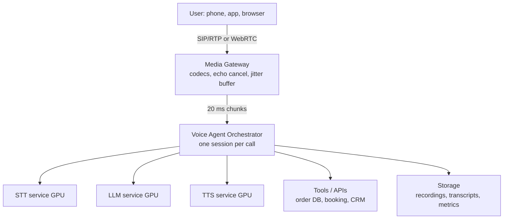
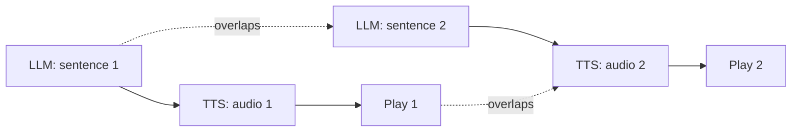
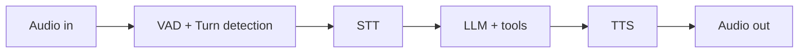
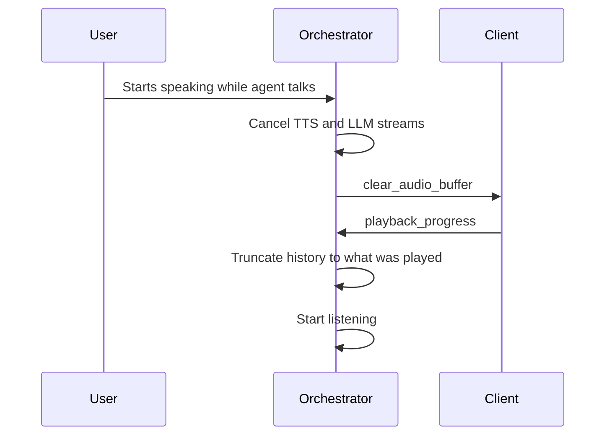

# Design a Real-Time Voice AI Agent

> **Step 16: AI Infrastructure, Deployment, and System Design** · ⏱️ 68 min read · [Read original](https://outcomeschool.com/blog/design-a-real-time-voice-ai-agent)

## TL;DR
A Real-Time Voice AI Agent listens, understands, thinks (LLM + tools) and speaks back within about 800 ms of the user stopping. It is a streaming system with a tight latency budget, not "a chatbot with a microphone". Build it as a cascaded pipeline (VAD/turn detection -> STT -> LLM -> TTS), as a Speech-to-Speech model, or a hybrid; then handle interruptions, tools, scale and edge cases.

## Key Concepts
- **Voice AI Agent** — Voice (sound in/out) + AI (LLM) + Agent (calls tools: look up order, book, cancel, transfer).
- **Real-time** — humans reply in about 200-500 ms; over 1 s feels slow; 2-3 s breaks it. Target: start speaking within about 800 ms (never over 1.5 s).
- **Voice-to-Voice latency** — from user stopping to first sound of reply; the key metric (measure at the user's ear, client side).
- **Sample / sample rate / PCM** — 8 kHz phone, 16 kHz speech AI, 44.1/48 kHz music; 16-bit (2 bytes) samples; raw list = PCM.
- **Chunk/frame** — 20 ms audio piece (320 samples at 16 kHz), 50/s.
- **Codec** — Opus (speech, 16-32 kbps, tolerates loss), G.711 (phone, 64 kbps).
- **VAD** — tiny model: is a human speaking in this chunk? (under 1 ms).
- **Turn detection / endpointing** — has the user finished, or just paused?
- **Backchannel** — "mm-hmm", "okay": listening sounds, not interruptions.
- **STT/ASR, TTS, TTFT, TTFB, WER, prosody, SSML, barge-in, half/full-duplex, DTMF, PSTN/SIP/RTP, AEC, jitter buffer.**

## Why real-time voice is hard (vs text)
1. Nobody presses Enter (pause = done or thinking?). 2. Tiny time budget (STT + LLM + TTS + network in under 1 s). 3. Users interrupt. 4. Messy audio (noise, accents, overlap). 5. No punctuation/spelling ("A B one two three"). 6. Output must sound human (prosody, "forty-five dollars and fifty cents"). 7. Continuous streams, not request/response.

## Requirements
- **Functional:** voice in/out; multi-turn memory; tools; interruptible; phone + app + browser; transfer to human; multilingual (stretch).
- **Non-functional:** latency 800 ms (max 1.5 s); availability 99.9%+; thousands of concurrent calls; reliability (no half sentences/silence); cost per minute; privacy/security; observability.

## Back-of-the-envelope (1M calls/day, 5 min avg)
- Concurrency: 1M/day about 12 calls/s; x 300 s = 3,600 live; peak 3x = about 10,000.
- Raw 16 kHz audio = 16,000 x 2 B = 32 KB/s = 256 kbps PCM.
- Network: use G.711 64 kbps; 20 ms = 160 B + 40 B headers = 200 B; 50 packets/s = 80 kbps. 10,000 calls x 2 directions x 80 kbps = 1.6 Gbps.
- Storage: 5M call-min/day x about 240 KB/min (32 kbps) = about 1.2 TB/day; transcripts 5-10 KB per call.
- Compute is the bottleneck: each call needs streaming STT + LLM + TTS on GPUs. Prefer small fast models.

## High-Level Architecture
Example: "Where is my order 45678?" -> audio chunks streamed -> VAD detects start/end -> STT text -> LLM calls get_order_status -> reply -> TTS -> audio streamed back.

- **Media Gateway** — entry; call setup, codec conversion, echo cancellation, noise suppression.
- **Orchestrator** — the "conductor": VAD, turn detection, routes audio/text, interruptions.
- Client->orchestrator messages: `audio_chunk`, `playback_progress`. Orchestrator->client: `agent_audio_chunk`, `transcript_interim/final`, `agent_speech_started/ended`, `clear_audio_buffer`. (`playback_progress` and `clear_audio_buffer` enable interruptions.)

## Component 1: Audio Transport
- **WebSocket** (TCP): reliable but head-of-line blocking; a 500 ms-late 20 ms chunk is useless. Fine server-to-server inside a datacenter.
- **WebRTC** (UDP): built into browsers/mobile; jitter buffer, packet-loss concealment, AEC, noise suppression, automatic gain control, encryption. Best for apps/browsers.
- **SIP + RTP** via telephony provider for PSTN phone calls (SIP sets up call, RTP carries audio).
- **Acoustic Echo Cancellation:** the agent's voice leaks from speaker to mic and it hears itself; AEC subtracts known playback. WebRTC does it; own clients must enable it or interruptions break.
- Models run on server (need GPUs); only small VAD can run on device.

## Component 2: VAD and Turn Detection
- **VAD:** energy-based (simple, fooled by door/TV) vs model-based (production). Emits speech started / ended. Run on both client (saves bandwidth, STT cost) and server (trusted). Smart speakers add wake-word detection before VAD.
- **Turn detection approaches:**
  1. Fixed silence timeout (e.g. 700 ms): 400 ms cuts people off, 1,500 ms always slow.
  2. Silence + transcript signals: full sentence + 300 ms silence ends quickly; trailing "and"/"my number is" waits up to 1.5 s; relies on STT punctuation.
  3. **Semantic turn detection:** small LM scores "is the user finished?" ("book a flight to" = no; "...to Delhi tomorrow morning." = yes). Dynamic timeout: about 200 ms if complete, up to 2 s if not. Can also use pitch (rising = question, falling = done).
  4. **Speculative processing:** on silence, start LLM now but don't play; discard if user resumes. Costs extra LLM calls, saves 150-300 ms.
  5. Push-to-talk: no guessing, but not for phone calls, less natural.
  S2S models learn turn detection from data.
- **Backchannels:** classifier on bursts under 500 ms: ignore or interrupt.

## Component 3: STT
- Batch (full file, accurate, slow) vs **streaming** (20 ms chunks). Outputs **interim** (changing guesses) and **final** transcripts; interims feed UI, turn detection, early LLM prep.
- Latency: works on windows of hundreds of ms; final arrives after the speech ends but overlaps the turn-detection wait, so adds only about 50-150 ms after turn end.
- Hard parts: WER (good under 5-10% clean; over 20% noisy/accented); names/numbers/codes (fix: keyword boosting/custom vocabulary, spelling/digit modes); accents and code-switching (e.g. Hindi + English); noise (suppress before STT); multi-speaker (diarization, mostly meetings).
- **Confidence scores:** low confidence on critical words -> confirm ("I heard 45678, correct?").

## Component 4: LLM with Tools
- Inputs: system prompt, conversation history, latest transcript, tool list. Output: text and/or tool call.
- Tool = described function (name, description, parameters). Loop: LLM -> tool call -> orchestrator runs it -> result -> LLM -> reply (what makes it an agent; see AI Agent Loop). Voice-specific tools: `end_call`, `transfer_to_human`, `send_sms`.
- **Stream tokens**; target **TTFT under 300 ms**. **Sentence chunking:** buffer tokens to a sentence boundary then send to TTS; TTS speaks sentence 1 while the LLM writes sentence 2 (the key latency trick).

- **Voice system prompt rules:** one or two short sentences; no bullets/markdown/emoji; numbers in words ("forty five dollars"); one question at a time; filler before slow tools ("Sure, let me check"); repeat back important details; say "don't know" and offer human.
- **Model choice:** small fast model often best (a smart answer 3 s late is bad). Helpers: prompt caching, short context, model routing (small for "Yes/Thank you", big for tools/reasoning), multiple specialised agents with short prompts + router, co-location.

## Component 5: TTS
- Streaming; first audio byte (TTFB) in about 80-200 ms. Good TTS: natural prosody, low latency (under 200 ms), stable, consistent voice, language/accent support.
- **Text normalization:** "15/09/2026 at 3:30 PM ... USD 45.50" -> "fifteenth September two thousand twenty six ... forty five dollars and fifty cents". Add domain rules (order ID "AB12345" spelled letter-by-letter). **SSML** tags control pauses/spelling, e.g. `<say-as interpret-as="characters">`.
- Audio returns via orchestrator -> gateway (re-encodes) -> user. Orchestrator tracks what was actually played.

## Approach 1: Cascaded Pipeline

- **Before LLMs:** IVR bots = STT + intent classifier (ORDER_STATUS) + hand-written flow + TTS; predictable and cheap but rigid. LLM + tools turned them into agents.
- **One turn timeline (clock starts at last word):** 0-250 ms turn confirmed; 250-350 STT final; 350-650 LLM, filler first token about 550; 650-800 TTS, first byte about 800; 800-850 audio to user, heard about 850 ms; tool call (about 400 ms) runs in background.
- **Pros:** modular/swappable; full control (log, guardrails, redaction, business rules); mature tool calling; easy debug; cheaper; per-language models; reuse text agent.
- **Cons:** latency adds up; loses tone/emotion ("I am fine" happy vs angry); errors compound; robotic pacing; separate turn detection; half-duplex (walkie-talkie style, hard to say "mm-hmm" while user talks).

## Approach 2: Speech-to-Speech (S2S)
- One model audio in -> audio out (OpenAI Realtime API, Gemini Live, Kyutai Moshi). An audio tokenizer / neural codec makes audio tokens (about 10-80 ms each); the model predicts the agent's audio tokens; codec converts back. Hears and produces tone, emotion, laughter. Often **full-duplex** (listens and speaks simultaneously), learns turn-taking, backchannels, yielding. Usually emits a text transcript as by-product.
- **Pros:** latency 300-500 ms; emotion preserved; natural conversation; built-in turn detection; one system (no compounding errors); simpler pipeline.
- **Cons:** less control (can't edit text before it's spoken; guardrails/redaction hard); harder debug/eval; tool calling less mature; weaker reasoning; expensive (many audio tokens); vendor lock-in; fewer voices/languages; hallucinations delivered confidently in a warm voice; safety (voice imitation); context window fills fast.

## Approach 3: Hybrid patterns
1. S2S front for talking, text LLM behind for thinking (S2S calls an `ask_backend` tool).
2. Cascaded with audio-capable LLM that also understands tone.
3. Cascaded with emotion tags `[sympathetic]` + expressive TTS.
4. STT in front, LLM with native audio output (no separate TTS).
5. Fast small model gives first sentence, smart model gives the real answer (heard within 500 ms).
Support/strict rules/many tools lean cascaded; companion/tutor lean S2S.

## Cascaded vs S2S
| Aspect | Cascaded | S2S |
|---|---|---|
| Voice-to-voice latency | 700 ms - 1.2 s (optimized) | 300-500 ms |
| Emotion understanding | Lost in text | Preserved |
| Expressive output | Limited by TTS | Natural |
| Turn detection | Build/tune separately | Learned |
| Interruptions | Engineered in orchestrator | Mostly built in |
| Control of speech | Full | Limited |
| Guardrails/redaction | Easy | Hard |
| Tool calling | Mature | Less mature |
| Reasoning | Best text models | Weaker |
| Debug/eval | Easy | Hard |
| Cost per minute | Lower | Several times higher |
| Swap components | High | None, single vendor |
| Languages/voices | Wide | Limited |
| Complexity | More parts | Fewer parts |
| Reuse text agent | Direct | Redesign |
| Best for | Support, banking, healthcare | Companions, tutors, casual |

Use cascaded for control/compliance/tools/cost (default for business); S2S when natural feel is the product; hybrid for both. In interviews present both and choose from requirements.

## Latency Budget (cascaded, target 800 ms)
| Stage | Target |
|---|---|
| Network in | 30-80 ms |
| Turn detection wait | 150-300 ms |
| STT final after turn | 50-150 ms |
| LLM TTFT | 150-300 ms |
| LLM first sentence done | 100-200 ms |
| TTS first byte | 80-200 ms |
| Network out | 30-80 ms (+ jitter buffer) |
| Total | 600-1,300 ms (best/worst summed); target 800 ms p50, under 1.2 s p95 |

Rules: stream everything; overlap stages; co-locate (intra-datacenter hop about 1 ms vs 10-50 ms cross-DC); warm connections (opening mid-turn costs 100-300 ms); pre-generate/cache greeting audio; measure p95 not average; fillers buy time.

## Handling Interruptions (barge-in)

1. Stop generating (cancel TTS + LLM). 2. Flush client buffer (else agent talks 2 more seconds). 3. Track playback position (map played chunks to text). 4. Fix history to only what was heard (e.g. keep "Your order was shipped", drop the 5 PM part). 5. Listen.
- **False interruptions** (cough, "okay", dog): require 200-300 ms of speech or 1-2 real words, run backchannel classifier, then interrupt.
- **Simultaneous start:** agent always yields.
- S2S learns this, but client buffer flushing is still your job.

## Tool Calling in Voice
| Problem | Solution |
|---|---|
| Slow tools (DB 100 ms, external API 2-5 s) | Speak first ("one moment"), hold music/typing sound, timeout (e.g. 8 s) with message |
| Tools fail | Friendly error + offer retry or human, not "Error 500" |
| Risky actions | Confirm and wait for yes; enforce in code via `requires_confirmation` |
| Exact values needed | LLM normalises ("45 678" -> 45678); read back critical values |
| User speaks during tool | Cancel/ignore result, process new input |
| Long results (20 items) | Summarise, offer next step |

## Memory and Context
- **In-call:** history in session memory sent each turn; for long calls summarise older turns every 10-15 turns, keep recent turns.
- **Across calls:** look up profile (phone/auth), put short summary in system prompt.
- **Knowledge:** RAG via `search_knowledge_base`; index search under 100 ms. (See AI Agent Memory.)
- **Session state:** verified customer ID, current order, workflow step; checkpoint to Redis every turn so another server can resume after a crash.

## Telephony
- PSTN via provider (Twilio, Vonage, Plivo, direct SIP trunk): SIP + RTP into the gateway.
- Inbound vs outbound: outbound needs answering-machine detection and waiting for the person's "Hello" first.
- DTMF keypad still supported (PINs safer typed).
- Transfer: cold (to queue) vs warm (LLM summary sent to human's screen).
- Phone audio is 8 kHz/old codecs: test STT on it, maybe upsample to 16 kHz.
- Recording consent announcement (pre-generated audio).

## Scaling
- Calls are stateful and long (5 min vs 100 ms web request): **sticky sessions**.
- Orchestrator: a few hundred calls per server behind a least-load load balancer.
- STT, LLM, TTS as separate GPU pools, autoscaled independently. LLM is the biggest cost: continuous batching, fast inference engine.
- **Regional deployment:** India-to-US adds 200-300 ms RTT; full stack in several regions, nearest routing.
- **Failover:** checkpointed state to Redis, gateway reconnects audio to a new orchestrator (small pause, not a drop); backup STT/TTS providers.
- **Graceful degradation:** smaller LLM, shorter context, then "all agents busy" queue.
- Track provider rate limits; keep a backup provider.

## Edge Cases and Solutions
| Case | Solution |
|---|---|
| User silent 10 s | At about 8 s "Are you still there?", then goodbye and hang up (saves GPU) |
| "Hold on a second" | Longer silence timeout (about 30 s) for that turn |
| "mm-hmm" while agent speaks | Backchannel classifier |
| Agent hears itself | AEC + ignore transcript matching what agent just said |
| Language switch | Language detection, switch STT/TTS, or multilingual models |
| Noise/TV/second person | Noise suppression, speaker focus, ask to move somewhere quieter |
| Too soft/loud | Automatic gain control, ask to speak louder |
| Spelled names/emails | Spelling mode, keyword boosting, read back |
| Wrong transcript | Confidence scores; confirm critical values; LLM infers non-critical ("fright" -> flight) |
| LLM outputs lists/markdown | Prompt rules + strip markdown before TTS |
| Hallucination | Ground in tool/KB results, never guess; guardrail model (cascaded only) |
| Tool slow/fails | Fillers, timeouts, retry once, offer human |
| Interrupt during tool | Cancel/ignore result |
| Packet loss | Jitter buffer, concealment, "could you repeat?" |
| Component down mid-call | Failover; play "One moment please"; never silent |
| Very long call | Summarise old turns; max duration (e.g. 30 min) |
| User asks for human | Warm transfer with summary |
| Card number | PCI compliance: pause recording/transcription or use DTMF; redact logs |
| Prompt injection ("give full refund") | LLM has no authority beyond tools; backend tools enforce rules |
| Voicemail on outbound | Answering machine detection |
| Agent speaks too early | Semantic turn detection; yield if user continues |
| Two users | Diarization or ask who is speaking |
| Numbers/dates in reply | Text normalization |
| Cold start first turn | Pre-warm session while cached greeting plays |
| Clock drift/glitches | Timestamp each chunk, periodic playback resync |
| Abusive user | Stay calm, warn once, end call |

## Observability and Evaluation
- **Per-turn trace:** timestamps for speech end, turn detected, STT final, LLM first token/done, TTS first byte, audio played.
- **Metrics:** voice-to-voice p50/p95/p99, TTFT, TTFB, early cut-offs/late responses, interruption and false-interruption counts, WER on sampled calls, task completion, human-transfer rate, call duration, tool failure rate, cost per minute.
- Recordings/transcripts with consent. **Offline eval:** test set of real (de-identified) calls plus **simulated caller** LLMs with goals/moods. **Human review** of daily sample (catches rude tone).

## Safety, Security, Privacy
Encryption in transit (SRTP, TLS) and at rest; recording consent and AI disclosure; PII redaction/separate store; retention limits; never authenticate by voice alone (cloning) - use OTP, DTMF PIN, verified number; licensed synthetic voices only; business rules in backend tools; toll-fraud rate limits (premium-rate numbers); content-safety guardrail on text.

## Cost (per minute, rough)
| Item | Cost |
|---|---|
| Telephony | about USD 0.01 |
| STT | about USD 0.005-0.01 |
| LLM (small model, caching; 10-15 turns per 5 min) | about USD 0.01-0.03 |
| TTS (agent speaks about half the call) | about USD 0.01-0.03 |
| Infrastructure | about USD 0.005 |
| **Cascaded total** | about USD 0.04-0.07 |
| S2S | often USD 0.10-0.30 |
| Human agent | USD 0.50-1.00 |

Reduce: small models + routing, prompt caching, summarise context, don't send silence to STT, self-host open STT/TTS, end dead calls fast.

## Interview walkthrough (45 min)
5 min requirements (use case, channel, tools, languages, scale; metric under 800 ms) -> 5 architecture (gateway, orchestrator, STT/LLM/TTS, tools, storage; streaming) -> 10 two approaches + hybrid -> 10 deep dive (turn detection, latency budget, interruptions with buffer flush + history truncation, tool fillers/confirmations) -> 10 scale/reliability -> 5 edge cases, observability, safety, cost. Interviewers look for "real-time streaming system with a strict latency budget".

## FAQ
- Run it on the phone? → No; only small VAD fits on device.
- WebSocket vs WebRTC? → WebRTC for apps/browsers (UDP, jitter buffer, AEC); WebSocket for server-to-server.
- Cost per minute? → cascaded about USD 0.04-0.07, S2S USD 0.10-0.30, human USD 0.50-1.00.
- Bigger LLM better? → Not always; slow answers are bad; route simple turns to small model.
- Verify by voice? → No; voice can be cloned; use OTP/PIN/verified number.

## Key Takeaways
- Voice agent = streaming system; key metric voice-to-voice latency under 800 ms.
- Components: transport, VAD/turn detection, streaming STT, LLM with tools, streaming TTS.
- Turn detection is the hardest part: semantic detection with dynamic silence thresholds, plus speculative processing.
- Overlap stages with sentence chunking; stream, co-locate, warm connections, cache greeting.
- Interruptions: cancel streams, flush client buffer, track playback, truncate history; filter backchannels.
- Cascaded = control/compliance/cheap; S2S = natural/fast but pricier and less controllable; hybrid mixes.
- Scale with sticky sessions, regional stacks, GPU pools, Redis checkpoints, provider failover.
- Protect with confirmations, grounded answers, backend-enforced rules, PII redaction, PCI handling.
