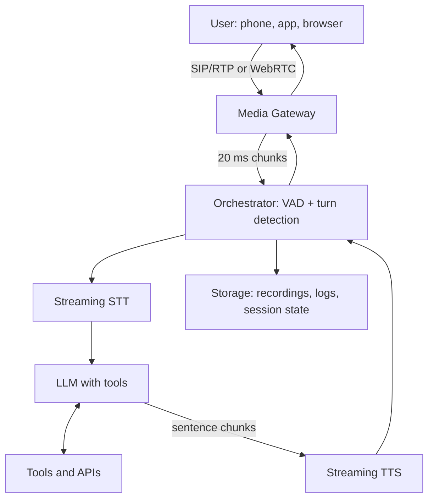

# Design a Real-Time Voice AI Agent

> **Step 16: AI Infrastructure, Deployment, and System Design** · ⏱️ 68 min read · [Read original](https://outcomeschool.com/blog/design-a-real-time-voice-ai-agent)

## TL;DR
A Real-Time Voice AI Agent listens, understands, thinks (with tools), and talks back within a fraction of a second. It is a streaming system with a strict latency budget (target: first audio within about 800 ms of the user finishing), not "a chatbot with a microphone". The key design choice is a cascaded STT, LLM, TTS pipeline vs an end-to-end Speech-to-Speech model, or a hybrid.

## Key Concepts
- **Voice-to-voice latency** — time from the user stopping to the first agent sound; the key metric. Target 800 ms (never above 1.5 s). Human reply gap is about 200 to 500 ms.
- **Media gateway** — entry point: call setup, codecs, echo cancellation, jitter buffer.
- **Orchestrator** — one session per call; runs VAD, turn detection, calls STT/LLM/TTS, handles interruptions.
- **VAD** — per-20 ms-chunk speech yes/no. **Turn detection** — decides if the user finished (not just paused).
- **Streaming STT** — interim (changeable) and final transcripts; metric WER.
- **LLM with tools** — brain; metric TTFT (under 300 ms). **TTS** — streaming; metric time to first byte (80 to 200 ms).
- **Barge-in** — user speaks while the agent talks. **Backchannel** — "mm-hmm", not an interruption.
- **WebRTC** (UDP, apps/browsers) vs **WebSocket** (TCP, head-of-line blocking; fine server to server) vs **SIP/RTP** (phone).
- **AEC** — acoustic echo cancellation so the agent does not hear itself.

## How It Works
**Why voice is hard:** no Enter key, tiny time budget, interruptions, noisy audio, no punctuation (names, numbers), human-sounding output, continuous streams.

**Scale estimate (1M calls/day, 5 min):** about 12 calls/s, so about 3,600 concurrent, about 10,000 at peak. Network about 1.6 Gbps, recordings about 1.2 TB/day. GPU compute for three models per call is the real cost.

### Turn detection (from simple to advanced)
1. Fixed silence timeout (no good value).
2. Silence plus transcript signals.
3. Semantic turn detection with dynamic timeout (about 200 ms if complete, up to 2 s if not).
4. Speculative processing: start the LLM reply early, discard if the user resumes (saves about 150 to 300 ms).
5. Push-to-talk.

### Overlap trick
Stream LLM tokens, chunk into sentences, send to TTS; sentence 1 plays while sentence 2 is generated. Voice-specific prompt: short replies, no markdown, numbers as words, filler like "let me check", confirm key details.

### Approaches
| Aspect | Cascaded | Speech-to-Speech |
|---|---|---|
| Latency | 700 ms to 1.2 s | 300 to 500 ms |
| Emotion/tone | Lost in text | Preserved |
| Control, guardrails | Full | Limited |
| Tool calling, reasoning | Mature, best | Newer, weaker |
| Debugging | Easy | Hard |
| Cost/min | Lower (about $0.04 to $0.07) | Several times (about $0.10 to $0.30) |
| Swapping parts | Easy | Single vendor |

Hybrid patterns: S2S front plus text agent backend; audio-aware LLM; expressive TTS with emotion tags; LLM with native audio output; fast small model first, smart model behind. Default for business use: cascaded.

### Latency budget (target 800 ms)
Network in 30 to 80, turn detection 150 to 300, STT final 50 to 150, LLM TTFT 150 to 300, first sentence 100 to 200, TTS first byte 80 to 200, network out 30 to 80 ms. Rules: stream everything, overlap, co-locate, keep warm connections, cache the greeting, measure p95, use fillers.

### Interruption handling
Cancel TTS and LLM, send `clear_audio_buffer`, find the played text via playback progress, truncate history to what was heard, then listen. Avoid false interruptions: require 200 to 300 ms of speech or real words, filter backchannels. If both start together, the agent yields.

### Tools, memory, telephony
- Tools: say a filler first, use timeouts, friendly errors, confirm risky actions in code (`requires_confirmation`), read back critical values, cancel on user interrupt, summarize long results. Special tools: `end_call`, `transfer_to_human`, `send_sms`.
- Memory: summarize old turns, load customer profile across calls, RAG for knowledge, checkpoint session state to Redis each turn.
- Telephony: PSTN, SIP/RTP, DTMF, warm vs cold transfer, answering machine detection, 8 kHz audio, recording consent.

### Scaling and operations
Sticky sessions, orchestrator fleet behind a load balancer, independently autoscaled GPU pools (continuous batching), regional deployment, Redis checkpoint failover, backup providers, graceful degradation, rate limits.

Edge cases: silence timeouts, "hold on", echo, language switches, noise, spelled names, STT errors (confidence plus confirmation), markdown in output, hallucination (ground in tools, guardrails), card numbers (PCI: DTMF, redact), prompt injection (enforce policy in backend tools), voicemail, cold start (pre-warm), very long calls.

Observability: per-turn trace, p50/p95/p99 latency, WER, task completion, transfer rate, simulated callers. Safety: encryption, AI disclosure, PII redaction, never verify identity by voice alone (cloning).

## Diagram

## Key Takeaways
- Treat it as a real-time streaming system; optimize voice-to-voice latency (about 800 ms).
- Turn detection is the hardest part: combine VAD with semantic turn detection and dynamic timeouts.
- Stream and overlap every stage; pre-warm, co-locate, measure p95.
- Interruptions need buffer flush, playback tracking, and history truncation.
- Cascaded = control, cost, tools; S2S = natural feel, low latency, less control; hybrids mix both.
- Enforce business rules and confirmations in backend code, not only in the prompt.
