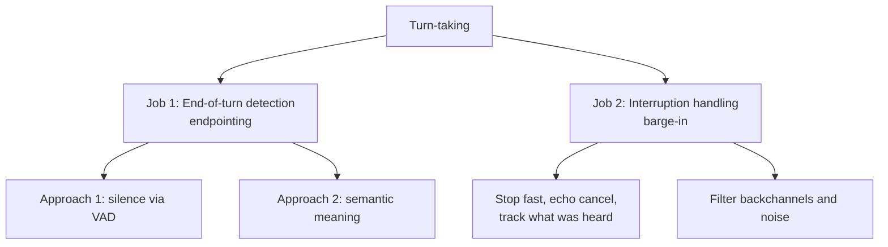
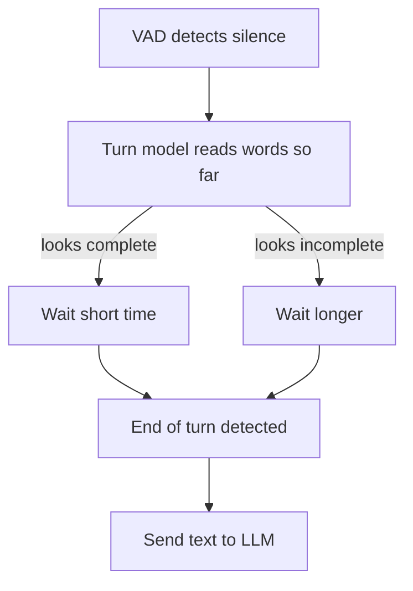

# What is turn-taking in a voice AI agent?

> **Step 16: AI Infrastructure, Deployment, and System Design** · ⏱️ 17 min read · [Read original](https://outcomeschool.com/blog/what-is-turn-taking-in-a-voice-ai-agent)

## TL;DR
Turn-taking is the skill of knowing when the user has finished, when the agent should speak, and when it must stop because the user is talking again. It splits into end-of-turn detection (silence via VAD, improved with semantic meaning) and interruption handling (barge-in, echo cancellation, backchannel filtering). Full-duplex models learn all this inside one model.

## Key Concepts
- **Turn** — one chunk of speech by one speaker; a conversation is a chain of turns.
- **Turn-taking** — deciding who talks when, avoiding overlap and long silences. Three recurring questions: has the user finished? is it my turn? has the user started again while I talk?
- **Voice AI agent** — talks via voice (support bots, assistants, AI receptionists); typical pipeline STT -> LLM -> TTS.
- **VAD (Voice Activity Detection)** — small fast model saying "speech" or "no speech" per audio piece (about 20 ms); does not understand words.
- **Silence threshold/timeout** — fixed silence length that ends a turn (e.g. 700 ms).
- **Endpointing / end-of-turn detection** — finding the end point of the user's speech.
- **Semantic turn detection** — model reads words (and maybe tone) and outputs a 0-1 probability the user is done.
- **Barge-in** — user speaks while the agent is speaking.
- **Backchannels** — "uh-huh", "okay", "right": "I am listening", not a turn.
- **Echo cancellation** — removes the agent's own voice from the mic input.
- **Half-duplex vs full-duplex** — strict turns vs listening and speaking simultaneously.

## How It Works

### How humans do it
- In a ten-language study, the most common gap between turns is 0-200 ms, too short to hear, think and then start; humans predict the end and prepare their reply early.
- Signals: words (unfinished "book a table for..."), tone (falls at statement end, rises on yes/no questions), pause type.
- Humans stop when cut in on and give backchannels without taking the turn.

### Why it is hard for a machine
Machine gets a stream of about 20 ms slices. One second of silence could mean finished, thinking, or reading a card number. Two failure modes:
- **Cutting in too early** ("My phone number is 98765..." pause, agent says "Thank you").
- **Waiting too long** (2 s delay, user says "Hello?").

### Approach 1: Wait for silence
VAD labels each piece speech/silent; if silence lasts over a fixed time (e.g. 700 ms), end of turn, send text to LLM. Simple, fast, cheap.
- Short timeout (300 ms): fast replies but cuts in when user pauses to think.
- Long timeout (1500 ms): rarely cuts in, every reply feels slow.
- Flaw: it listens to sound, not meaning ("My number is 98765" pause looks like "Thank you" pause). See the latency-budget blog.

### Approach 2: Understand the meaning
| User said | Chance turn over | Agent |
|---|---|---|
| "What time do you open?" | high, about 0.95 | Reply quickly |
| "I want to book a table for" | low, about 0.05 | Wait longer |
| "My card number is 4512 8890" | low, about 0.20 | Wait longer |
| "Okay, that is all, thank you." | high, about 0.97 | Reply quickly |

Combined: VAD detects silence -> turn model reads words so far -> complete = short wait, incomplete = long wait -> end of turn. Timeout becomes dynamic. Some models read STT text only; some listen to audio too (falling pitch). Speculative LLM generation can prepare the reply during the wait.

### Handling interruptions
Keep VAD running while the agent speaks. Flow: agent speaking -> VAD hears user -> agent stops audio immediately -> listens -> LLM replies to the new request.
1. **Stop fast** (talking 2 more seconds feels ignoring).
2. **Don't hear itself**: use echo cancellation, otherwise it interrupts itself.
3. **Remember what the user actually heard**: if five sentences planned and interrupted after two, history keeps only two.

### Not every sound is a new turn
| Sound while agent speaks | Meaning | Action |
|---|---|---|
| "Uh-huh", "okay", "right" | Listening | Keep speaking |
| Cough, door, TV, other person | Not a turn | Keep speaking |
| "Wait, stop", "No, I meant Monday" | Wants the turn | Stop and listen |

Method: wait a bit (e.g. user speaks at least half a second, or says more than "okay"); some systems use a trained backchannel model.

### Half-duplex vs full-duplex
| Point | Half-duplex (pipeline) | Full-duplex |
|---|---|---|
| Listen/speak | Strict turns | Both simultaneously |
| Turn decision | Separate VAD + turn model | Learned inside model |
| Backchannels | Extra logic | Learned from conversations |
| Control/debug | Easier | Harder |
| Use | Many production agents | Research, early products (e.g. Kyutai Moshi) |

Walkie-talkie vs phone call. Full-duplex is closer to humans; the pipeline is easier to build, control and connect to tools, so most production agents use it. See "Design a Real-Time Voice AI Agent".

### Walkthrough (restaurant)
1. "I want to book a table for..." pause -> unfinished, low score, keep waiting.
2. "...four people tomorrow at 8 PM." -> complete, high score, short wait, end of turn.
3. LLM replies, TTS starts speaking.
4. User says "uh-huh" -> backchannel, keep going.
5. User says "Wait, terrace please." -> real interruption; stop; history records only heard part.
6. Agent replies: terrace table for four booked.

## Trade-offs & Pitfalls
- Fixed timeout always trades speed vs cut-offs; semantic detection reduces both mistakes.
- Stopping on every sound makes the agent break mid-sentence; need backchannel/noise discrimination.
- Not truncating history causes the LLM to assume unheard content was delivered.
- Full-duplex: more natural but harder to debug and control.

## FAQ
- Endpointing? → End-of-turn detection; fixed silence or silence plus word meaning.
- Good timeout? → No single number; make it dynamic via semantic detection.
- Why echo cancellation? → Mic hears speaker; agent would interrupt itself.
- Reply on interrupt? → Stop audio, keep only the heard part in history.
- Human turn gap? → Typically 0-200 ms.

## Key Takeaways
- Turn-taking = end-of-turn detection + interruption handling.
- VAD only detects sound; semantic turn detection adds meaning and sets a dynamic wait.
- Two errors to minimise: cutting in early and replying late.
- Barge-in: keep VAD running while speaking, stop fast, use echo cancellation, record only heard speech.
- Ignore backchannels, coughs and background noise.
- Half-duplex pipelines dominate production; full-duplex models learn turn-taking end-to-end.
