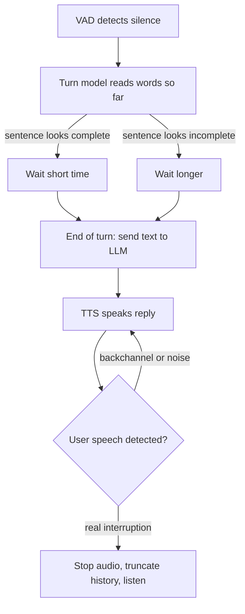

# What is turn-taking in a voice AI agent?

> **Step 16: AI Infrastructure, Deployment, and System Design** · ⏱️ 17 min read · [Read original](https://outcomeschool.com/blog/what-is-turn-taking-in-a-voice-ai-agent)

## TL;DR
Turn-taking is how a voice AI agent decides when the user has finished, when to start speaking, and when to stop because the user wants to talk again. Silence alone is not enough; combining VAD with semantic understanding gives natural conversation.

## Key Concepts
- **Turn** — one chunk of speech by one speaker.
- **Endpointing (end-of-turn detection)** — finding when the user has finished.
- **VAD** — small model labeling each audio piece as speech or no speech.
- **Silence timeout** — silence length that ends a turn (e.g., 700 ms).
- **Semantic turn detection** — model reads words (sometimes tone) and outputs the chance the turn is over (0 to 1).
- **Barge-in** — user speaks while the agent is speaking.
- **Backchannel** — "uh-huh", "okay"; listening signals, not turns.
- **Half-duplex vs full-duplex** — strict turns vs listening and speaking simultaneously.

## How It Works
**Humans:** the typical gap between turns across ten languages is 0 to 200 ms, so we predict the end using words, tone, and pauses.

**Pipeline:** STT, then LLM, then TTS. Something must decide when to send words to the LLM: too early gives half-answers, too late gives dead air.

**Mistakes:** cutting in too early (user pauses to check digits) vs waiting too long (user says "Hello?"). The same silence can mean done, thinking, or reading a number.

### Approach 1: wait for silence
VAD plus fixed timeout. Simple, but 300 ms cuts people off while 1500 ms feels slow; no value fits all.

### Approach 2: understand meaning
| User said | Chance turn is over | Action |
|---|---|---|
| "What time do you open?" | High (~0.95) | Reply quickly |
| "I want to book a table for" | Low (~0.05) | Wait longer |
| "My card number is 4512 8890" | Low (~0.20) | Wait longer |

Combine: VAD detects silence, the turn model sets a short or long wait.

### Interruptions
Keep VAD running while speaking. On real barge-in: stop audio fast, use echo cancellation so the agent does not hear itself, and record only what the user actually heard in history.

### Not every sound is a turn
| Sound | Meaning | Action |
|---|---|---|
| "Uh-huh", "okay" | Listening | Keep speaking |
| Cough, noise | Not a turn | Keep speaking |
| "Wait, no, I meant Monday" | Wants the turn | Stop and listen |

Typically require about half a second of speech or more than a simple "okay", or use a backchannel model.

### Half vs full duplex
| Point | Half-duplex (pipeline) | Full-duplex |
|---|---|---|
| Talking/listening | One side at a time | Both at once |
| Turn decision | VAD plus turn model | Learned in model |
| Control/debugging | Easier | Harder |
| Use | Most production | Research, early products (e.g., Moshi) |

## Diagram

## Key Takeaways
- Two jobs: end-of-turn detection and interruption handling.
- Silence alone cannot tell "done" from "thinking"; add meaning.
- Make the silence timeout dynamic based on sentence completeness.
- Distinguish backchannels and noise from real interruptions.
- Echo cancellation prevents self-interruption; history must keep only what was heard.
- Full-duplex models learn turn-taking, but pipelines dominate production for control.
