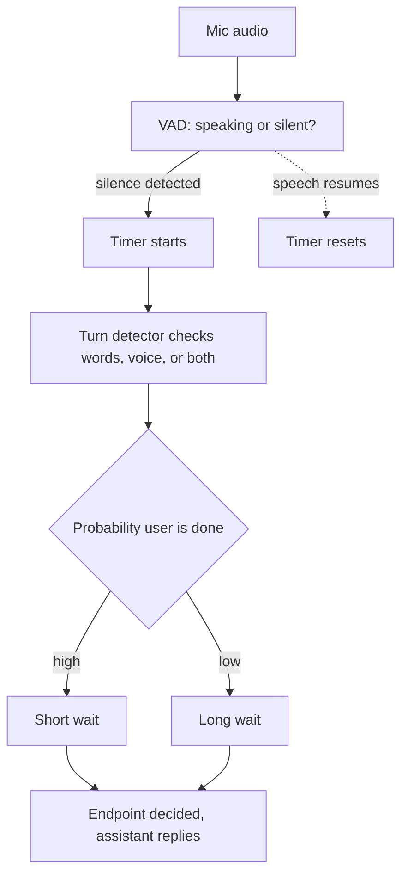
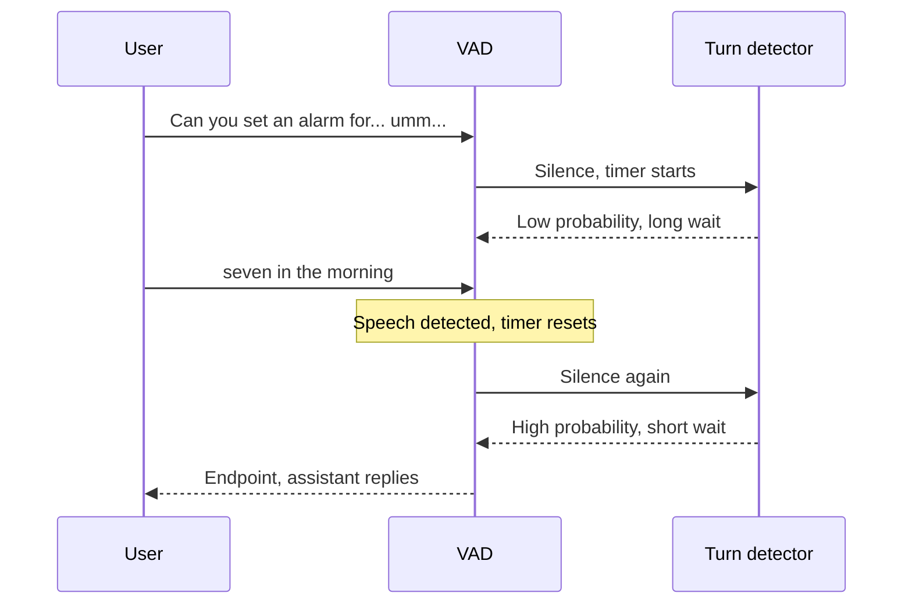

# How does endpointing decide when the user has finished speaking?

> **Step 16: AI Infrastructure, Deployment, and System Design** · ⏱️ 17 min read · [Read original](https://outcomeschool.com/blog/endpointing-in-voice-agents)

## TL;DR
Endpointing (end-of-turn / turn detection) decides when the user has finished so the assistant can stop listening and reply. A fixed silence timer is simple but crude; real systems combine VAD silence with a words-based and/or voice-based turn detector that outputs a probability, then pick a short or long wait accordingly, balancing latency against cut-offs.

## Key Concepts
- **Endpoint** — the moment the user has finished their turn; endpointing = detecting it (part of turn-taking).
- **VAD** — small neural network scoring each audio frame 0-1 for speech.
- **Frame** — 20-30 ms audio piece.
- **Streaming speech recognition** — text produced piece by piece while the user talks.
- **Turn detector / end-of-turn model** — outputs probability the user is done.
- **Prosody** — melody and rhythm of speech (pitch, speed, stretching).
- **Early vs late endpoint**, **barge-in**, **cut-off rate**.

## How It Works

### Why it is hard
Humans leave about 200 ms gaps; silence does not always mean the end. "I want to book a flight to... umm... Mumbai." — the pause after "to" must not end the turn, while a plain "Yes." should end it fast. Two opposing goals: don't cut off thoughts; don't make users wait.

### Approach 1: Fixed silence timer
Rule: silent for e.g. 700 ms (example; real range a few hundred ms to about 1 s) -> finished. Timer starts when speech stops; resets if speech resumes.
- Pro: simple, fast to run.
- Con: one number can't fit all (short cuts off thinkers; long slows everything, even "Yes."); every reply delayed by at least the full wait.

### How VAD works
Frames of 20-30 ms each get a score 0-1; a threshold (e.g. 0.5) labels speech/silence. Example: frames 1-3 scores 0.95/0.97/0.92 = speech; 4-6 scores 0.10/0.05/0.04 = silence. Silence is not zero sound (fan, traffic); neural VAD tells speech from noise, unlike old loudness-only methods. 700 ms with 30 ms frames is about 23 silent frames in a row.

### Approach 2: Reading the words
Streaming recognition gives text so far; a turn detector trained on labelled conversations returns a probability.
| Text so far | P(done) |
|---|---|
| "What is the weather in" | 0.05 |
| "I want to book a flight to" | 0.08 |
| "What is the weather in Delhi today" | 0.94 |
| "Yes" | 0.90 |

- Many detectors also read recent messages: after "What is your phone number?", "98765" is probably unfinished.
- Wait scales with probability: high -> about 200 ms; low -> about 2 s.
- Con: depends on STT text (wrong/late text -> wrong/late decision); text loses delivery ("You are coming." vs "?" without punctuation).

### Approach 3: Listening to the voice (prosody)
Clues: falling pitch ends statements; rising pitch ends questions; slowing/stretching the last word; filler "umm/uhh" (often dropped from STT text, so only audio keeps them) = still thinking; breath in = about to continue. Audio-based detector learns from labelled recordings and doesn't wait for STT. Example: "I need a taxi" (level pitch) -> likely continues ("and a hotel room").
- Pro: catches tone/thinking pauses text can't.
- Con: prosody varies by person, language, accent.

### Approach 4: Combine all signals
| Signal | Good at | Weak at |
|---|---|---|
| Silence (VAD) | Fast, simple, any language | Can't tell pause from end |
| Words | Knows unfinished sentences | Depends on STT text |
| Voice | Tone, fillers, thinking pauses | Varies across speakers/accents |

- VAD always runs (cheap); heavier turn detector often only when silence starts.
- Timer length is dynamic; there is a maximum wait so the assistant never waits forever.
- Example "Can you set an alarm for... umm... seven in the morning?": pause + "umm" -> low prob, long wait; user resumes, timer resets; at end, full question + rising pitch -> high prob, short wait -> reply "Sure, I have set an alarm for 7 AM."

## Trade-offs & Pitfalls
- **Early endpoint** (cut off, half-request reply, wrong answers) vs **late endpoint** (slow, unnatural). Shorter wait -> fewer late, more early; longer wait -> the reverse.
- Measure **latency** (real finish to decision) and **cut-off rate**; tune per use case: quick commands ("Turn off the lights") use short waits; customer support with long explanations needs longer waits. (See dynamic endpointing per-user speech rate, and latency budget blog.)
- Safety nets: **barge-in** (VAD hears speech again -> stop reply and keep listening); **start work early** at first sign of an endpoint (discarded if user continues, costs compute, hides wait if correct).

## FAQ
- Endpointing = VAD? → No; VAD is a frame-level speech signal, endpointing decides turn end using it plus words/voice.
- How long to wait? → No single value; fixed timers a few hundred ms to about 1 s; dynamic about 200 ms vs about 2 s.
- Endpoint too early? → Barge-in recovers.
- Why fillers matter? → "umm" means still thinking; STT drops them, audio models hear them.
- Turn detector always running? → Often only on silence; VAD always runs; max wait exists.

## Key Takeaways
- Endpointing = detecting end of the user's turn; slow or wrong endpointing hurts the whole reply.
- Silence alone can't distinguish a pause from an end.
- VAD scores frames; the silence timer counts consecutive silent frames.
- Word-based and prosody-based detectors give a "done" probability that makes the wait dynamic.
- Combined systems run VAD always, turn detector on silence, with a max wait.
- It is a latency vs cut-off trade-off tuned per use case; barge-in covers mistakes.
