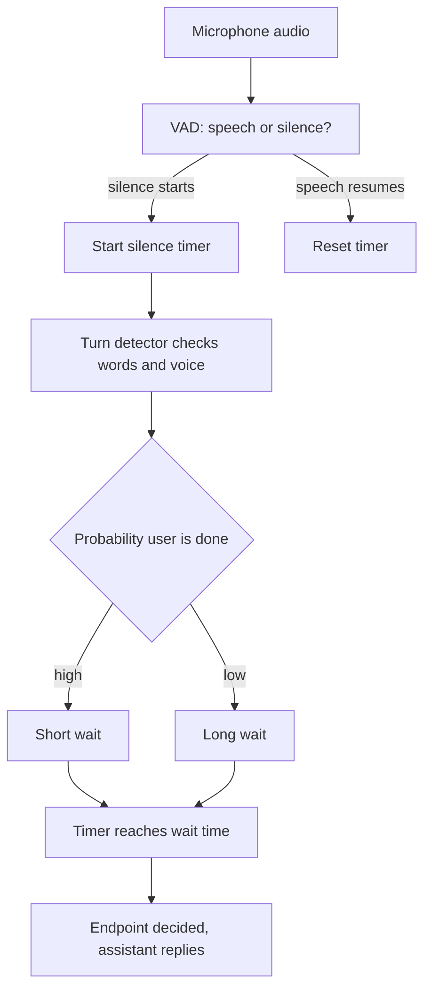

# How does endpointing decide when the user has finished speaking?

> **Step 16: AI Infrastructure, Deployment, and System Design** · ⏱️ 17 min read · [Read original](https://outcomeschool.com/blog/endpointing-in-voice-agents)

## TL;DR
Endpointing (end-of-turn or turn detection) is how a voice assistant decides the user has finished speaking so it can reply. It is hard because silence does not always mean the end. Real systems combine silence, words, and voice cues and balance speed against cutting the user off.

## Key Concepts
- **Endpoint** — the moment the user's turn is judged finished; part of the bigger job of turn-taking.
- **VAD (Voice Activity Detection)** — small neural net that scores each 20-30 ms audio frame from 0 to 1 for "someone is speaking"; a threshold (e.g. 0.5) gives speech vs silence.
- **Silence timer** — counts consecutive silent VAD frames; resets if speech resumes.
- **Turn detector / end-of-turn model** — outputs the probability that the user is done, from text so far, audio, or both.
- **Prosody** — melody and rhythm of speech: falling or rising pitch, slowing down, fillers ("umm"), breath-in.
- **Early vs late endpoint** — cutting the user off vs making them wait.

## How It Works
### Approach 1: Fixed silence timer
Wait N ms (e.g. 700) of silence, then reply. Simple and fast, but one number fits no one: short values cut off thinkers, long values slow down every reply, even a plain "Yes."

### Approach 2: Reading the words
Streaming ASR gives text so far; a small model scores completeness ("What is the weather in" ≈ 0.05, "...Delhi today" ≈ 0.94). It may also read recent conversation turns (after "What is your phone number?", "98765" is probably unfinished). High probability means a short wait (~200 ms); low means a long wait (~2 s). Weakness: depends on ASR text quality and timing, and text loses tone ("You are coming." vs "?").

### Approach 3: Listening to the voice
An audio-based detector learns prosody cues directly from audio, including fillers that ASR often drops. Weakness: prosody varies by speaker, language, and accent.

### Approach 4: Combine everything
| Signal | Good at | Weak at |
|---|---|---|
| Silence (VAD) | Fast, simple, language-agnostic | Cannot tell a pause from an end |
| Words | Spots unfinished sentences | Depends on ASR text |
| Voice | Tone, fillers, thinking pauses | Varies across speakers |

VAD runs always (cheap) and triggers the heavier turn detector only when silence starts. The timer stays but its length adapts to the detector's confidence, with a maximum wait so the agent never waits forever.

### Trade-off and safety nets
Shorter waits mean fewer late but more early endpoints. Teams measure latency (real finish to decision) and cut-off rate, then tune per use case (quick commands vs customer support). Safety nets: barge-in when the user resumes, and speculatively preparing the answer at the first sign of an endpoint (discarded if the user continues).

## Diagram

## Key Takeaways
- Silence does not always mean the end; endpointing must avoid both cutting users off and making them wait.
- VAD detects speech vs silence; endpointing is the decision built on top of it.
- A fixed timer is simple but a poor fit; adaptive waits driven by a turn detector are better.
- Words catch unfinished sentences, voice catches tone and fillers; combine both with silence.
- Always cap the maximum wait and support barge-in to recover from mistakes.
