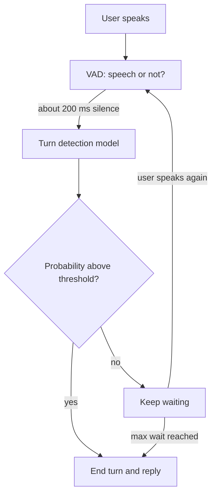

# How do silence-based and model-based turn detection differ?

> **Step 16: AI Infrastructure, Deployment, and System Design** · ⏱️ 17 min read · [Read original](https://outcomeschool.com/blog/silence-vs-model-based-turn-detection)

## TL;DR
Turn detection decides when the user has finished speaking. Silence-based detection uses a VAD plus a fixed timeout; model-based detection uses a trained model to predict the probability the turn is over. Real assistants layer the model on top of the VAD and keep a long timeout as backup.

## Key Concepts
- **Turn detection / end-of-turn / endpointing** — deciding when the user's turn is over.
- **VAD** — tiny model that labels each short audio piece (e.g. 30 ms) as speech or no speech.
- **Silence timeout** — fixed no-speech duration (e.g. 700 ms) that ends the turn.
- **Model-based detection** — outputs a probability (0 to 1) that the turn is complete.
- **Text-based model** — reads the ASR transcript plus recent messages.
- **Audio-based model** — listens to pitch, speed, and fillers directly.

## How It Works
### Silence-based
A counter resets whenever the VAD hears speech and grows by one chunk otherwise (only after the user has spoken); at the timeout, `end_of_turn()` fires. Pros: simple, cheap, language-agnostic, one number to tune.

Problems: pause length does not reveal sentence completeness. "Book a table for... um... four people" gets cut at the pause; raising the timeout to 2 s makes every reply slow. It also waits the full timeout after a clear "Yes," mishandles digit groups, and noise can delay detection.

### Model-based
The model sees "I want to book a table for" (0.05 done) vs "...four people." (0.92 done). High probability gives a short pause before replying; low probability means wait longer.
- **Text-based**: strong on meaning and context (knows a phone number needs more digits), but cannot hear tone, adds ASR delay, and inherits transcript errors.
- **Audio-based**: hears tone and fillers, independent of transcript, but weaker on meaning and context.
- Some models combine both.

Cons overall: extra compute, language coverage limited to training, can be wrong.

### In the pipeline
VAD runs constantly; after a short pause (e.g. 200 ms) the bigger model runs once. If probability is at least the threshold (e.g. 0.8) end the turn; otherwise keep waiting, but end anyway at a max wait (e.g. 3 s).

| Feature | Silence-based | Model-based |
|---|---|---|
| Looks at | Pause length | Words, voice, context |
| Decision | Fixed rule | Probability |
| Mid-sentence pauses | Often interrupts | Usually waits |
| Short answers | Waits full timeout | Replies quickly |
| Cost | Very cheap | Extra model |
| Languages | Almost any | Trained languages |

Use silence-based for prototypes, simple commands, low-power devices, many languages. Use model-based for natural assistants, long sentences, numbers, and support calls.

## Diagram

## Key Takeaways
- Silence alone cannot tell a thinking pause from an end of turn.
- A fixed timeout forces a trade-off: interrupts vs slow replies.
- Model-based detection outputs a probability and adapts the wait to it.
- Text models understand meaning; audio models hear tone and fillers.
- Production keeps the VAD, adds the model on top, and retains a long timeout fallback.
