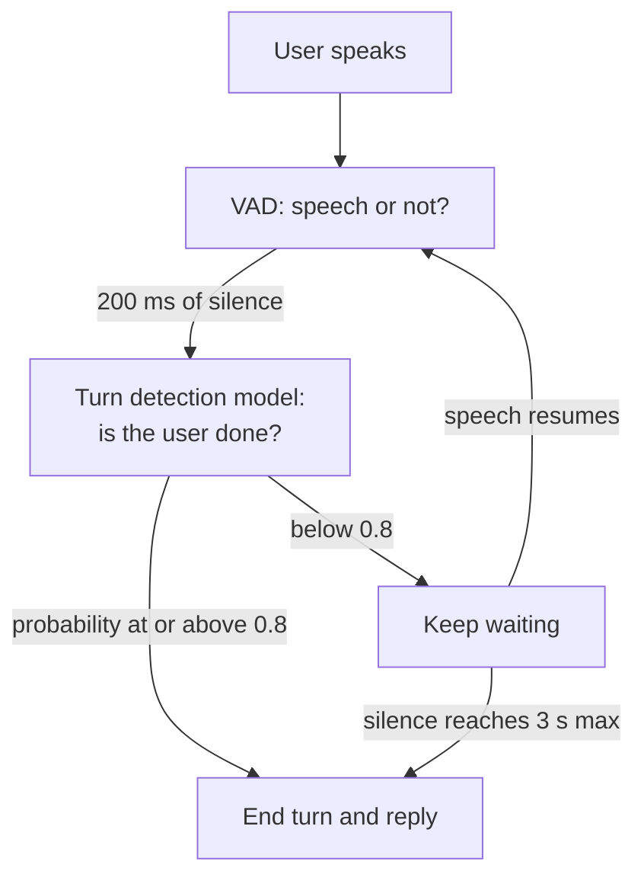

# How do silence-based and model-based turn detection differ?

> **Step 16: AI Infrastructure, Deployment, and System Design** · ⏱️ 17 min read · [Read original](https://outcomeschool.com/blog/silence-vs-model-based-turn-detection)

## TL;DR
Silence-based turn detection ends the user's turn when the VAD reports a pause longer than a fixed timeout. Model-based detection uses a trained model on words and/or voice to output the probability that the user is done. Production systems keep the VAD, run the model on short pauses, and keep a long silence timeout as backup.

## Key Concepts
- **Turn detection / end-of-turn detection / endpointing** — deciding when the user has finished so the assistant can reply (same job, three names; part of turn-taking).
- **VAD (Voice Activity Detector)** — tiny model that labels each short audio piece (e.g. 30 ms) "speech" or "no speech".
- **Silence timeout** — fixed silence length that ends a turn (example 700 ms).
- **Model-based detection** — trained on labelled "turn complete / not complete" examples; outputs probability 0-1.
- **Text-based model** — reads transcript (plus recent messages), often a small language model.
- **Audio-based model** — listens to sound directly (pitch, speed, fillers).
- Two failure modes: too early (interrupts mid-sentence) and too late (slow).

## How It Works

### Silence-based
1. User speaks; VAD says "speech" for each piece.
2. User stops; VAD says "no speech"; timer starts.
3. Timer hits 200 ms: keep waiting.
4. Timer hits 700 ms: timeout reached.
5. End of turn declared; reply generated. If speech resumes before 700 ms, the timer resets.

```
SILENCE_TIMEOUT_MS = 700; CHUNK_MS = 30
for chunk in microphone_chunks():
    if vad.is_speech(chunk): user_spoke = True; silence_ms = 0
    elif user_spoke:
        silence_ms += CHUNK_MS
        if silence_ms >= SILENCE_TIMEOUT_MS: end_of_turn()
```
`user_spoke` ensures silence is counted only after the user has said something (otherwise a quiet room would end empty turns repeatedly).

- **Pros:** simple, fast and cheap (tiny VAD), works for almost any language (ignores words), one main number to tune.

### Problems with silence-based
- Pause length doesn't indicate completeness: "I want to book a table for... um... four people." — pause after "for" over 700 ms causes an interruption.
- Raising to 2 s makes every complete sentence wait 2 s. Short timeout = interrupts thinkers; long = slow. No single number fits all (see dynamic endpointing).
- More failure cases: reading numbers in groups ("98765... 43210"), thinking aloud ("Book it for, hmm, let me check, Friday"), short complete answers ("Yes." still waits the full timeout), background noise (VAD thinks the user is still speaking, so late detection).

### Model-based
- Humans use clues (words, completeness, pitch falling like a full stop). Model gives probability, e.g. "I want to book a table for" = 0.05; "...for four people." = 0.92.
- High probability -> reply after a short pause; low -> wait longer even in silence.
- Example: pause after "for" -> low probability, keep waiting; after "four people." -> high, reply quickly.
- **Pros:** fewer interruptions on thinking pauses; faster on complete sentences; uses meaning and tone.
- **Cons:** extra model (compute); only works for trained languages; can be wrong, so keep a silence timeout backup.

### Text-based vs audio-based models
| Type | Looks at | Pros | Cons |
|---|---|---|---|
| Text-based | Transcript + recent conversation (e.g. after "What is your phone number?", "98765" is incomplete) | Understands meaning and context | Misses tone; waits on STT (small delay); transcript errors propagate |
| Audio-based | Pitch (down = finished, level/up = unfinished), speed (slowing), fillers (um/uh) | Hears how it's said; no transcript dependence | Weaker meaning/context understanding |

Some systems combine both in one model.

### Combined voice pipeline
VAD runs always (cheap); the bigger model runs only after a short pause (e.g. 200 ms silence). Probability at or above threshold (0.8) -> end turn; otherwise wait longer; at max wait (3 s) end anyway.



```
SHORT_PAUSE_MS=200; MAX_WAIT_MS=3000; THRESHOLD=0.8
if silence_ms < SHORT_PAUSE_MS: return
prob_done = turn_model.predict(conversation, audio)
if prob_done >= THRESHOLD: end_of_turn()
elif silence_ms >= MAX_WAIT_MS: end_of_turn()
```
(In real systems run the model once per pause and reuse the result.)

Restaurant example: "I want to book a table for" -> 200 ms silence -> 0.05, wait; "um... four people." resets counter; 200 ms silence -> 0.92, reply. With a 700 ms timeout the assistant would interrupt at the thinking pause (if over 700 ms) and wait 700 ms at the end; here it waits through the thinking pause and replies after about 200 ms plus model time. Speculative LLM generation can hide even this wait.

## Silence-Based vs Model-Based
| Feature | Silence-based | Model-based |
|---|---|---|
| Looks at | Pause length | Words, voice sound, context |
| Tool | VAD + fixed timeout | VAD + trained model |
| Decision | Rule: silence > timeout | Probability user is done |
| Mid-sentence pauses | Often interrupts | Usually waits |
| Short complete answers | Waits full timeout | Replies quickly |
| Cost | Very cheap | Higher (extra model) |
| Languages | Almost any | Trained languages only |
| Build effort | Very easy | More setup and tuning |

## When to Use Which
- **Silence-based:** prototypes, short simple commands ("turn on the lights"), low compute devices, many languages without a model.
- **Model-based:** natural human-like assistants; long sentences, thinking pauses, numbers/addresses; both interruptions and slowness hurt (customer support).
- Typical real systems: VAD + model on top + long silence timeout backup.

## FAQ
- Turn detection = endpointing? → Yes.
- VAD's role? → Per-piece speech detection; cheap enough to always run; silence-based counts its silence; model-based uses it to trigger the model.
- One timeout for everyone? → No.
- Model-based for every language? → No; silence-based is safer for unsupported languages.
- Why keep a timeout? → Model can be wrong; a long timeout (e.g. 3 s) ensures the assistant never gets stuck.

## Key Takeaways
- Silence-based = VAD + fixed timeout: cheap, language-agnostic, but blind to meaning.
- Fixed timeout forces a trade-off between interrupting users and slow replies.
- Model-based outputs probability of "done" from words and/or voice to adapt the wait.
- Text models understand context but miss tone; audio models hear tone but lack meaning.
- Hybrid pipeline: VAD always on, model on short pauses, threshold about 0.8, max wait backup.
- Choose silence-based for simple/multilingual/low-resource; model-based for natural conversation.
