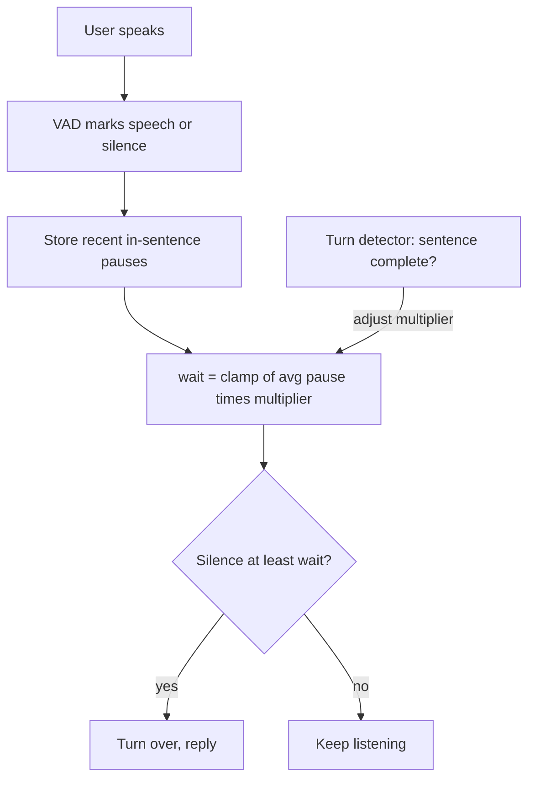

# How does dynamic endpointing adapt to how fast a user talks?

> **Step 16: AI Infrastructure, Deployment, and System Design** · ⏱️ 17 min read · [Read original](https://outcomeschool.com/blog/dynamic-endpointing)

## TL;DR
Dynamic endpointing replaces the fixed silence timer with a waiting time learned from each user's own recent in-sentence pauses, then adjusted by how complete the sentence looks. Fast talkers get quicker replies and slow talkers are cut off less.

## Key Concepts
- **Endpointing** — deciding where the user's turn ends so the assistant can reply.
- **In-sentence pause** — a short silence after which the user kept speaking; shows what "not done yet" looks like for this user.
- **Speaking rate** — words or syllables per second; a related speed signal.
- **Clamp** — keep a value inside a minimum and maximum.
- **Prosody** — pitch, loudness, rhythm; an extra completeness hint.

## How It Works
### Why fixed fails
With an 800 ms limit: User A (normal pauses ~200 ms) waits needlessly; User B (pauses ~700 ms, up to 900 when thinking) gets cut off. Lowering the limit hurts B, raising it hurts A.

### Core idea
A silence is long or short only relative to this user's normal pauses. Ask "is this silence much longer than usual for this user?" not "has it crossed 800 ms?"

### Computing the wait
1. Keep the last few (e.g. 5) in-sentence pauses, so the system follows speed changes.
2. Average them.
3. Multiply (e.g. by 2) and clamp:

$$wait = \text{clamp}(\text{avg\_pause} \times 2,\ 300,\ 2000)$$

The minimum prevents hasty replies; the maximum prevents waiting forever. Use a default (e.g. 800 ms) until enough pauses (e.g. 3) are seen. Variants: weighted moving average, or slightly above the longest recent pause.

Worked example: User A pauses 150, 200, 250 gives avg 200 and wait 400 ms. User B pauses 500, 700, 900 gives avg 700 and wait 1400 ms. B's 900 ms thinking pause no longer cuts them off.

| User | Normal pause | Fixed wait | Dynamic wait |
|---|---|---|---|
| A | 200 ms | 800 ms | 400 ms |
| B | 700 ms | 800 ms | 1400 ms |

### Adding sentence meaning
A turn-detection model scores completeness. Complete sentence: multiplier 1.5. Incomplete (ends in "and", "to", "the", "in"): multiplier 3. Unsure: 2. For A (avg 200): 300 vs 600 ms. For B an incomplete sentence gives 2100, clamped to 2000.

### Where it fails
- Start of the conversation (uses default).
- Noisy rooms where VAD mistakes noise for speech, corrupting pause lengths.
- One unusually long thinking pause from a normally fast talker.

## Diagram

## Key Takeaways
- Silence is only meaningful relative to the user's own pauses.
- Wait = clamped multiple of the recent average in-sentence pause.
- Min and max limits protect against rushing and endless waiting.
- Sentence meaning raises or lowers the multiplier.
- It reduces but does not eliminate errors: cold start, noise, and long thinking pauses remain.
