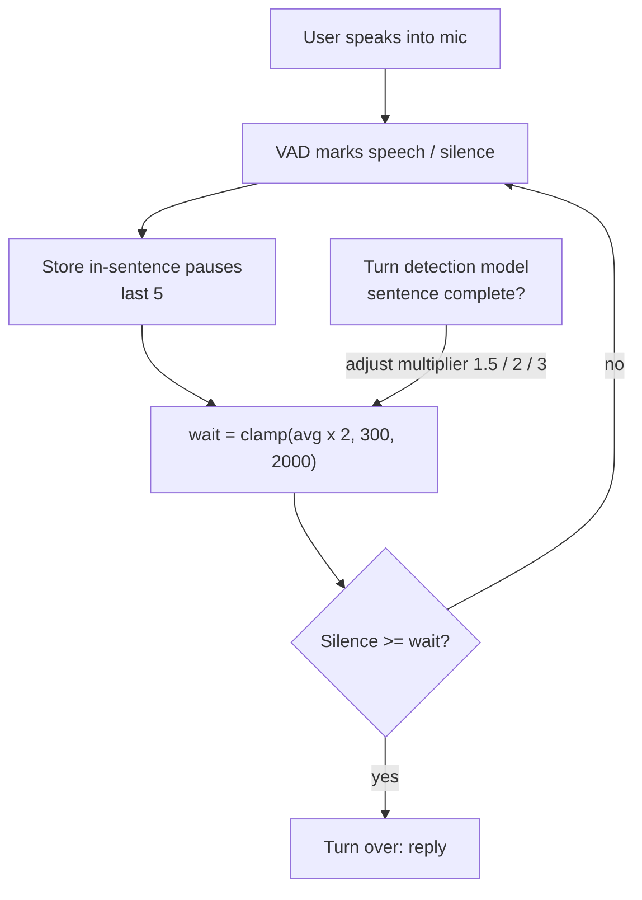

# How does dynamic endpointing adapt to how fast a user talks?

> **Step 16: AI Infrastructure, Deployment, and System Design** · ⏱️ 17 min read · [Read original](https://outcomeschool.com/blog/dynamic-endpointing)

## TL;DR
Dynamic endpointing learns the length of a user's normal in-sentence pauses and sets the silence wait before "turn over" from that. Fast talkers get a short wait, slow talkers a long one. The sentence meaning further shortens or lengthens the wait. This cuts both mistakes: cutting users off and replying too slowly.

## Key Concepts
- **Endpointing** — deciding the point where the user has finished speaking so the assistant can reply (finding the end of the user's turn).
- **Turn** — one complete piece of speech by one speaker before the other replies.
- **VAD (Voice Activity Detector)** — marks each small slice of audio as speech / no speech.
- **Fixed silence timer** — if silence > fixed limit (e.g. 800 ms), turn is over.
- **Dynamic endpointing** — waiting time changes per user and per moment, based on how the user speaks and what was said so far.
- **In-sentence pause** — silence after which the user continued speaking; shows what a normal "not done yet" pause looks like.
- **Speaking rate** — words/syllables per second; higher rate gives shorter wait.
- **Turn detection / end-of-turn model** — small model scoring how likely the thought is finished from words so far.
- **Prosody** — pitch, loudness, rhythm; pitch often falls at the end of a statement and stays level when the user will continue.

## How It Works
### Why a fixed timer fails
Two mistakes to balance: cutting the user off vs replying too slowly. Example with 800 ms fixed limit:
- User A (fast, pauses ~200 ms): always waits 800 ms; assistant feels slow.
- User B (slow, pauses ~700 ms, up to 900 ms when thinking): a 900 ms pause crosses 800, so B is cut off.
Lowering the limit cuts B off more; raising it makes A wait longer. One number cannot fit both.

### Core idea
A silence is long or short only relative to this user's normal pauses (500 ms is very long for A, normal for B). Ask "is the silence much longer than this user's normal pauses?" instead of "is it > 800 ms?".

### Measuring speed
- Signals: pause length and speaking rate (the blog focuses on pause length, comparing silence with silence).
- VAD marks speech/no-speech; each time the user stops briefly and then continues, record that silence.
- Keep only the most recent pauses (e.g. last 5) so the system tracks speeding up/slowing down.

### Pauses to waiting time
1. Average the recent pauses (normal pause).
2. Multiply by a factor (e.g. 2): finished only when silence is clearly longer than normal.
3. Clamp between min and max (e.g. 300 and 2000 ms).

$$\text{waiting\_time} = \text{clamp}(\text{average\_pause} \times 2,\ 300,\ 2000)$$

- Min protects against replying too fast (100 ms is too short for anyone); max prevents waiting forever.
- Variants: moving average weighting recent pauses more; wait slightly above the longest recent pause.
- Cold start: default wait (e.g. 800 ms) until a few pauses (at least 3) are collected.

### Code essence
`deque(maxlen=5)` of pauses; `waiting_time()` returns 800 if fewer than 3 pauses, else `max(300, min(avg*2, 2000))`; `is_turn_over(silence_ms)` = `silence_ms >= waiting_time()`.

### Walkthrough
| User | Pauses (ms) | Average | x2 | Dynamic wait | Fixed wait | Result |
|---|---|---|---|---|---|---|
| A | 150, 200, 250 | 200 | 400 | 400 ms | 800 ms | Reply 400 ms sooner |
| B | 500, 700, 900 | 700 | 1400 | 1400 ms | 800 ms | No cut-off at 900 ms pause |

### Using sentence meaning
"What is the weather in Delhi?" (complete) vs "What is the weather in..." (incomplete), same silence. A turn detection model scores completeness:
- Complete: wait = clamp(avg x 1.5, 300, 2000).
- Incomplete (ends with "and", "to", "the", "in"): wait = clamp(avg x 3, 300, 2000).
- Unsure: normal x2.
- A: complete 200x1.5 = 300 ms; incomplete 200x3 = 600 ms. B: incomplete 700x3 = 2100, capped to 2000 ms.
- Prosody adds a further hint.

### Diagram

## Trade-offs & Pitfalls
- Works well: fast talkers (quick replies), slow talkers / second-language speakers / thinkers (fewer cut-offs), speed changes mid-conversation.
- Fails: conversation start (no data, default wait); noisy rooms (VAD counts noise as speech, wrong pauses); one very long thinking pause from a normally fast talker (sentence meaning helps but not always).
- Does not remove every mistake, but reduces both kinds for non-average talkers.

## Key Takeaways
- Endpointing = finding the end of the user's turn; a balance between cutting off and lagging.
- A fixed silence timer treats all users the same, so fails fast and slow talkers.
- Silence is judged relative to the user's own recent in-sentence pauses.
- wait = clamp(avg pause x multiplier, min, max); keep last ~5 pauses; default until >= 3.
- Sentence completeness (and prosody) tunes the multiplier: lower if complete, higher if incomplete.
- Failure modes: cold start, noisy VAD, sudden long thinking pause.

## FAQ
- Start of conversation? → Default wait (e.g. 800 ms) until at least 3 pauses are seen.
- Why only recent pauses? → To follow the user speeding up or slowing down.
- Speaking rate instead of pause length? → Yes; higher rate gives shorter wait.
- Background noise? → Yes, it corrupts VAD and pause lengths.
