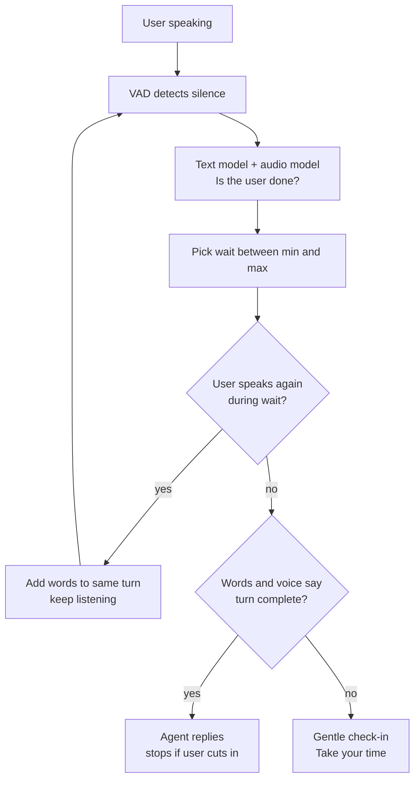

# How does a voice agent handle long pauses when the user is thinking?

> **Step 16: AI Infrastructure, Deployment, and System Design** · ⏱️ 17 min read · [Read original](https://outcomeschool.com/blog/long-pauses-in-voice-agents)

## TL;DR
A voice agent does not treat every silence as end of turn. It combines silence length (VAD), the words (semantic turn detection), and the voice (prosody), and picks a dynamic wait between a minimum and maximum, waiting longer when the user sounds like they are thinking. It also recovers if it speaks too early and checks in gently on very long silences.

## Key Concepts
- **Thinking pause** — silence while the user is still mid-turn (e.g. "It is the 14th of... [2 s] ...March, 1990"). Same length as a finished-turn silence but means "wait for me".
- **Turn-taking** — speakers alternate.
- **End-of-turn detection / endpointing** — deciding whether the user has finished.
- **VAD** — model listening to 10-32 ms audio chunks: "is a human speaking?" Gives speech/silence signal only, not whether the turn is finished.
- **Semantic turn detection** — small language model on the STT/ASR text giving a 0-1 "finished" score.
- **Prosody** — pitch, speed, loudness, length of sounds.
- **Barge-in** — user speaking over the agent.
- **Dynamic waiting time** — wait chosen between min and max from model confidence.

## How It Works
Two failure modes: speaking too early (cuts in on half a sentence) vs too late (dead silence, user thinks call dropped).

### Approaches
1. **Fixed short timer (e.g. 500 ms)** — fine for "Yes"/"No"; interrupts thinkers every time.
2. **Longer timer (e.g. 3 s)** — no interruption in thinking, but every reply is slow, and pauses over 3 s still get cut off.
3. **Look at the words** — small LM scores finish-likelihood; also uses the question asked (after "date of birth?", "14th of March" alone is less likely complete because the year is missing). Catches incomplete sentences, filler words, thinking phrases.

| Said so far | Finished? | Why |
|---|---|---|
| "It is the 14th of" | Low (0.05) | Incomplete |
| "It is the 14th of March, 1990." | High (0.95) | Complete answer |
| "Hmm, let me think..." | Low (0.10) | States thinking |
| "I want to book a table for" | Low (0.05) | Incomplete |
| "Um, so, the thing is" | Low (0.10) | Filler words |

   Scores are illustrative. Limit: text loses delivery ("I want to book a table for two." then "Actually, make it four." looks complete but the flat voice showed deciding).
4. **Listen to how it is said (prosody)** — falling pitch = done; flat/slightly rising mid-statement = continuing (but English questions also rise, so learn from data); stretched sounds ("sooooo", "uhhhh") = thinking. Audio models on the last few seconds learn from recorded speech.

Combine all three: silence length (VAD) + words (text model) + tone (audio model). Long silence after "for" with flat pitch = thinking; short silence after "Yes." with falling pitch = done.

### Dynamic waiting time
- Minimum wait: even if sure, gives user a chance to continue and STT time to finish.
- Maximum wait: avoids waiting forever.
- Sure done: wait near min; thinking: wait near max. Example min 0.5 s, max 4 s: "Yes." with falling pitch replies after 0.5 s; "It is the 14th of..." stretches toward 4 s, user finishes within 2 s, then wait ~0.5 s and reply.
- If user speaks during the wait, timer resets and words join the same turn.

### If the agent speaks too early
Barge-in handling: agent speaking, VAD hears user, stop speech immediately, discard rest of reply, listen, join new words with earlier ones, generate a fresh reply on the full sentence. History keeps only the part the user heard. Do not stop for coughs, "mm-hmm", or noise; require real words or a minimum speech length. Some agents draft a reply early during the pause but do not speak it until the turn is confirmed (cost: wasted work when the user continues).

### Very long silence
Past max wait with incomplete words: 1) "Take your time." / "No problem, I am here when you are ready." 2) "Are you still there?" 3) After a few tries, politely end the call or offer a callback. If user says "Hold on, let me find my card", reply "Sure, take your time." and raise the silence limit for a while.

### Diagram

## Trade-offs & Pitfalls
- Works when user leaves clear signals (fillers, thinking phrases, incomplete sentences, flat pitch) and the agent asked a clear question.
- Fails when: user pauses after a complete-sounding sentence then adds more; noisy background (VAD never sees silence); unfamiliar language/accent for the model; reading long numbers with gaps (each group looks complete). Fix: wait longer between digit groups or until the expected digit count.

## Key Takeaways
- Same silence length can mean "thinking" or "done"; length alone cannot decide.
- VAD detects speech only; it cannot detect turn completion.
- Fixed timers force a speed vs interruption trade-off.
- Combine silence, text semantics, and prosody; map confidence to a wait in [min, max].
- Always have recovery: barge-in handling, ignore backchannels/noise, gentle check-ins, honor "hold on".

## FAQ
- How long should it wait? → No single number; min-max range driven by model confidence.
- VAD alone? → No.
- Fillers help? → Yes, they lower the finished score.
- "Hold on"? → Treat as wait request, raise silence limit.
- Card numbers hard? → Gaps between digit groups look like complete answers.
