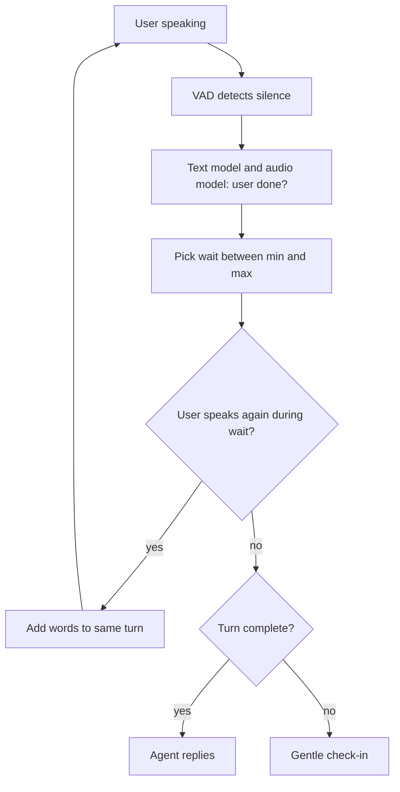

# How does a voice agent handle long pauses when the user is thinking?

> **Step 16: AI Infrastructure, Deployment, and System Design** · ⏱️ 17 min read · [Read original](https://outcomeschool.com/blog/long-pauses-in-voice-agents)

## TL;DR
A thinking pause and an end-of-turn pause can be the same length, so silence length alone cannot separate them. Voice agents combine VAD, a text-based turn model, an audio (prosody) model, and a dynamic wait between a min and max, plus barge-in and gentle check-ins as safety nets.

## Key Concepts
- **Thinking pause** — a silence where the user is still mid-turn (e.g. "It is the 14th of... [2 s] ...March, 1990").
- **Endpointing / end-of-turn detection** — deciding the turn is over.
- **VAD** — flags each 10-32 ms piece as speech or not; says nothing about completeness.
- **Semantic turn detection** — small language model scores "has the user finished?" from the transcript.
- **Prosody** — pitch, speed, loudness, sound length.
- **Min / max wait** — bounds for the dynamic waiting time.

## How It Works
Wrong calls fail two ways: too early (replies to half a sentence) or too late (dead air, user thinks the call dropped).

1. **Fixed short timer (e.g. 0.5 s)** — fine for "Yes", but interrupts thinkers.
2. **Longer timer (e.g. 3 s)** — no interruption, but every reply is slow, and longer pauses still get cut.
3. **Look at the words** — score examples: "It is the 14th of" 0.05, full date 0.95, "Hmm, let me think..." 0.10. Catches incomplete endings (for, of, and, but), fillers (um, uh, hmm), and thinking phrases. Uses the agent's last question as context. Misses cases like "...for two." [slow, flat] "Actually, make it four."
4. **Listen to prosody** — falling pitch suggests done; flat or rising mid-statement and stretched sounds suggest continuing (questions may rise, so learn from data).
5. **Dynamic wait** — pick a wait between min (e.g. 0.5 s, also gives STT time to finish) and max (e.g. 4 s) by model confidence. Speech during the wait resets the timer and appends words to the same turn.

### Safety nets
- **Barge-in**: if the agent spoke too early and VAD hears the user, stop immediately, discard the rest, keep listening, merge words, regenerate. History keeps only the part the user heard. Ignore coughs, "mm-hmm", and noise by requiring real words or minimum speech length.
- **Speculative reply**: draft during the pause, speak only once the turn is confirmed; wasted work if the user continues.
- **Very long silence**: "Take your time" then "Are you still there?" then politely end or offer a callback. If the user says "Hold on", raise the silence limit.

### Works vs fails
Works with clear signals (fillers, incomplete sentences, flat pitch) and clear questions. Fails when a complete-sounding sentence is followed by more, in noise, with untrained languages or accents, and with long numbers read in groups (special rule: wait for the expected digit count).

## Diagram

## Key Takeaways
- Same-length silences can mean "wait for me" or "your turn."
- Fixed timers force a bad trade-off between interrupting and lagging.
- Combine silence, word meaning, and prosody, then scale the wait with confidence.
- Barge-in handling and history truncation recover from wrong guesses.
- Long silences get graceful check-ins, never endless waiting or replying to half a sentence.
