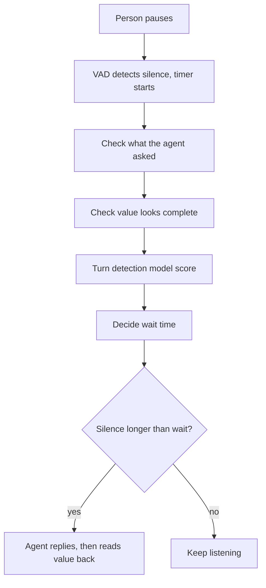

# How does a voice agent know a phone number or email is not finished yet?

> **Step 16: AI Infrastructure, Deployment, and System Design** · ⏱️ 17 min read · [Read original](https://outcomeschool.com/blog/unfinished-input-in-voice-agents)

## TL;DR
People pause between groups of digits or parts of an email, so silence-based endpointing jumps in too early. Voice agents fix this by using the expected answer type, checking whether the value looks complete, and using a turn detection model, then confirming by read-back.

## Key Concepts
- **Endpointing** — deciding the person's turn is over; sits between STT and LLM in the pipeline.
- **Context-aware endpointing** — silence limit depends on what the agent just asked.
- **Partial transcripts** — early STT text while the person is still speaking.
- **Turn detection model** — small model that outputs the probability the person is done.
- **Read-back** — agent repeats the value for confirmation.
- **Barge-in** — user can interrupt and the agent stops immediately.

## How It Works
Example: "five five five" (pause) "one two three" (pause) "four five six seven"; or "john" (pause) "dot smith" (pause) "at gmail" (pause) "dot com".

| Approach | Idea | Problem |
|---|---|---|
| 1. Fixed silence (~0.6 s) | Silent beyond limit means done | Mid-number pause looks like an end |
| 2. Longer for everyone (2 s) | Tolerates pauses | Every answer, even "Yes", is slow |
| 3. Use the question asked | Per-type limits, e.g. normal 0.6, phone 1.5, email 2.0 s | Still silence only: waits needlessly when done, cuts in on long searches |
| 4. Value looks complete | Count digits (10) or match email shape after mapping "at" to @ and "dot" to . | Rigid rules |
| 5. Turn detection model | Learns from conversations, incl. the question | Needs training data |

### Approach 4 detail
Check partial transcripts at each pause. Phone: "555" (3 digits) incomplete, "555 123" (6) incomplete, "555 123 4567" (10) complete. Email: no @, then no ending like .com, then matches pattern. Combined rule: if complete, reply after a short silence (e.g. 0.5 to 0.7 s); if incomplete, wait much longer (e.g. 3 to 4 s) but keep a maximum so the agent asks for the rest.

### Approach 5 detail
The model reads the conversation (optionally audio, since intonation stays flat or rises mid-number and drops at the end). Probability above 0.8 gives about 0.3 s wait, above 0.4 gives about 1 s, otherwise 3 s. Handles "double five", extensions, and self-corrections if seen in training.

### Safety nets
Read the value back ("Is that correct?"), spell tricky letters (m/n, b/d), and support barge-in.

### Where it fails
Extensions added after a complete-looking number, unexpected lengths (country codes), STT errors ("for" vs "four"), look-complete emails (".co" before ".uk"), and noisy audio confusing VAD.

## Diagram

## Key Takeaways
- A mid-number pause looks identical to an end-of-sentence pause to a VAD.
- Raising the timeout globally makes every turn slow; make it context-aware instead.
- Completeness checks (digit count, email pattern) make the agent both faster and more patient.
- A learned turn model handles messy cases rules miss.
- Read-back and barge-in catch whatever endpointing gets wrong.
