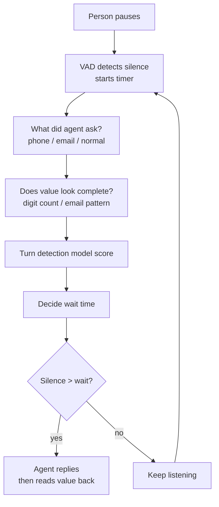

# How does a voice agent know a phone number or email is not finished yet?

> **Step 16: AI Infrastructure, Deployment, and System Design** · ⏱️ 17 min read · [Read original](https://outcomeschool.com/blog/unfinished-input-in-voice-agents)

## TL;DR
People say phone numbers and emails in chunks with ~1 s pauses, so silence alone mistakes a mid-value pause for end of turn. The agent stacks signals: silence (VAD), the question it just asked, whether the partial transcript looks complete (digit count / email pattern), and a turn detection model. It also reads values back and supports barge-in as safety nets.

## Key Concepts
- **Endpointing / turn detection** — deciding when the person finished their turn so the agent can reply; sits between STT and LLM in the pipeline (STT, endpointing, LLM, TTS).
- **VAD** — says only whether someone is speaking right now.
- **Context-aware endpointing** — silence limit depends on the expected answer type.
- **Partial transcripts** — early STT text while the person is still speaking.
- **Turn detection model** — small trained model giving 0-1 "person is done" probability; text-only or text+audio.
- **Intonation** — voice stays flat or rises when more is coming, drops when done.
- **Read-back** and **barge-in** — safety nets.

## How It Works
Example: "five five five" (pause) "one two three" (pause) "four five six seven"; email "john" (pause) "dot smith" (pause) "at gmail" (pause) "dot com". Jumping in after the first pause ("that does not look valid") annoys the user, who must restart.

### Approaches (simplest to best)
| # | Approach | Idea | Problem |
|---|---|---|---|
| 1 | Fixed silence (e.g. 0.6 s) | `silence > limit` | Mid-number pause looks the same as end-of-sentence pause |
| 2 | Longer for everyone (2 s) | Allows number pauses | Every answer ("Yes") slowed; "Hello? Are you there?" |
| 3 | Use the question asked | `SILENCE_LIMITS = {normal 0.6, phone_number 1.5, email 2.0}` keyed by `expected_answer` | Still silence-only: waits 1.5 s for nothing after quick 10 digits; cuts in if 2 s pause while searching card |
| 4 | Check value looks complete | Count digits (>= 10) in partial transcripts; email: convert " at "to @, " dot " to ".", strip spaces, regex match | Rigid rules |
| 5 | Turn detection model | Learns from real conversations | Needs training data |

Details:
- Approach 3: email gets the longest limit since people spell letter by letter.
- Approach 4 phone walkthrough: "555" (3 digits) incomplete; "555 123" (6) incomplete; "555 123 4567" (10) complete. Email walkthrough: "john.smith" (no @), "john.smith@gmail" (no ending), "john.smith@gmail.com" matches. Combined rules: phone complete wait > 0.5 s else > 3.0 s; email complete > 0.7 s else > 4.0 s; else 0.6 s. Faster when complete, more patient when incomplete; always keep a max wait (3 s for incomplete phone), then reply asking for the rest. Rigid cases: other country lengths, extensions, "double five", self-corrections ("five five... no wait, five six"). Digit length is configurable.
- Approach 5: reads the conversation incl. the question; learns "My number is five five five" = not done, "My email is john at" = not done, full number = done. Policy: p > 0.8 wait 0.3 s; p > 0.4 wait 1.0 s; else 3.0 s. Handles messy cases if seen in training.

### Safety nets when unsure
- **Read back**: "I have your number as five five five, one two three, four five six seven. Is that correct?" For emails spell tricky letters (m/n, b/d sound alike on phone lines).
- **Barge-in**: if agent replies early and the person keeps talking, stop immediately and keep listening.

### Diagram

## Trade-offs & Pitfalls
- Works well: fixed-length phone numbers, emails with common endings (.com, .org), one clear question at a time.
- Fails: extension added after a complete-looking number; unexpected lengths (country codes); STT errors ("for" vs "four") break digit counts; "john at company dot co" before "dot uk"; background noise confuses VAD so the timer starts wrongly.
- Read-back and barge-in catch endpointing misses. Each signal covers others' weaknesses: VAD knows silence not why; question gives expected type; completeness check gives parts; model handles messy cases.

## Key Takeaways
- Mid-value pauses are indistinguishable from end-of-turn pauses by silence alone.
- Making everyone wait longer slows all turns; condition the wait on the expected answer.
- Partial transcripts enable completeness checks: digit count, email shape.
- Complete means short wait, incomplete means long wait, but cap the wait.
- A learned turn model (text and intonation) handles "double five", extensions, corrections.
- Read-back confirmation and barge-in are essential backstops.

## FAQ
- Context-aware endpointing? → Silence limit changes with the expected answer type.
- Partial transcripts? → Early STT text used at each pause to check completeness.
- Tone useful? → Yes, intonation (flat/rising vs falling).
- Wait forever for incomplete? → No, keep a max wait, then ask for the rest.
- Why barge-in? → Early replies do not ruin the call.
