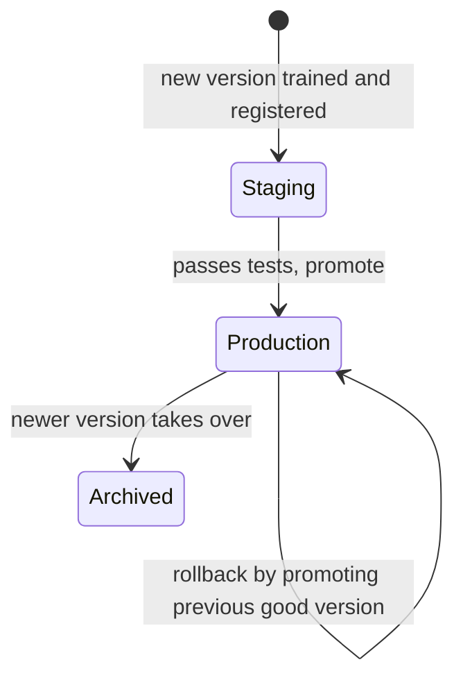
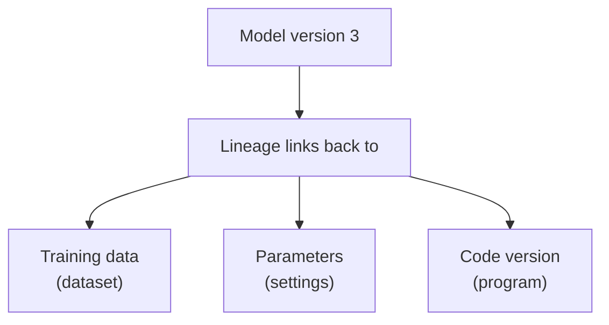
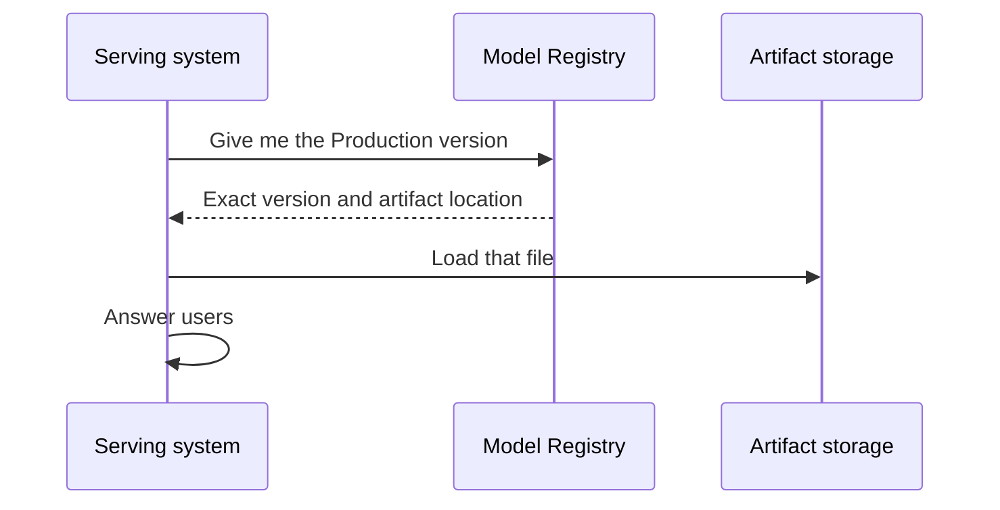

# How does a Model Registry work?

> **Step 16: AI Infrastructure, Deployment, and System Design** · ⏱️ 15 min read · [Read original](https://outcomeschool.com/blog/model-registry)

## TL;DR
A Model Registry is a central catalog of all trained model versions. Each version has a number, metadata (metrics, parameters, data reference, creator, time), lineage back to its ingredients, and a stage such as Staging, Production, or Archived. Serving asks the registry for the Production version, so the live model is always known, reproducible, and easy to roll back.

## Key Concepts
- **Model artifact** — the file(s) holding what the model learned, saved to disk.
- **Model version** — one specific trained copy, produced at one time with specific settings (e.g. v1: 10,000 photos; v2: 50,000; v3: 50,000 with slower, more careful learning).
- **Model Registry** — central catalog storing and tracking all model versions, each with name, number, and info (like a library catalog for books).
- **Metadata** — data about the model; the artifact is the model, the metadata is its label.
- **Lineage** — recorded trail of how a model was produced, linking it to training data, parameters, and code version. It is the recipe for the model.
- **Reproducibility** — being able to recreate the same result later.
- **Stage** — status tag on a version: Staging, Production, Archived.
- **Promoting** — moving a version between stages.
- **Rollback** — returning to a previous good version.
- **Serving** — the system that loads a model and predicts for real users.

## How It Works

### Problem before a registry
Models are saved wherever convenient (laptops, shared drives) with names like model_final.bin and model_final_v2_real.bin. This causes:
- **Too many versions** — fifty trainings a month, scattered and confusingly named.
- **No clear production model** — nobody knows which model is serving users.
- **No reproducibility** — data, settings, and code were not recorded, so the live model cannot be rebuilt months later.
- **No safe rollback** — if the new model is bad, the previous good file is unknown, so going back is slow and risky.

Core problem: models are scattered, unlabeled, and untracked.

### What it stores per version
- **Artifact location** — pointer (e.g. cloud storage path); often the registry holds the pointer, not the big file.
- **Metrics** — how good it is (e.g. 94% correct), used to compare versions.
- **Parameters** — training settings that explain behavior.
- **Training data reference** — pointer to the exact dataset, not a copy.
- **Who and when** — creator and creation time.

Example entry: model cat-or-dog-classifier, version 3, artifact at s3://our-models/cat-dog/v3/model.bin, accuracy 94%, photos 50,000 and slow learning, dataset "pet-photos-2026-05", created by Priya on 2026-05-20 10:15, stage Production.

### Lineage
Links a version back to its training data, parameters, and code version, like a cake recipe. Months later, follow the live model's lineage to the exact data and settings and rebuild the same model.

### Stages
- **Staging** — being tested before going live.
- **Production** — live and serving real users; usually only one version at a time, so "which model is live?" is always clear.
- **Archived** — retired but kept on record, not deleted.

Passing tests means promote Staging to Production. When a newer version takes over, the old one goes to Archived. Rollback example: v3 in Production misbehaves, so promote v2 (still recorded) back to Production, with no retraining or file hunting.

### Connection to serving
1. Train and register a new version (metadata and lineage recorded).
2. Promote to Staging, test, then promote to Production.
3. Serving asks the registry for the Production version, gets the exact version and artifact location, and loads that file. If it misbehaves, promote the previous good version and serving loads it again.

The registry is the single source of truth. Changing a stage in the registry controls what is live, and serving follows.

### MLflow Model Registry
- Register a model under a name; MLflow auto-assigns version numbers.
- Each version keeps metrics, parameters, lineage to the producing run, and creator and time.
- Current MLflow uses **aliases** and **tags** instead of fixed stages. An alias is a movable name pointing to one version (e.g. `@champion` for the live one); a tag is a small label (e.g. marking it tested).
- Serving can request a specific version number or whatever an alias points to. Promoting means moving the champion alias to the new version.
- The older Staging, Production, and Archived stages are deprecated in MLflow.

## Diagram(s)

### Stage lifecycle

### Lineage of a version

### Registry and serving

## Trade-offs & Pitfalls
- Registry often stores only a pointer to the artifact and to the data, so the underlying storage must keep those files available.
- Without recorded lineage, reproducibility is lost.
- Never delete old versions: archiving keeps them available for rollback.
- MLflow stages are deprecated, so use aliases and tags in newer projects.

## FAQ
- Does it store the actual model file? → Not always; often only the artifact location (pointer), but the file is always reachable along with metrics, parameters, data reference, and creator and time.
- Artifact vs metadata? → Artifact is the model file; metadata is data about it (metrics, parameters, data reference, who and when). The value lies in the metadata.
- How to roll back? → Promote the previous good version back to Production; no retraining needed, and serving loads it again.
- Does MLflow still use Staging and Production stages? → No, deprecated in favor of aliases and tags; moving an alias to a new version promotes it.

## Key Takeaways
- A Model Registry is the single source of truth for what models exist, which is live, and where each came from.
- A registry entry is artifact location plus metadata (metrics, parameters, data reference, who and when), not just a file.
- Lineage (data, parameters, code) gives reproducibility.
- Stages (Staging, Production, Archived) show where each version stands; promoting moves a version forward.
- Rollback is just promoting the previous good version.
- Serving pulls the Production version from the registry, so changing a stage changes what is live.
- MLflow uses aliases (e.g. `@champion`) and tags instead of deprecated stages.
