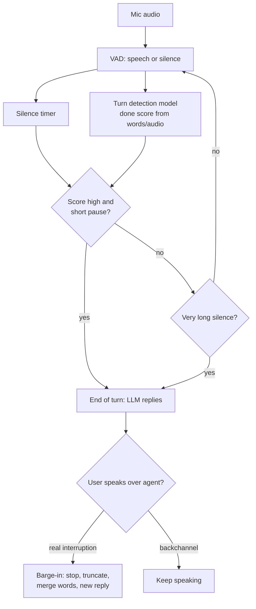

# Why does a voice agent cut people off mid-sentence?

> **Step 16: AI Infrastructure, Deployment, and System Design** · ⏱️ 15 min read · [Read original](https://outcomeschool.com/blog/voice-agents-cutting-users-off)

## TL;DR
Simple voice agents end the user's turn after a fixed silence (VAD plus timer), but people pause mid-sentence, so the agent replies to half a sentence. Longer timers just make every reply slow. The fix is semantic turn detection (silence plus meaning), with barge-in handling for the remaining mistakes.

## Key Concepts
- **Pipeline** — mic, STT, LLM (needs the full sentence), TTS, speak.
- **Turn / turn detection / end of turn** — one person's chance to speak; deciding when it ends.
- **VAD** — small fast model answering many times per second "is someone speaking?"
- **Silence threshold** — fixed silence (few hundred ms to 1 s) after which the turn ends.
- **Semantic turn detection** — end of turn judged by meaning, not just silence.
- **Barge-in** — user interrupts the agent while it speaks.
- **Backchannel** — "uh-huh", "okay", "right": means "go on", not "stop".
- **Echo cancellation** — removes the agent's own voice from mic audio.

## How It Works
### The silence timer
Loop over 20 ms chunks: if `vad.is_speech`, set talking and reset `silence_ms`; else if talking add 20; when `silence_ms >= 500` call `end_of_turn()`. Simple and fast, but ignores what was said.

### Why it cuts people off (example, threshold 500 ms)
User: "I want to book a table for... [0.7 s pause] ...four people tomorrow evening."
1. Speech, timer 0. 2. Pause, timer climbs. 3. At 500 ms agent decides done (pause is 700 ms). 4. Sends "I want to book a table for" to LLM, says "Sure. For how many people?" 5. User continues; both talk over each other.

### Common causes
- Thinking pauses ("My order number is... let me check... 4 5 7 2")
- Filler words (um, uh, so...) — timer doesn't understand words
- Reading numbers/lists/addresses in groups
- Slow speakers (elderly, non-native)
- Background noise confusing VAD (car horn, fan, another voice)
- Network delays: late/lost packets look like silence
In all cases the gap means "not done yet".

### Why not just wait longer?
| Threshold | Good | Bad |
|---|---|---|
| Short (300 ms) | Quick replies | Cuts people off |
| Long (2 s) | Rarely cuts off | Slow, awkward silence; users say "Hello?" which confuses the agent |
Builders favor fast, so short thresholds persist. One fixed number can never fit all pauses.

### Semantic turn detection
Model scores whether the thought is complete ("...table for" incomplete; "...four people tomorrow evening." complete). May read STT text or raw audio (pitch drops at end of statement, stays level mid-thought).
```
if done_score > 0.8 and silence_ms >= 300: end_of_turn()   # complete + short pause
elif silence_ms >= 2000: end_of_turn()                      # incomplete but very long pause
```
Values illustrative. Extra fixes: context-aware waiting (after asking phone number wait longer), filler-word awareness, STT end-of-speech signals, better VAD and noise removal.

### Recovery via barge-in
On user speech while agent talks: stop immediately; discard rest of reply and remember only what the user heard; keep listening; join old and new words into one sentence; generate a fresh reply. Do not stop on backchannels. Use echo cancellation so the agent does not hear itself on speakerphone and interrupt itself.

### Diagram


## Trade-offs & Pitfalls
- Speed vs accuracy: short thresholds give interruptions, long give lag.
- Noise, accents, network issues still corrupt silence signals.
- Stopping on every "uh-huh" or on its own echoed voice makes the agent erratic.

## Key Takeaways
- LLM needs the full sentence, so end-of-turn detection gates reply quality.
- Pauses mid-sentence are normal; silence != finished.
- A fixed threshold forces a speed vs interruption trade-off.
- Combine silence and meaning (and prosody) for the decision.
- Barge-in must stop instantly, truncate memory to what was heard, and merge turns.
- Distinguish backchannels from real interruptions; use echo cancellation.
