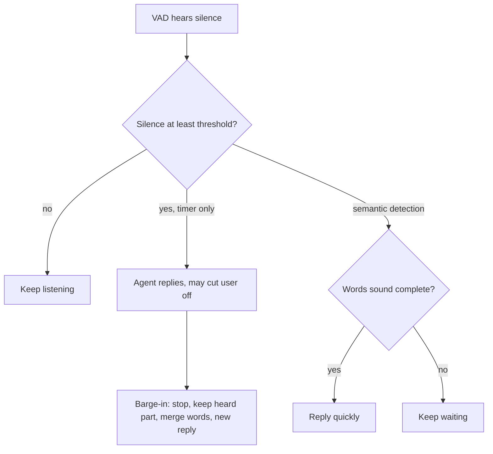

# Why does a voice agent cut people off mid-sentence?

> **Step 16: AI Infrastructure, Deployment, and System Design** · ⏱️ 15 min read · [Read original](https://outcomeschool.com/blog/voice-agents-cutting-users-off)

## TL;DR
Simple voice agents use a VAD plus a fixed silence timer, so any pause longer than the threshold is treated as the end of the turn. Longer timers make everything slow, so modern agents use semantic turn detection and recover with barge-in handling when they still get it wrong.

## Key Concepts
- **Turn / end of turn** — one person's chance to speak and the moment it is judged over.
- **Silence threshold** — fixed duration (typically a few hundred ms to 1 s) after which VAD silence ends the turn.
- **Semantic turn detection** — judging the end of turn by whether the words sound like a complete thought.
- **Barge-in** — user interrupting the agent while it speaks.
- **Backchannel** — "uh-huh", "okay", "right": means "go on", not "stop".
- **Echo cancellation** — removes the agent's own voice from the microphone audio.

## How It Works
The LLM needs the full sentence, so the pipeline is mic, STT, LLM, TTS, speaker, and turn detection must decide first whether the user is done.

### Why the silence timer fails
Example with a 500 ms threshold: "I want to book a table for... [0.7 s] ...four people tomorrow evening." The timer fires mid-pause, the LLM gets "I want to book a table for," the agent starts replying, and both talk over each other.

Common causes: thinking pauses, filler words ("um", "so..."), reading numbers and lists in groups, slow speakers (elderly or non-native), background noise confusing VAD, and network jitter that looks like silence. In all cases the gap means "not done," which a timer cannot see.

### Why not just wait longer
| Threshold | Good | Bad |
|---|---|---|
| Short (300 ms) | Fast replies | Cuts people off |
| Long (2 s) | Rarely cuts off | Slow, awkward, users say "Hello?" |

### Semantic turn detection fix
A small model (text, audio, or both) scores completeness. Rule: if score above 0.8 and silence at least 300 ms, end the turn; else if silence at least 2000 ms, end anyway; otherwise keep listening (numbers illustrative). "...table for" scores low, so the agent waits; "...tomorrow evening." scores high, so it replies fast.

Extra helpers: context-aware waiting (after "What is your phone number?"), filler-word awareness, STT end-of-speech signals, better VAD and noise removal.

### Recovery
On barge-in: stop speaking immediately, discard the rest and remember only what the user heard, keep listening, merge old and new words, regenerate a reply. Distinguish backchannels from real interruptions, and use echo cancellation so the agent does not interrupt itself on a speakerphone.

## Diagram

## Key Takeaways
- A silence timer hears gaps, not meaning, so pauses become false endpoints.
- Short thresholds cut people off; long ones make the agent feel slow.
- Semantic turn detection asks "is this a complete thought?" instead of "how long was the silence?"
- Barge-in handling lets the agent stop, remember what was heard, and merge the user's words.
- Separate backchannels from interruptions and cancel echo of the agent's own voice.
