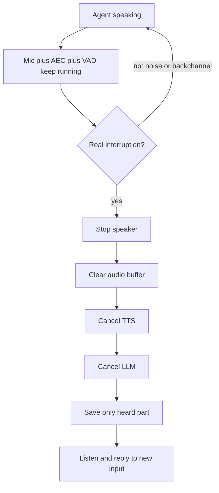

# What is barge-in in a voice AI agent?

> **Step 16: AI Infrastructure, Deployment, and System Design** · ⏱️ 17 min read · [Read original](https://outcomeschool.com/blog/what-is-barge-in-in-a-voice-ai-agent)

## TL;DR
Barge-in is the user speaking while the agent is still talking, with the agent stopping so it can listen. Supporting it means listening during playback, rejecting echo and non-interruptions, halting the whole pipeline fast, and saving only what the user actually heard.

## Key Concepts
- **Barge-in** — user interrupts and the agent stops its speech. The term comes from IVR phone menus that let callers act before the message finished.
- **AEC (Acoustic Echo Cancellation)** — subtracts the agent's known outgoing audio from the mic signal.
- **Self-interruption** — agent hears its own voice and stops itself.
- **False barge-in** — agent stops for noise, a cough, or "uh-huh".
- **Backchannel** — short listening sounds like "okay", "right".
- **Word-level timestamps** — TTS output telling when each word was spoken.

## How It Works
A simple agent mutes the mic while speaking (walkie-talkie style) and cannot support barge-in. To support it, the mic, VAD, and STT must keep running during the agent's speech.

### Two problems
1. **Hearing itself**: speakerphone echo fools VAD. AEC removes the agent's audio before VAD; it is imperfect, so a single short burst should not trigger barge-in.
2. **Not every sound is an interruption**: backchannels, door, dog, TV, cough, other people. Two opposite errors: false barge-in (agent cuts itself) vs missed barge-in (agent ignores the user).

### Detection approaches
| Approach | Pro | Con |
|---|---|---|
| Stop on any voice | Fastest | Many false barge-ins |
| Wait for enough speech (e.g. 0.5 s or 2-3 words) | Far fewer false ones | Small delay; "okay, okay, yes" slips through |
| Understand the meaning (word list or small model on audio and text) | Handles backchannels | Needs words first, slower |

In practice: VAD gives a fast first signal, then min-speech and meaning checks confirm; a word like "stop" is let through despite being short.

### After barge-in
The old reply lives in several places: LLM still generating, TTS still synthesizing, buffered audio, speaker playing. Stop in order: speaker, buffer, TTS, LLM, then save the heard part and listen.

### Remembering what was heard
The LLM writes text far faster than audio plays. If the full reply is stored, the LLM assumes the user heard, say, the total amount. Truncate history to what was played using playback timing or word timestamps (OpenAI Realtime API: `conversation.item.truncate` with milliseconds played). Optionally note "the user interrupted here."

### Speed
Delays stack: VAD confirmation, meaning check, audio already in flight. Use small buffers, duck volume when VAD fires, stop fully on confirmation, restore if false alarm. Faster stop means more false barge-ins; tune per environment (noisy phone line waits longer).

## Diagram

## Key Takeaways
- Barge-in needs the agent to listen while it speaks.
- AEC prevents the agent from interrupting itself.
- Confirm interruptions by duration and meaning to avoid false barge-ins.
- Stop every stage, not just the LLM, or buffered audio keeps playing.
- Truncate conversation history to what the user actually heard.
