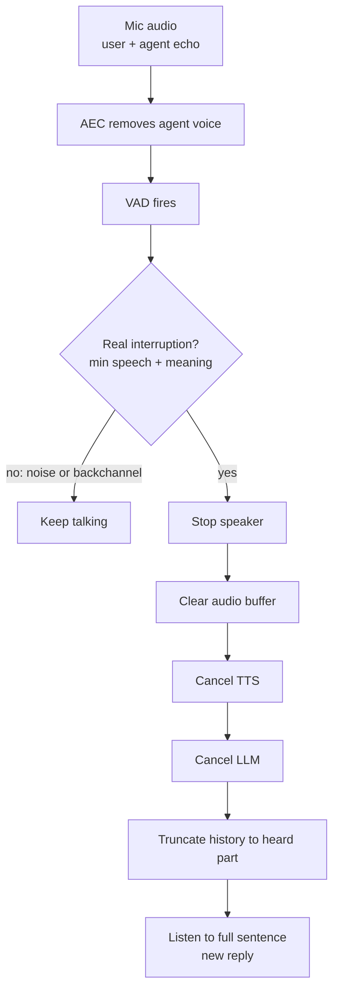

# What is barge-in in a voice AI agent?

> **Step 16: AI Infrastructure, Deployment, and System Design** · ⏱️ 17 min read · [Read original](https://outcomeschool.com/blog/what-is-barge-in-in-a-voice-ai-agent)

## TL;DR
Barge-in is the user interrupting the agent mid-speech and the agent stopping instantly to listen. It needs the mic/VAD/STT running while the agent speaks, echo cancellation, a check separating real interruptions from noise/backchannels, a full pipeline stop, and truncating history to what the user actually heard, all quickly.

## Key Concepts
- **Barge-in** — user speaks over the agent; agent stops and listens. Term comes from IVR (Interactive Voice Response) phone menus that let callers press a key or speak mid-message.
- **Pipeline** — STT, LLM, TTS, speaker; plus **VAD** (is a human speaking now, every 20-30 ms).
- **Half-duplex (walkie-talkie)** agent ignores the mic while speaking, so no barge-in.
- **Self-interruption** — agent hears its own voice through the mic and stops itself.
- **AEC (Acoustic Echo Cancellation)** — subtracts the known outgoing audio (predicted as it returns into the mic) from mic signal.
- **Backchannel** — "uh-huh", "okay", "right", "hmm": "continue".
- **False barge-in** — stopping for noise/cough/backchannel/other people/echo. **Missed barge-in** — not stopping when the user wants to speak.
- **Audio buffer** — audio generated and waiting to play.

## How It Works
Example: agent lists "new orders, tracking, refunds..." user says "Refund." and agent stops, moves to refund.

### Problem 1: agent hears itself
Speaker on phone: mic picks up agent voice; VAD says human; agent stops. AEC (usually from phone/browser/OS) removes it before VAD. Imperfect: loud speaker, big empty room, low-quality phone leak echo, so do not trust a single short burst.

### Problem 2: not every sound is an interruption
Backchannels, background noise (door, dog, TV, horn), coughs/breaths, other people.
| Mistake | Effect |
|---|---|
| False barge-in | Agent keeps cutting itself |
| Missed barge-in | Agent doesn't listen |

### Detection approaches
| Approach | Pro | Con |
|---|---|---|
| 1 Stop on any voice (VAD) | Very fast | Coughs, "uh-huh", echo cause false barge-ins |
| 2 Min speech (e.g. 0.5 s or 2-3 words from STT) | Far fewer false | Small delay; long "okay, okay, yes" still passes |
| 3 Understand meaning (backchannel word list or small model; some use audio+words) | Handles backchannels: "wait/stop/no that is wrong/actually I want a refund" = interrupt | Needs words first, slower than VAD |
In practice combine: VAD fires first (get ready to stop), then min-speech and meaning checks confirm; meaning check lets a single word like "stop" through.

### After barge-in: stop everything
Old reply lives in LLM (still generating), TTS (still synthesising), buffer (queued audio), speaker (playing). Stop in order: speaker, buffer, TTS, LLM (stopping only the LLM lets buffered audio keep playing). Then listen to the full sentence and start a new reply. Code: `speaker.stop(); audio_buffer.clear(); tts.cancel(); llm.cancel(); mark_heard_part(); is_speaking=False; start_listening()`. Real systems run these in parallel tasks.

### Remember what the user heard
LLM generates text much faster than audio plays. Example full reply: "Your order will arrive at 7 PM. The delivery partner is Ravi. You can track the order in the app. Your total is 450 rupees." User heard up to "The delivery partner is...". Saving the full reply makes the LLM think the user knows the total ("As I told you, 450 rupees" - false). Truncate history to played part using timing (audio start/stop) or TTS word-level timestamps. OpenAI Realtime API: `conversation.item.truncate` with ms played cuts the rest incl. text. Optionally add a note "the user interrupted here".

### Why fast
Delays add: VAD needs a few chunks, confirmation (esp. waiting for words), audio already in phone network/speaker. Use small audio buffers; duck volume when VAD fires, fully stop on confirmation, restore on false alarm. Trade-off: faster stop = more false barge-ins. Noisy phone line waits longer; quiet in-app assistant stops faster.

### Diagram

## Trade-offs & Pitfalls
- Responsiveness vs false barge-ins; tune to environment.
- AEC leakage; backchannel misclassification; stale full-reply history causing false claims.

## Key Takeaways
- Barge-in requires always-on mic, VAD, STT during agent speech.
- AEC prevents self-interruption.
- Confirm with min speech and semantic check; VAD alone is too trigger-happy.
- Stop speaker first, then buffer, TTS, LLM.
- Truncate history to what was actually played (timestamps / truncate API).
- Keep buffers small; the stop must feel instant.

## FAQ
- Simple agent can't barge-in? → mic ignored while speaking (walkie-talkie).
- Stop on "uh-huh"? → No.
- Why speaker first? → Buffered audio would keep playing.
