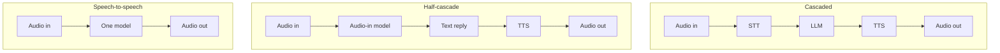
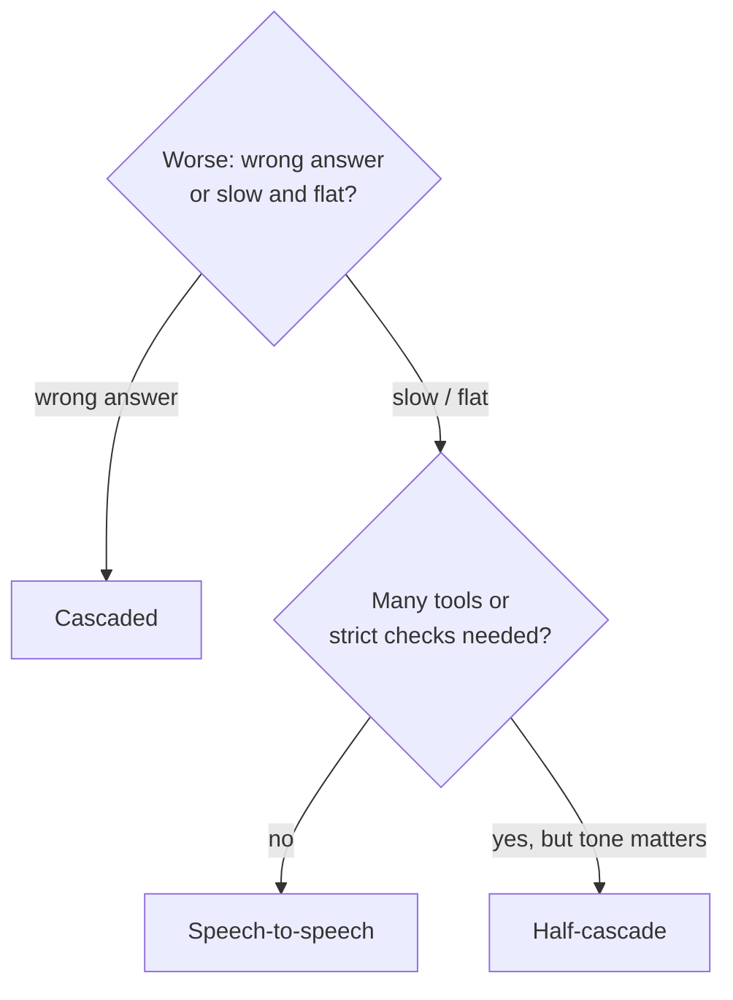

# Cascaded vs Speech-to-Speech: How to choose the right voice agent architecture?

> **Step 16: AI Infrastructure, Deployment, and System Design** · ⏱️ 16 min read · [Read original](https://outcomeschool.com/blog/cascaded-vs-speech-to-speech)

## TL;DR
A voice agent must hear, think, speak. Cascaded chains STT, LLM, TTS (control, accuracy, swappable parts); speech-to-speech is one audio-in/audio-out model (low delay, tone kept, natural). Half-cascade (audio-in model plus TTS) is the middle. Choose by whether a wrong answer or a slow/flat answer is worse.

## Key Concepts
- **Voice agent architecture** — how models doing hear/think/speak are arranged.
- **Cascaded** — STT (ASR) to LLM to TTS; text is the connector.
- **Speech-to-speech** — one model; works on audio tokens ("words of sound"), outputs audio tokens turned back into sound. Often produces internal text for reasoning/transcript, but the voice comes from the model, not a TTS.
- **Half-cascade** — model hears audio directly (keeps tone), replies as text, TTS speaks it.
- **Streaming** — STT emits words immediately, LLM starts on arrival, TTS speaks first sentence while LLM writes the rest.

## How It Works
### Cascaded
User audio, STT, text, LLM, text reply, TTS, speech.
- Strengths: full visibility (text logs); best model per job and swap parts; strong reasoning/tool use with any text LLM (code runs tool and returns result); easy safety checks on text before TTS (e.g. block unauthorized refund promises); full voice control (custom voice, brand pronunciation, speed).
- Weaknesses: delay is the sum of steps; tone lost ("Great..." angry reads as "Great"); STT errors propagate ("two fifteen" heard as "two fifty"; LLM can't hear audio); needs separate silence/turn detection models.
- Delay example: STT 300 + LLM 500 + TTS 200 = 1000 ms. Streaming cuts it a lot but handoff delay remains.

### Speech-to-speech
- Strengths: lower delay (no handoffs); tone kept and matched; natural speech (laugh, pause, speed, warmth); can listen while speaking so interruptions are handled natively; simpler setup.
- Weaknesses: harder to see inside (transcript is a side output); less choice (cannot swap voice or brain alone); often weaker at long instructions, careful reasoning, reliable tool choice; limited voices and pronunciation control; harder pre-speech safety checks; higher cost (audio tokens priced above text; compare cost per minute for expected call length).

### Half-cascade
Benefits: hears real voice (tone kept); text reply can be checked, logged, voice controlled; tool calling more reliable via text step. Trade-off: voice less expressive than full S2S; TTS adds delay back.

### Comparison
| Point | Cascaded | Half-Cascade | Speech-to-Speech |
|---|---|---|---|
| Models | 3 | 2 | 1 |
| Delay | Higher | Medium | Lower |
| User tone | Lost | Kept | Kept |
| Voice naturalness | Good (TTS) | Good (TTS) | Very natural |
| Visibility | Easy | Easy for reply | Harder |
| Swapping parts | Easy | TTS only | No |
| Reasoning/tools | Strong | Good | Often weaker |
| Voice/pronunciation control | Full | Full | Limited |
| Pre-speech safety checks | Easy | Easy | Harder |

### How to choose
Ask: is a wrong answer or a slow, flat answer worse? Wrong is worse leans cascaded; slow/flat leans S2S.
- Bank support agent: strict rules, costly mistakes, so cascaded.
- Language practice partner: natural, fast, few tools, so S2S.
- Restaurant booking that must notice mood and call tools: half-cascade.
Choose cascaded for many tools/strict instructions, reply checking, specific voice/pronunciation, swappable parts. Choose S2S for lowest delay and human-like feel, reacting to emotion, simple tasks. Choose half-cascade for tone awareness plus checkable text and controlled voice with tool calls. Not forever: S2S is improving at reasoning/tool calling; keep tools, instructions, test calls separate from the model so you can compare on real calls.

### Diagram

### Decision tree

## Key Takeaways
- Cascaded = control and accuracy; S2S = speed and naturalness.
- Cascaded delay is additive; streaming mitigates but does not remove it.
- Text-in-the-middle loses tone and propagates STT errors.
- S2S is hard to inspect, swap, guard, and may cost more.
- Half-cascade keeps tone and text control at the price of some expressiveness and delay.
- Design to keep options open since S2S improves quickly.
