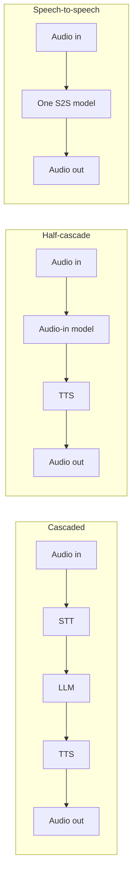

# Cascaded vs Speech-to-Speech: How to choose the right voice agent architecture?

> **Step 16: AI Infrastructure, Deployment, and System Design** · ⏱️ 16 min read · [Read original](https://outcomeschool.com/blog/cascaded-vs-speech-to-speech)

## TL;DR
Every voice agent must hear, think, and speak. Cascaded agents chain STT, LLM, and TTS (controllable, strong tools, but slower and tone-blind); speech-to-speech uses one audio model (fast, natural, but harder to control). A half-cascade sits in between. Choose by asking what is worse: a wrong answer or a slow, flat one.

## Key Concepts
- **Cascaded** — STT then LLM then TTS, with text between the models.
- **Speech-to-speech (S2S)** — one model takes audio in and gives audio out, using audio tokens internally.
- **Half-cascade** — audio-in model hears the voice directly, replies in text, then a TTS speaks it.
- **Streaming** — STT, LLM, and TTS overlap to cut cascaded delay.
- **Audio tokens** — small pieces of sound the S2S model reads and writes.

## How It Works
### Cascaded
Text connects the models. Delay is additive: e.g. STT 300 ms + LLM 500 ms + TTS 200 ms = 1000 ms (illustrative). Streaming helps but handoff delay remains.
- Strengths: visible transcripts and logs, best model per slot and swappable parts, strongest text LLMs for long instructions and tool use, easy safety checks on text before TTS, full voice and pronunciation control.
- Weaknesses: summed delay, tone lost ("Great..." in anger reads as "Great"), STT errors propagate ("two fifteen" to "two fifty"), separate turn-detection components needed.

### Speech-to-speech
Hearing, thinking, speaking in one model; often produces text internally for transcripts but the voice comes from the model.
- Strengths: lower delay, tone kept and matched, natural laughter and pauses, can listen while speaking so handles interruptions, simpler setup.
- Weaknesses: harder to see inside (transcript is a side output), no swapping parts, often weaker at complex reasoning and tools, limited voice control, hard to check replies before playback, audio tokens usually cost more than text.

### Half-cascade
Keeps user tone, gives checkable text replies, usually more reliable tool calling than S2S; voice is less expressive and TTS adds delay back.

| Point | Cascaded | Half-cascade | S2S |
|---|---|---|---|
| Models | 3 | 2 | 1 |
| Delay | Higher | Medium | Lower |
| User tone | Lost | Kept | Kept |
| Debuggability | Easy | Easy for reply | Harder |
| Tools and reasoning | Strong | Good | Often weaker |
| Voice control | Full | Full | Limited |

### Choosing
- Bank support (strict rules, costly errors): cascaded.
- Language practice partner (natural, fast, few tools): S2S.
- Booking agent that must sense mood and call tools: half-cascade.

Keep tools, instructions, and test calls separate from the model so you can switch architecture later as S2S improves.

## Diagram

## Key Takeaways
- Cascaded = control and accuracy; S2S = speed and naturalness.
- Cascaded delay is the sum of three stages; S2S removes handoffs.
- Text between models enables logging, safety checks, and swapping parts.
- Half-cascade hears tone yet keeps text control.
- The choice is not permanent; keep logic decoupled and compare on real calls.
