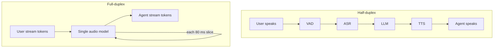

# How do half-duplex and full-duplex voice agents differ?

> **Step 16: AI Infrastructure, Deployment, and System Design** · ⏱️ 16 min read · [Read original](https://outcomeschool.com/blog/half-duplex-vs-full-duplex-voice-agents)

## TL;DR
Half-duplex agents are walkie-talkies: they listen or speak, one at a time, built as a VAD/ASR/LLM/TTS pipeline. Full-duplex agents (like Kyutai's Moshi) listen and speak simultaneously with a single audio model, giving natural overlap and short gaps but less control.

## Key Concepts
- **Half-duplex** — both sides can talk, but only one at a time.
- **Full-duplex** — both can talk at once, like a phone call.
- **Barge-in** — user interrupts and the agent stops; a patch on half-duplex, not true full-duplex.
- **Backchannel** — "hmm", "okay" while the other talks.
- **Audio tokens / two streams** — Moshi encodes 80 ms slices (12.5 per second) into tokens, with a user stream and an agent stream.
- **Inner Monologue** — Moshi predicts the text of its own words slightly ahead of the audio.

## How It Works
### Half-duplex pipeline
1. VAD detects speech and ends the turn after fixed silence (e.g. 700 ms).
2. ASR converts speech to text.
3. LLM writes the reply.
4. TTS makes the voice.
5. Speaker plays it; loop back to listening.

Problems: summed delay (human gaps are around 200 ms); cuts people off at pauses; cannot hear while speaking; cannot produce backchannels. Root cause: one thing at a time.

### Barge-in on top
A listener (often VAD) stays on during speech and stops the agent on user speech. But it only detects, not understands, the interruption; the content becomes a new turn later. It can misfire on coughs, doors, "hmm", and the agent's own echo (needs echo cancellation).

### Full-duplex (Moshi)
One model reads the latest slice of the user stream and writes the next slice of the agent stream, 12.5 times per second. Silence is also an output: the model writes silence tokens when the agent should not speak, so there is no separate silence timer; it learns turn timing from conversations. Per the Moshi paper: theoretical delay 160 ms, about 200 ms in practice on one GPU.

### Same restaurant call
Half-duplex cuts in at "table for... umm", has a reply gap, and on interruption merely stops. Full-duplex says "hmm", waits, replies quickly, and understands the interruption and adjusts.

| Point | Half-duplex | Full-duplex |
|---|---|---|
| Listen/speak | One at a time | Together |
| Architecture | VAD, ASR, LLM, TTS | Often one speech model |
| End of turn | Silence or turn detector | Model each slice |
| Gap | Longer | About 200 ms (Moshi) |
| Backchannels | No | Yes |
| Control, tools, debugging | Easy | Harder |

### When to use
Half-duplex: customer support, tool calls, APIs, strict rules. Full-duplex: companions, language practice, natural flow. Full-duplex drawbacks: needs overlapping-speech training data, can talk over the user or stay silent at the wrong time.

## Diagram

## Key Takeaways
- Duplex describes whether both sides can talk at once.
- Half-duplex adds delay and cuts off users; barge-in helps but does not change its one-direction rule.
- Full-duplex models treat silence as an output, so turn-taking is learned, not timed.
- Full-duplex gains naturalness but loses tool and business-logic ease and debuggability.
- Pick half-duplex for structured tasks, full-duplex for natural conversation.
