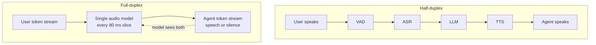

# How do half-duplex and full-duplex voice agents differ?

> **Step 16: AI Infrastructure, Deployment, and System Design** · ⏱️ 16 min read · [Read original](https://outcomeschool.com/blog/half-duplex-vs-full-duplex-voice-agents)

## TL;DR
Half-duplex agents take turns (walkie-talkie): a VAD, ASR, LLM, TTS pipeline that listens or speaks, never both. Full-duplex agents (e.g. Moshi) listen and speak simultaneously via a single audio model, giving ~200 ms gaps, backchannels, and native interruption handling, at the cost of control and tooling ease.

## Key Concepts
- **Duplex** — how two sides send information. Half-duplex: both can talk, one at a time (walkie-talkie). Full-duplex: both at once (phone call).
- **Backchannel** — "hmm", "okay", "right": "I am following, continue".
- **Barge-in** — user interrupting a speaking agent; on half-duplex it only detects speech and stops the agent.
- **Echo cancellation** — removes agent voice from mic.
- **Audio tokens** — small groups of numbers for each audio slice.
- **Moshi** — full-duplex speech model by Kyutai (2024). **Inner Monologue** — Moshi predicts text of its own words slightly ahead of matching audio tokens, to keep words meaningful.

## How It Works
### Half-duplex pipeline
1. VAD detects speech/silence; fixed silence (e.g. 700 ms) = end of turn.
2. ASR: speech to text ("book a table for two").
3. LLM writes text reply ("Sure, for what time?").
4. TTS: text to voice.
5. Speaker plays, then listen again.
Partial results may be passed along to save time, but it still waits for turn end. Only one direction active at a time.

### Problems
1. **Waiting gap** — silence timer + ASR + LLM + TTS add up; human gaps are ~200 ms.
2. **Cuts people off** — "My number is 98765..." pause; turn detectors using words/tone reduce but still must decide turn over first.
3. **Can't hear while speaking** — reading flights, user says "the second one", agent continues.
4. **No backchannels** — can't produce them; user "hmm" is ignored or treated as new turn.
Root cause: only one thing at a time.

### Barge-in on half-duplex
Listener (often the VAD) stays active while the agent speaks; on user speech it stops the voice and returns to listening. What the user said is handled later as a new turn, so it doesn't make it full-duplex (just switches faster). Issues: coughs/door/background talk stop it; "hmm" stops it; agent's own echo triggers false interruption (needs echo cancellation).

### Full-duplex agent
Listens and speaks continuously; can say "hmm" while user talks; hears and understands the user while speaking; decides to stop/continue/adjust; replies quickly since it has been thinking all along.
How (Moshi): audio cut into 80 ms slices (12.5/s), converted to audio tokens. Two parallel token streams: user and agent. Each slice, the model reads latest user tokens and writes next agent tokens, seeing both so it knows overlaps.
```
Slice:  1     2  3     4  5     6
User:   book  a  table -  -     -
Agent:  -     -  hmm   -  sure  for
```
Slices 1-2 user talks; slice 3 agent backchannel; slice 4 both silent, model decides user finished; from 5 agent replies. Silence is also an output (silence tokens): no separate silence timer; behavior learned from conversations incl. real human recordings. Moshi paper: theoretical delay 160 ms, ~200 ms in practice on a single GPU.

### Same conversation (restaurant)
Half-duplex: cuts in at "umm" pause, gap before reply, barge-in only stops it and starts a new turn. Full-duplex: says "hmm" and waits, replies quickly, on "no, that's all" understands and says "Okay, have a great dinner."

### Comparison
| Point | Half-duplex | Full-duplex |
|---|---|---|
| Listen/speak | One at a time | Both |
| Architecture | VAD, ASR, LLM, TTS pipeline | Often single speech model |
| End of turn | Silence / turn detector | Model each slice |
| Response gap | Longer, sums | ~200 ms (Moshi) |
| Interruptions | Barge-in stops agent | Hears, understands, adjusts |
| Backchannels | Not possible | Possible |
| Control over parts | High, swappable | Low |
| Tools/business logic | Easy (text LLM) | Harder |
| Debugging | Easy (text per step) | Harder |

### Diagram


## Trade-offs & Pitfalls
- Half-duplex: swappable parts, easy tools/DB/business rules, easy debugging, mature for structured tasks; but gap before replies, cuts at pauses, no backchannels, barge-in false stops.
- Full-duplex: natural, short gap, handles pauses/interruptions/overlap, backchannels; but hard to control output, tools/rules harder (audio-centric), needs scarce overlapping-speech training data, may talk over user or go silent at wrong time if timing not learned.
- Use half-duplex (with good turn detection + barge-in) for support agents checking orders, calling APIs, strict rules; full-duplex for companions, language practice, natural flow.

## Key Takeaways
- Duplex = whether both sides can talk at once.
- Half-duplex is a sequential pipeline; delays add up.
- Barge-in improves half-duplex but is not full-duplex (detect and stop, not understand).
- Full-duplex models run user and agent audio-token streams in parallel and treat silence as output.
- Moshi: 80 ms slices, ~200 ms practical latency.
- Choose by control/tool needs vs naturalness.
