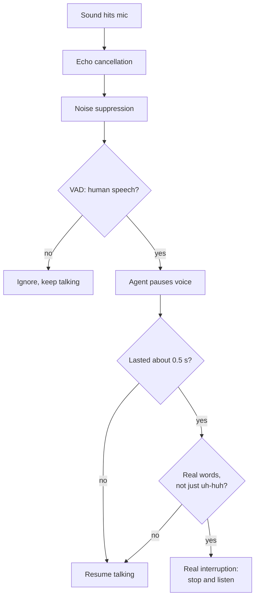

# How does a voice agent tell a real interruption from a cough or background noise?

> **Step 16: AI Infrastructure, Deployment, and System Design** · ⏱️ 16 min read · [Read original](https://outcomeschool.com/blog/interruption-vs-background-noise)

## TL;DR
The agent passes every sound through a series of filters: echo cancellation, noise suppression, VAD, minimum duration, real words (STT), and a pause-then-decide strategy. Only sounds passing all checks stop the agent. Trained interruption models can replace hand rules.

## Key Concepts
- **Interruption (barge-in)** — user speaks while the agent talks, wanting it to stop.
- **False interruption** — agent stops for cough, sneeze, door, dog, TV, car horn, or "uh-huh"; user must say "Please continue".
- **Echo cancellation** — subtract the known agent audio from mic signal.
- **Noise suppression** — model trained on speech vs fans, traffic, typing, wind; **background voice cancellation** keeps main (closest) speaker only.
- **VAD** — scores ~30 ms pieces 0-1 for human speech (cut-off e.g. 0.5).
- **Backchannel** — "uh-huh", "okay", "right", "mm-hmm".
- **Interruption model** — trained to label sounds as real interruption / backchannel / noise.

## How It Works
Hard because the mic yields only a stream of numbers (air pressure); cough, bark, and "Wait" are all numbers. Two mistakes: stopping too easily (confusing) vs too late (user feels ignored, talks over agent). So use serial checks.

1. **Remove agent's own voice** — mic = agent + user + noise; subtract agent; remains user + noise. Prevents self-interruption.
2. **Remove background noise** — steady noise gone (busy street example). Cannot remove everything: cough comes from a human mouth, sudden bang slips through. Background voice cancellation handles TV/next-room voices (real speech but not the user).
3. **Is it human speech? (VAD)** — barks, doors, music without singing score low. Cough, laugh, loud "hmm" can still score high; VAD can't tell cough from a word.
4. **Long enough?** — cough is a fraction of a second; "Wait, I want the morning flight" lasts longer. Min duration ~0.5 s default in some frameworks. Longer min removes more coughs but stops slower (noisy call center longer; quiet app shorter). Timeline: cough ends before 0.5 s mark, "Wait" passes it.
5. **Real words?** — STT yields no words for cough/noise. Rule: stop only after N words (some 1, some 2+). Example: cough 0.7 s, passes duration, STT "" so keep talking; "Wait" 0.6 s with STT "wait" so stop. Backchannel list: "uh-huh"/"okay" alone keep talking; "okay, but wait" stops. Problem: STT needs time to emit the first word, so talking over the user longer.
6. **Pause first, then decide** — on first VAD speech, pause or lower the voice (do not discard). If long enough with words: stop fully and listen. If no words and quiet: false interruption, resume from where paused (sounds like a speaker pausing at a cough). Some frameworks wait ~2 s of silence by default; shorter is less noticeable but may resume while user is about to speak.

### Trained interruption model
Rules limited (cough and "Wait" both short; "yeah" may agree or start a question). Model trained on real conversations labeled interruption/backchannel/noise; listens to audio (tone, pitch, rhythm): sharp rising "Wait" vs soft flat "mm-hmm".

### Diagram

Examples: dog bark - never pauses; cough - pauses then resumes; "Wait, I want the morning flight" - passes all.

## Trade-offs & Pitfalls
- Works: steady noise, short noises (cough, clap, door), clear phrases ("Wait a second").
- Struggles: another person nearby (real words); very short interruption "No" (near min time, looks like backchannel, slower stop); "yeah"/"okay" starting a new point; very noisy line where STT hallucinates words.
- Every setting is a trade-off: test on real call recordings; tune min time, min words, pause timing.

## Key Takeaways
- Stack filters: AEC, noise suppression, VAD, duration, words.
- No single check is enough; each removes a class of false triggers.
- Pause/duck first, then confirm: fast yet recoverable.
- Backchannels are real speech but not interruptions.
- Trained models using audio cues beat fixed rules on edge cases.
- Longer min duration = fewer false stops but slower real stops.

## FAQ
- Noise suppression alone? → No; coughs and bangs pass.
- "Uh-huh"? → No stop (backchannel).
- Min speaking time? → ~0.5 s default in some frameworks; tune per use case.
