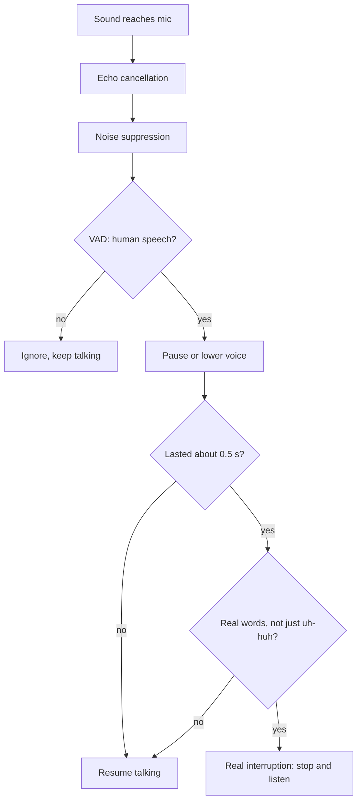

# How does a voice agent tell a real interruption from a cough or background noise?

> **Step 16: AI Infrastructure, Deployment, and System Design** · ⏱️ 16 min read · [Read original](https://outcomeschool.com/blog/interruption-vs-background-noise)

## TL;DR
A microphone gives only a stream of numbers, so a cough, a dog bark, and "Wait" all look alike. Voice agents run a chain of checks (echo cancellation, noise suppression, VAD, duration, real words) plus a pause-first strategy, so only genuine interruptions stop the agent.

## Key Concepts
- **Interruption (barge-in)** — user speaks to make the agent stop and listen.
- **False interruption** — agent stops for a cough, door, TV, or "uh-huh".
- **Echo cancellation** — subtract the agent's known output from the mic signal.
- **Noise suppression / background voice cancellation** — model keeps speech (ideally only the main speaker) and lowers fans, traffic, TV.
- **VAD** — scores ~30 ms pieces 0 to 1 for human speech.
- **Backchannel** — "uh-huh", "okay": real speech that does not mean stop.
- **Interruption model** — trained to label sounds as interruption, backchannel, or noise.

## How It Works
Two failure modes: stopping too easily (confusing) vs too late (user feels ignored). No single check works, so use a series; a sound must pass all to stop the agent.

1. **Remove the agent's own voice** — mic = agent + user + noise; subtract agent, leaving user + noise.
2. **Remove background noise** — suppression handles steady noise; background voice cancellation targets TV or other people (still imperfect).
3. **Is it human speech?** — VAD threshold (e.g. 0.5). Filters barks and doors, but coughs, laughs, and "hmm" can still score high.
4. **Did it last long enough?** — minimum duration (some frameworks default about 0.5 s). Coughs are short. Trade-off: longer filters more but slows real stops; noisy call centers want longer.
5. **Real words?** — STT output: a cough gives no words, "Wait" does. Minimum word count (one or more). Backchannel word list ("uh-huh", "okay") keeps talking; "okay, but wait" stops. Weakness: STT needs time to produce words.
6. **Pause first, then decide** — pause or lower volume at first speech, keep the sentence, then stop fully if words arrive or resume from where it paused if not (some frameworks wait about 2 s of silence). Fast reaction without losing the sentence.

### Trained interruption model
Rules are brittle (short "Wait" vs short cough; "yeah" to agree vs to start a new point). A model on labeled conversations uses audio (tone, pitch, rhythm), so a sharp rising "Wait" differs from a soft flat "mm-hmm".

### Limits
Struggles with nearby people talking, very short interruptions like "No", "yeah" starting a new point, and very noisy lines where STT hallucinates words. Tune on real call recordings.

## Diagram

## Key Takeaways
- Use layered checks; each removes a class of false triggers.
- Cough passes VAD and maybe duration but fails the words check.
- Pausing first gives speed without discarding the sentence.
- Every threshold is a trade-off between false stops and slow stops; tune on real audio.
- A trained model using audio, words, and timing beats fixed rules on tricky cases.
