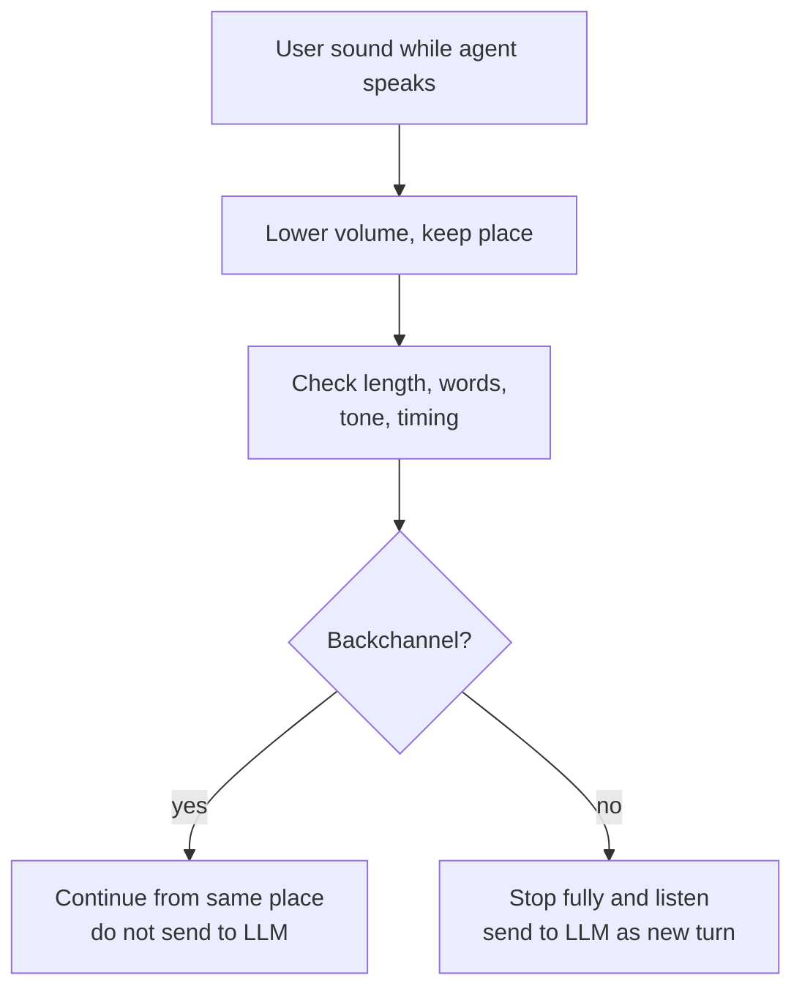

# What are backchannels, and why should "mm-hmm" not stop the agent?

> **Step 16: AI Infrastructure, Deployment, and System Design** · ⏱️ 16 min read · [Read original](https://outcomeschool.com/blog/backchannels-in-voice-agents)

## TL;DR
Backchannels ("mm-hmm", "yeah", "okay", "right", "I see", "wow") tell the speaker "go on, I'm following". A voice agent that stops for them (false barge-in) breaks flow and repeats itself. Agents combine length, words, tone, timing, and ideally a trained model, plus a soft pause while unsure, and never send backchannels to the LLM as new turns.

## Key Concepts
- **Backchannel** — short listener sound showing attention without taking the turn. Term from linguist Victor Yngve (1970): main channel (speaker) vs back channel (listener). In Japanese called *aizuchi*, used far more often than in English.
- **Barge-in** — user speaking during agent reply; **false barge-in** — stopping for non-interruptions.
- **VAD** — only says a human voice is present, cannot tell "stop" from "mm-hmm". Echo cancellation first removes agent's own voice.
- **Soft pause** — lower volume/pause while keeping place, until classified.
- **Full-duplex model** — listens and speaks simultaneously, can learn backchannel handling from data.

## How It Works
### Human conversation
Friend tells trip story; "mm-hmm", "oh no" don't stop the friend. Total silence on a call prompts "Hello? Are you there?" — backchannels make conversation natural.

### What goes wrong
Simplest rule: VAD hears voice while agent speaks, stop. Router example: agent says unplug router, user "mm-hmm", agent stops, "Sorry, did you want to say something?", user "No, please continue", agent restarts from beginning. Issues: conversation keeps breaking; repeats waste time; users go silent unnaturally; worst case, drops its answer and replies to "mm-hmm" as a new question.

### Backchannel vs interruption
| User says | Meaning | Agent |
|---|---|---|
| "mm-hmm" | following | Keep talking |
| "yeah, okay" | go on | Keep talking |
| "right" | agree, continue | Keep talking |
| "wait" | stop | Stop and listen |
| "no, not that one" | wrong | Stop and listen |
| "can you repeat the address" | new question | Stop and listen |
Backchannel: short, no new info, requests nothing. Interruption: correction, question, or stop request. Ambiguity: soft "okay" = go on; loud fast "okay, okay, I got it" = stop; "okay, but what about the price?" = starts as backchannel then real question.

### Signals
1. **Length** — backchannels usually < 1 s; e.g. wait for >= 0.5 s speech. Con: real "stop" is short too; "yeah, yeah, okay" can exceed limit.
2. **Words** (via STT) — set like {mm-hmm, mhm, uh-huh, yeah, yes, okay, ok, right, sure}; strip punctuation, lowercase, split; if 0 or > 3 words then not a backchannel; else all words in set. "yeah okay" True; "okay but what about the price" False. Cover spellings ("mm hmm", "mmhmm", "uh huh"). Con: STT latency; list lacks meaning ("right, but that is not my question").
3. **How said** — backchannels soft/low; interruptions louder/faster/more energetic; audio model on volume, pitch, speed.
4. **When said** — backchannels land at natural pauses (end of phrase); agent knows its own pause points; mid-sentence sustained speech is more likely an interruption.
5. **Model over all** — audio + words + timing, trained on labeled conversations; handles tricky cases better than lists. Full-duplex models can learn this without separate rules.

### While unsure
VAD is instant; STT words come later. Soft pause: on first voice lower volume/pause and keep place; check length, words, tone, timing; backchannel then continue from the same place; interruption then stop fully. Never send a backchannel to the LLM as a new message (it replies "Great, anything else?").

### Example (router)
"mm-hmm" and "okay": soft, short, in list, at natural pause, so continue. "wait, which light should be green?": longer, "wait" + question, so stop; LLM gets question; agent answers "The light with the internet symbol on it."

### Diagram

## Trade-offs & Pitfalls
- Works: common short backchannels, clean audio, soft pause, multiple signals combined.
- Struggles: ambiguous words ("okay", "right") with unclear tone; backchannel becoming a sentence ("yeah, yeah, but..."), requiring decision reversal; noisy audio; languages/cultures; slow STT lengthening uncertainty.

## Key Takeaways
- Backchannel = "continue", not a turn request.
- VAD alone cannot separate "stop" from "mm-hmm".
- Use length, words, prosody, timing, then a model.
- Soft pause lets the agent act fast without discarding its answer.
- Don't forward backchannels to the LLM.
- Same word can mean different things; context decides.
