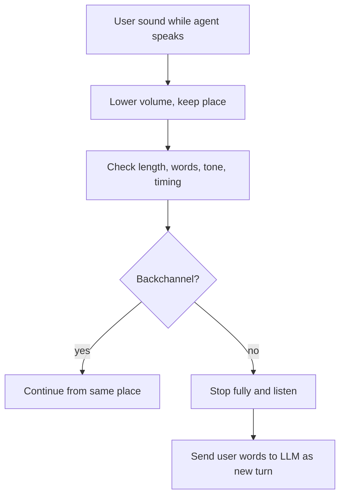

# What are backchannels, and why should "mm-hmm" not stop the agent?

> **Step 16: AI Infrastructure, Deployment, and System Design** · ⏱️ 16 min read · [Read original](https://outcomeschool.com/blog/backchannels-in-voice-agents)

## TL;DR
Backchannels are short listener signals ("mm-hmm", "okay", "right") that mean "go on," not "stop." VAD hears them as just a human voice, so naive barge-in stops the agent and breaks the flow. Agents combine length, words, tone, and timing, plus a soft pause, to tell them from real interruptions.

## Key Concepts
- **Backchannel** — short sound from the listener showing they are following; term introduced by linguist Victor Yngve in 1970 (main channel vs back channel).
- **Aizuchi** — Japanese backchannels, used more often than in English; they vary by language and culture.
- **False barge-in** — agent stops for something that was not an interruption.
- **Soft pause** — lower volume or pause while keeping place in the sentence.
- **Full-duplex model** — listens and speaks at once and can learn this behavior.

## How It Works
### The problem
Naive rule: VAD hears voice while agent speaks, so stop. Router example: user says "mm-hmm," agent stops, asks "did you want to say something?", then restarts from the beginning. Consequences: repeated breaks, wasted time, users go silent, or the LLM replies to "mm-hmm" as a new question.

### Backchannel vs interruption
| User says | Meaning | Agent |
|---|---|---|
| "mm-hmm", "yeah, okay", "right" | Following, continue | Keep talking |
| "wait", "no, not that one" | Stop or correction | Stop |
| "can you repeat the address" | New question | Stop |

Backchannels are short, carry no new info, ask for nothing. But the same word is ambiguous: soft "okay" vs loud "okay, okay, I got it" vs "okay, but what about the price?"

### Five signals
1. **Length** — usually under a second; simple but a real "stop" is also short, and "yeah, yeah, okay" can be long.
2. **Words** — list check: at most 3 words, all from a backchannel set ("mm-hmm", "uh-huh", "yeah", "okay", "right"...); handle spelling variants like "mm hmm". Fixed lists miss meaning ("right, but that is not my question") and STT adds delay.
3. **How it is said** — backchannels are soft and low; interruptions louder, faster, more energetic (audio model).
4. **When it is said** — backchannels land at natural pauses between phrases; the agent knows its own pauses. Speech mid-sentence that continues is more likely a real interruption.
5. **Joint model** — audio + words + timing gives "backchannel" or "interruption"; full-duplex models can learn this without separate rules.

### While unsure
VAD is instant but STT words arrive later. Soft pause: lower volume and keep place; if backchannel, continue from the same place; else stop fully. Never send a backchannel to the LLM as a new message.

### Limits
Ambiguous words, backchannels that grow into sentences ("yeah, yeah, but..."), noisy audio, language and culture differences, slow STT.

## Diagram

## Key Takeaways
- Backchannels signal "I'm with you," not "my turn."
- VAD cannot distinguish "stop" from "mm-hmm"; meaning is needed.
- Combine length, words, tone, and timing, or use a trained model.
- Soft pause bridges the gap before STT words arrive.
- Do not forward backchannels to the LLM as new user messages.
