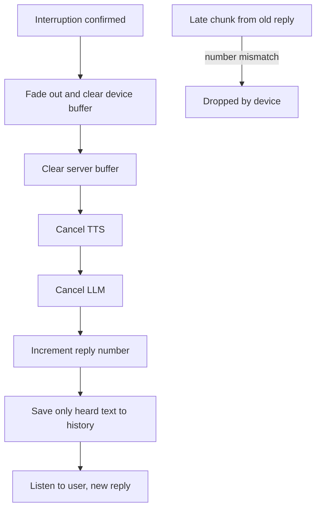

# How does a voice agent stop speaking instantly when interrupted?

> **Step 16: AI Infrastructure, Deployment, and System Design** · ⏱️ 17 min read · [Read original](https://outcomeschool.com/blog/stopping-speech-on-interruption)

## TL;DR
After barge-in is detected, the agent must go silent within a fraction of a second. That means clearing every place its audio waits (device, server, TTS, LLM), ignoring late chunks, and saving only the heard part of the reply. Stopping only the LLM leaves seconds of buffered speech playing.

## Key Concepts
- **Stopping instantly** — voice goes quiet within a fraction of a second of the stop decision.
- **Chunk** — small audio piece (often 20 ms) streamed from server to speaker.
- **Buffers** — LLM text queue, TTS, server buffer, network, device buffer (jitter buffer), telephony platform buffer, speaker.
- **Reply number** — id attached to every chunk of a reply so stale chunks can be dropped.
- **Pacing** — send audio at playback speed with only a small lead ahead.
- **Mark / timestamps** — signals telling how much audio was actually played.

## How It Works
TTS produces audio several times faster than real time, so seconds of already-"said" audio queue up. Stopping only the LLM, or only the server, lets the rest play. Clear from the ear outward (all within milliseconds):

1. **Stop sound at the ear** — app: stop player and empty buffer; phone call: send the platform a "clear" message (e.g. Twilio Media Streams). Fade out over a few ms to avoid a click.
2. **Clear the server buffer** — frameworks often send an interruption message through the pipeline so every stage drops what it holds.
3. **Cancel TTS and LLM** — stops refilling buffers and saves per-token or per-character cost.
4. **Ignore late audio** — chunks already on the network carry reply number 7; after interruption the current reply is 8, so the device plays a chunk only if its number matches the current reply.
5. **Remember only what was heard** — truncate history to the played part using device-played milliseconds, Twilio mark messages, or TTS word timestamps; or OpenAI Realtime `conversation.item.truncate`. Otherwise the LLM thinks the user already heard "1 PM and 5 PM".

### Keep waiting areas small
Pacing keeps about 200 ms ahead on the device; the rest stays on the server where it is cleared instantly. Trade-off: big buffer is smooth but slow to stop; small buffer stops fast but can break up on a slow network.

### Where it fails
Telephony or phone buffers the agent cannot clear, slow networks needing big buffers, no timestamps (only estimates), a pipeline stage that ignores the interruption message, and false barge-ins (so some agents lower volume first).

## Diagram

## Key Takeaways
- Stopping the LLM alone is not enough; audio is queued in many places.
- Clear buffers from nearest-to-ear to farthest.
- Reply numbers kill stale in-flight chunks.
- Truncate conversation history to what was actually played.
- Pacing keeps device buffers small while the server buffer stays easy to drop.
