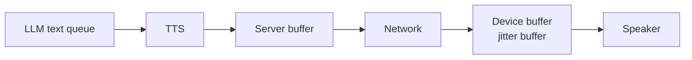
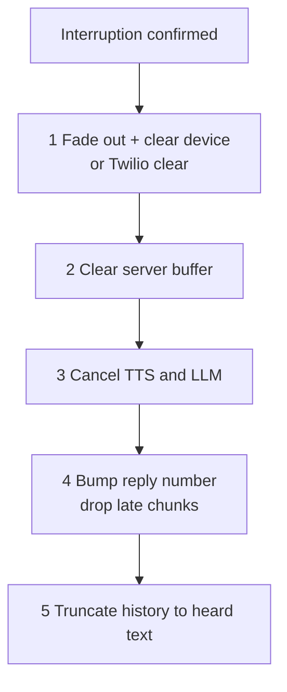

# How does a voice agent stop speaking instantly when interrupted?

> **Step 16: AI Infrastructure, Deployment, and System Design** · ⏱️ 17 min read · [Read original](https://outcomeschool.com/blog/stopping-speech-on-interruption)

## TL;DR
Audio the agent has "said" sits in many buffers between the LLM and the user's ear. To go silent instantly the agent clears every one (nearest the ear first), cancels LLM and TTS work, ignores late chunks via a reply number, and trims memory to what was heard. Keeping buffers small (pacing) makes it easier.

## Key Concepts
- **Barge-in detection** vs **stopping** — detection decides the user is interrupting; this note is what happens next. "Instantly" = quiet within a fraction of a second.
- **Streaming** — LLM writes token by token; TTS starts on first few words; audio in chunks (~20 ms).
- **Buffer** — place where data waits. TTS generates audio faster than playback so extra waits.
- **Jitter buffer** — small deliberate buffer in phone network/browser so sound doesn't break when chunks arrive late (also on the phone platform).
- **Pacing** — server sends audio at playback speed with only a little ahead.
- **Reply number** — id on each reply's chunks to drop stale ones.

## How It Works
### Where audio waits
LLM text queue, TTS (audio being made), server buffer (chunks to send), network (chunks in flight), device buffer (chunks to play), speaker. Together can hold several seconds of "already said" speech.

### Why stopping only the LLM fails
TTS still finishing a sentence, server buffer holds ~2 s, device ~0.5 s, so user hears 2-3 more seconds. Stopping only on the server leaves the device buffer playing. Empty every area, nearest ear first (steps run within ms, but order matters because ear hears first).

### Steps
1. **Stop sound at the ear** — app/browser: stop player, drop chunks. Phone call: send `clear` to the phone platform (e.g. Twilio Media Streams) which holds its own buffer. Fade volume to zero over a few ms to avoid a click from an abrupt cut.
2. **Clear server buffer** — drop chunks waiting. Frameworks send an interruption message through the whole pipeline; every stage drops what it holds and forwards it.
3. **Cancel LLM and TTS requests** — otherwise buffers refill; also saves per-token/character cost.
4. **Reply number** — chunks of reply 7 carry 7; on interruption move to 8 and tell the device; device plays chunk only if `chunk.reply_number == current_reply`. Late in-flight chunks dropped.
5. **Remember only what was heard** — example: LLM wrote "...6 AM, 9 AM, 1 PM, and 5 PM" but user heard to "9 AM"; saving full text makes LLM think 1 PM/5 PM were told. Find played amount: app device counts ms played; phone: send `mark` after chunks, Twilio returns it when audio before it finishes; TTS word timestamps map played time to last heard word. OpenAI Realtime `conversation.item.truncate` takes ms played and removes the rest.

### Keep waiting areas small
Pace the server to send at playback speed with ~200 ms ahead; rest stays on server and can be deleted instantly. Big buffer = smooth on slow network but slow stop; small = fast stop but may break up on slow network. Keep a small device buffer, rest on server.

### Complete example (flight call)
Reply 7 playing; after "9 AM" user says "9 AM works"; fade out and clear device buffer (or `clear`); empty server buffer; cancel TTS and LLM; move to reply 8, late chunk of 7 dropped; device reports 2,400 ms played, map to timestamps, save "We have flights at 6 AM, 9 AM"; send full user sentence to LLM; "Great, I will book the 9 AM flight for you."
```
def on_interruption():
    device.fade_out_and_clear(); server_buffer.clear()
    tts.cancel(); llm.cancel()
    agent.reply_number += 1
    history.save_agent_reply(text_played_so_far())
```

### Diagram




## Trade-offs & Pitfalls
- Works well: controlled devices (browser/app), paced server audio, TTS word timestamps.
- Harder: phone network/handset adds buffers that nothing can clear (tiny extra audio); slow networks need big device buffer; no TTS timestamps (estimate, e.g. equal time per word); a pipeline stage not handling interruption message leaks audio; false barge-in on cough/noise discards reply — hence lowering volume first and stopping fully after confirmation.

## Key Takeaways
- Stopping the LLM alone is never enough.
- Clear buffers from the ear backward, cancel generation, then bump reply number.
- `clear` and `mark` messages manage phone-platform buffers.
- Fade out over a few ms to avoid clicks.
- Truncate memory using played ms plus word timestamps (or `conversation.item.truncate`).
- Pacing keeps most audio on the server, deletable instantly; trade smoothness vs stop speed.
- Early cancellation also saves cost.
