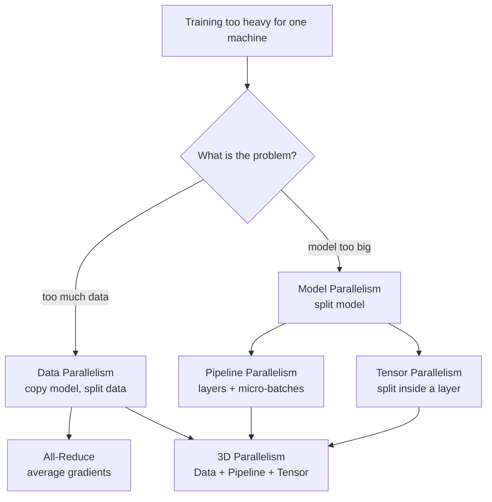
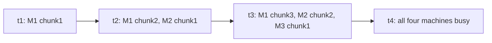

# How does distributed training work?

> **Step 16: AI Infrastructure, Deployment, and System Design** · ⏱️ 19 min read · [Read original](https://outcomeschool.com/blog/distributed-training)

## TL;DR
Distributed Training trains one model across many machines (each usually with several GPUs) so the work is shared. Data Parallelism copies the model and splits the data; Model, Pipeline and Tensor Parallelism split the model itself. Machines stay in sync by averaging gradients with All-Reduce, and the largest models combine all three splits (3D Parallelism).

## Key Concepts
- **Distributed Training** — training a single model on many machines at once; like ten people painting one wall.
- **Why needed** — too slow (trillions of tokens could take months or years on one machine) and too big (hundreds of billions of parameters do not fit in one machine's memory).
- **Single-machine loop** — forward pass, loss, backward pass (gradients), update; repeat per batch.
- **Gradient** — tells each number which way to move to reduce the mistake.
- **Data Parallelism** — full model copy on every machine, different data slice each; fixes "too much data".
- **Model Parallelism** — split the model into pieces on different machines; fixes "too big a model".
- **Pipeline Parallelism** — model split by layers plus micro-batches flowing like an assembly line.
- **Tensor Parallelism** — split the math inside one layer across machines, then combine partial results.
- **All-Reduce** — Reduce = combine values (sum/average); All = result returned to every machine.
- **Pipeline bubble** — idle time while the pipeline fills at the start and empties at the end.
- **Checkpointing** — saving progress regularly to recover from failures.

## How It Works

### Single machine loop
1. Forward pass: feed data, model produces an answer.
2. Loss: compare with correct answer; big loss = very wrong.
3. Backward pass: trace loss back to get gradients.
4. Update: nudge every number slightly in the better direction. Repeat.

### Data Parallelism
- Each machine holds an identical model copy and a different data slice (4 machines, 4 slices); all do forward/backward at once, so 4 slices are processed in the time of 1.
- Each machine's gradients differ (different data). Updating with its own gradients would make the copies drift into different models.

### Staying in sync: gradient averaging
- Average gradients across machines; all apply the same averaged update, so copies stay identical (same as one machine seeing all slices as one big batch).
- Example: gradients 2, 4, 6, 8 give (2+4+6+8)/4 = 5; every machine updates with 5.

### Communication: All-Reduce
- Before: M1=2, M2=4, M3=6, M4=8. After: all = 5.
- Takes network time; machines wait for each other, so a fast network is essential. A slow network means more waiting than computing.

### Model Parallelism
- Assumes the model does not fit on one machine; e.g. layer 1-4 on machines 1-4, output of one is input of the next.
- Problem: only one machine works at a time; the others idle.

### Pipeline Parallelism
- Assembly-line idea: split a batch into micro-batches and feed them continuously so all stages are busy (car-factory analogy: while worker 1 starts car 2, worker 2 works on car 1).
- By t4 all machines are busy on different chunks. Pipeline bubble remains at start/end; reduce it with more, smaller micro-batches.

### Tensor Parallelism
- Used when a single layer is too big for one machine: cut one giant multiplication into pieces, each machine does one, combine the results.
- Pipeline splits between layers; Tensor splits inside a layer.

### 3D Parallelism
| Level | Technique | Splits |
|---|---|---|
| Outermost | Data | many copies of the whole setup, different data |
| Middle | Pipeline | layers across machines |
| Innermost | Tensor | one layer's math across machines |

### Code (PyTorch DDP)
- `model = DDP(MyModel())`, then a nearly normal loop: forward, loss, `loss.backward()`, `optimizer.step()`, `optimizer.zero_grad()`.
- `loss.backward()` triggers All-Reduce automatically.
- Real setup also needs `torch.distributed.init_process_group`, one process per GPU, and a `DistributedSampler` for per-process data slices.

## Diagram(s)

### Which parallelism for which problem

### Pipeline over time

## Trade-offs & Pitfalls
- **Communication cost** — constant gradient exchange; slow network means waiting.
- **Idle machines** — Model Parallelism idles machines; Pipeline reduces it but the bubble remains.
- **Unbalanced split** — one machine with a bigger piece makes the others wait.
- **Failures** — with thousands of machines some fail during long runs; checkpoint regularly to recover without restarting.
- Data Parallelism does not work when the model does not fit on one machine.

## Key Takeaways
- Distributed Training fixes two problems: too slow and too big.
- Data Parallelism = same model everywhere, different data; Model Parallelism = split the model.
- Averaging gradients (All-Reduce) keeps all copies identical.
- Pipeline Parallelism uses micro-batches to avoid idle machines; the bubble shrinks with smaller micro-batches.
- Tensor Parallelism splits inside a layer; Pipeline splits between layers.
- Largest models use 3D Parallelism: Data, Pipeline, Tensor.
- Fast networks and checkpointing are essential at scale.
- PyTorch DDP does All-Reduce automatically during `loss.backward()`.

## Real-World Uses
- LLMs on thousands of GPUs, image/video generation, speech recognition, recommendation systems, scientific models (protein structure, weather).
