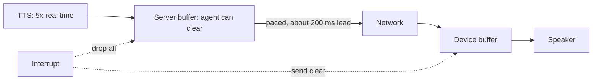

# Why does TTS audio buffering make interruptions slow?

> **Step 16: AI Infrastructure, Deployment, and System Design** · ⏱️ 17 min read · [Read original](https://outcomeschool.com/blog/tts-audio-buffering)

## TL;DR
TTS makes audio much faster than real time, so extra audio piles up in buffers between the server and the speaker. When the user interrupts, whatever sits where the agent cannot clear it keeps playing. Pacing audio at speech speed keeps most of it on the server, where it can be dropped instantly.

## Key Concepts
- **Buffer** — place where data waits before use (like a roof water tank that keeps flowing after you close the pipe).
- **Real time** — 1 second of audio takes 1 second to hear; TTS can run several times faster (example: 5x).
- **Chunk** — small audio piece, e.g. 20 ms on phone calls.
- **Jitter / underrun** — uneven chunk arrival that causes gaps if no buffer exists.
- **Jitter buffer** — small deliberate device buffer (tens to a couple hundred ms).
- **Pacing / lead** — send audio at playback speed; lead is audio sent but not yet played.

## How It Works
### Where audio waits
TTS, then server buffer, then network, then device buffer (plus a telephony platform buffer on calls), then speaker. The agent fully controls only the server buffer; farther is harder to reclaim.

### Delay math (10 s reply, TTS 5x)
- TTS finishes in about 2 s; server sends everything immediately.
- User interrupts at 3 s: heard 3 s, device buffer holds 10 - 3 = 7 s, so up to 7 more seconds of speech if it cannot be cleared.
- With a 0.2 s lead, the device holds only 0.2 s, so at most about 0.2 s of extra speech.

| Approach | Device buffer at 3 s | Extra speech |
|---|---|---|
| Send immediately | 7 s | Up to 7 s |
| 0.2 s ahead | 0.2 s | Up to 0.2 s |

Extra speech after interrupt = audio waiting where the agent cannot clear it. The delay is about buffer location, not LLM or TTS speed.

### Why not zero buffers
Network jitter causes underruns (gaps, clicks, stutter). Big buffer = smooth but slow to stop; small = fast stop but fragile. Goal: small buffers far from the agent, big ones only where the agent can clear them.

### Pacing
TTS runs full speed into the server buffer. The server tracks lead and sends the next chunk only when lead is below target (e.g. 200 ms); first 200 ms goes immediately so playback starts without extra wait. The loop computes `lead = sent_ms - played_ms`.

### Clearing the rest (nearest to farthest)
1. Stop TTS and LLM.
2. Empty server buffer.
3. Tell the device to clear (app message, or telephony "clear").
4. Ignore late chunks via reply number.

Example: interrupt at 3 s drops about 10 - 3 - 0.2 = 6.8 s (6800 ms) on the server before it is ever sent.

### Where it fails
Phone network and platform buffers, weak networks needing a bigger lead, no "clear" support, and clock-guessed playback position drifting.

## Diagram

## Key Takeaways
- TTS being faster than real time is what fills buffers.
- Interruption delay equals audio stranded where it cannot be cleared.
- You cannot remove device buffers; jitter protection needs a few hundred ms at most.
- Pace sends at playback speed so the surplus stays on the server.
- Clear nearest-to-farthest and tag replies with numbers to drop stragglers.
