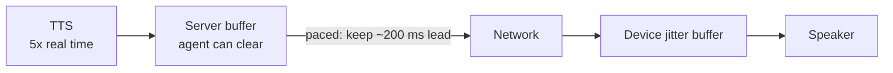

# Why does TTS audio buffering make interruptions slow?

> **Step 16: AI Infrastructure, Deployment, and System Design** · ⏱️ 17 min read · [Read original](https://outcomeschool.com/blog/tts-audio-buffering)

## TL;DR
TTS makes audio several times faster than real time, so extra audio piles up in buffers (server, network, device, telephony platform). On interruption, whatever sits where the agent can't clear keeps playing. Fix: pace audio to playback speed with a small lead (~200 ms) so most audio stays on the server, then clear nearest-to-farthest.

## Key Concepts
- **Buffer** — place data waits (analogy: roof water tank; closing the pipe doesn't empty the tank).
- **Real time** — 1 s audio takes 1 s to hear. Example TTS: 1 s audio in 0.2 s = 5x real time.
- **Chunk** — small audio piece (20 ms on phone calls).
- **Jitter** — uneven chunk arrival; **underrun** — speaker has nothing to play (gap, click, robotic stutter).
- **Jitter buffer** — small deliberate device buffer (tens to a couple hundred ms).
- **Pacing** and **lead** — sending at playback speed; lead = audio sent but not yet played.

## How It Works
### Where extra audio waits
TTS, server buffer (agent fully controls), network (in flight), device buffer, speaker; on phone calls plus the telephony platform's buffer. The farther the audio, the harder to take back.

### Interrupt example
"We have flights at 6 AM, 9 AM, 1 PM, 5 PM, and 9 PM." User says "9 AM works" after "9 AM". Stopping LLM and TTS only leaves "1 PM, 5 PM, 9 PM" in the device buffer playing 2-3 s more; users talk louder/repeat. The delay isn't LLM/TTS slowness but where created audio waits.

### Delay math
Reply 10 s, TTS 5x, server sends immediately: TTS finishes in ~2 s; at the 3 s interruption mark user heard 3 s; device buffer holds 10 - 3 = 7 s, so up to 7 s extra speech.
Rule: extra speech after interrupt = audio waiting where the agent cannot clear it.
| Approach | Device buffer at 3 s | Extra speech |
|---|---|---|
| Send everything immediately | 7 s | up to 7 s |
| Send 0.2 s ahead | 0.2 s | up to 0.2 s |

### Why not remove buffers
Network jitter causes underruns with no buffer. Big buffer = smooth but slow stop; small = fast stop but may break up. Cannot be zero. Goal: small buffers far from the agent, big buffers only where the agent can clear them.

### Fix: pacing
TTS still runs 5x, extra stays in server buffer, released at real time. Server tracks lead; if lead < target (200 ms) send next chunk, else wait. At start lead 0, so the first 200 ms goes at once (no start delay). Server buffer is easiest to clear (agent memory, one step, never sent).

### Clearing what's left (nearest to farthest)
1. Stop TTS and LLM. 2. Empty server buffer. 3. Tell device to clear (app message; telephony "clear"). Late chunks can still arrive, so tag replies with numbers; device drops chunks of stopped reply (e.g. 5).

### Code
Paced sender loop: `CHUNK_MS=20`, `TARGET_LEAD_MS=200`; `lead = sent_ms - played_ms`; if `lead >= target` or buffer empty sleep 5 ms, else pop and send chunk. `on_interrupt`: `tts_task.cancel(); stop_event.set(); dropped_ms = len(server_buffer)*CHUNK_MS; server_buffer.clear(); await device.send_clear()`.
Example: 10 s reply, interrupt at 3 s, TTS done: server buffer holds 10 - 3 - 0.2 = 6.8 s, prints `Dropped 6800 ms`. User hears at most ~0.2 s of old reply. Real systems have the device report actual played time rather than the clock guess.

### Diagram

## Trade-offs & Pitfalls
- Works: agent controls full path (own app); steady network (small lead); TTS much faster than real time (server always has audio).
- Fails: phone network/telephony platform buffers can't be fully cleared; weak network needs bigger lead (slower stop); no "clear" support means sent audio plays out; clock-guessed playback position drifts if playback started late/paused.

## Key Takeaways
- Interruption slowness comes from already-created audio waiting in buffers, not slow models.
- A faster TTS does not help; location of audio does.
- Cannot drop buffers entirely due to jitter/underrun.
- Pace output at real time with ~200 ms lead; keep the rest on the server.
- Clear nearest to farthest and use reply numbers to ignore stragglers.

## FAQ
- Faster TTS faster interrupts? → No.
- Reply numbers? → Drop late chunks from old reply.
- Clear all on phone? → Not always; small delay remains.
