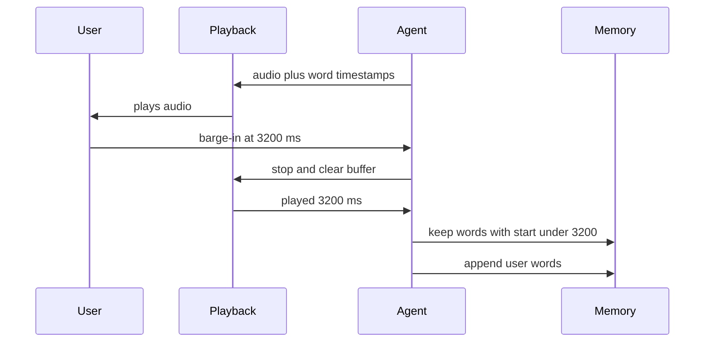

# How does a voice agent truncate its memory to only what the user actually heard?

> **Step 16: AI Infrastructure, Deployment, and System Design** · ⏱️ 17 min read · [Read original](https://outcomeschool.com/blog/truncating-context-on-interruption)

## TL;DR
LLMs write (and TTS generates) a reply far faster than it is spoken, so at barge-in the saved reply is longer than what the user heard. The agent measures played duration at playback, maps it to words via word timestamps (or a character-ratio estimate), and replaces the last agent message with only the heard part.

## Key Concepts
- **Memory / conversation history / context** — full list of turns sent to the LLM each reply; the LLM remembers nothing itself. If the record is wrong, the next reply is wrong.
- **Barge-in** — user interrupts; agent stops.
- **Buffer** — queue where audio waits on device or phone connection.
- **Played duration** = stop time − start time, measured at playback (not at send).
- **Word timestamp** — start time of each word in TTS audio (character timestamps can be converted).
- **Truncation** — cutting the last agent reply to where the user stopped hearing it.

## How It Works
### The problem
Reply: "We have three tables free tonight. One at 7 PM, one at 8 PM, and one at 9 PM. Which one would you like?" User hears to "One at 7 PM," and says "7 PM is perfect." A naive agent saves the full reply, so memory says user heard 8 and 9 PM.

### Why reply is ahead of speech
LLM writes 30 words in 1-2 s; speaking takes ~12 s. TTS makes audio faster than it plays; audio waits in buffer. (Real systems stream/overlap, still generation >> playback.) Pipeline: LLM ~1 s, TTS ~2 s, buffer, speaker ~12 s. Only the played part reached the user.

### What goes wrong without truncation
1. Assumes the user knows something: later "Do you have anything later?" and the agent says "As I said, 8 PM and 9 PM".
2. Misreads the answer: "Your total is 500 rupees. Shall I confirm the order?" User interrupts after the total with "Yes" (meaning understood); memory has the question, so it places the order (costly).
3. Skips information: planned "Please bring an ID card" never heard, but thinks it said it.

### Played time to words
Played duration example: start 12.0 s, stop 15.2 s = 3200 ms. Timestamps: We 0, have 200, three 400, tables 700, free 1100, tonight. 1400, One 2100, at 2400, 7 2600, PM, 2900, one 3400 ... Keep words with start < 3200: "We have three tables free tonight. One at 7 PM," ("one" at 3400 excluded). No timestamps: assume steady speed; 3 of 10 s played = keep first ~30% of characters. Less accurate but far better than the full reply.

### Steps
1. Stop audio, clear buffer, stop LLM and TTS. 2. Playback reports played duration. 3. Keep words started before it. 4. Replace last reply in memory. 5. Append user's words; LLM replies from corrected memory.
```
def truncate_reply(words, played_ms):
    heard = []
    for word, start_ms in words:
        if start_ms < played_ms: heard.append(word)
        else: break
    return " ".join(heard)
def on_barge_in(memory, words, played_ms):
    memory[-1] = {"role": "assistant", "content": truncate_reply(words, played_ms)}
```
Optional marker "[interrupted by the user]" so the LLM knows the reply was unfinished. Alternative: append words to memory only as they're played.

### Walkthrough
Memory ends up: User "Four people." / Agent "We have three tables free tonight. One at 7 PM," / User "7 PM is perfect." LLM replies "Great. Let me book a table for four people at 7 PM tonight." Agent can offer 8/9 PM later as new info.

### Speech-to-speech APIs
Models also generate faster than play. OpenAI Realtime `conversation.item.truncate` takes `item_id`, `content_index`, `audio_end_ms`; cuts the audio after that and (per docs) deletes the server-side transcript text of the cut part so no unheard text remains in context. Errors if `audio_end_ms` exceeds actual audio. The API can't know played time; the client playback side must measure and send it.

### Diagram


## Trade-offs & Pitfalls (edge cases)
- Word cut mid-way ("toni"): keep if it started before stop (keeps more) vs only if it finished (never saves unheard text).
- Not a real interruption (cough, noise, "uh-huh") and reply continues: do not truncate; only when the reply stopped for good.
- Playback time inexact on phone calls (network/line); measure as close to the user as possible.
- Tool action in the same reply (e.g. booking): check if it ran; memory must record the result even if unheard, so the agent can tell the user next.

## Key Takeaways
- Memory must equal what the user heard, not what was generated.
- Generation outpaces speech, so there is always a gap at barge-in.
- Measure played duration at playback, map via word timestamps, estimate by character ratio if absent.
- Without truncation: false assumptions, misread "yes", skipped info.
- Realtime APIs offer truncate events; client must supply played ms.
- Don't truncate on false interruptions; handle tool side effects separately.
