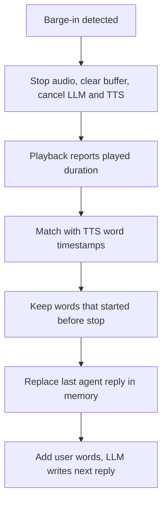

# How does a voice agent truncate its memory to only what the user actually heard?

> **Step 16: AI Infrastructure, Deployment, and System Design** · ⏱️ 17 min read · [Read original](https://outcomeschool.com/blog/truncating-context-on-interruption)

## TL;DR
The LLM writes and TTS generates a reply far faster than the speaker plays it, so at barge-in the memory holds more than the user heard. The agent measures played time, maps it to words via TTS timestamps, and cuts the saved reply so memory matches the user's experience.

## Key Concepts
- **Memory / context** — the conversation list sent to the LLM each turn; the LLM remembers nothing itself.
- **Truncation** — cutting the last agent reply so it ends where the user stopped hearing.
- **Played duration** — stop time minus start time, measured at playback, not send time.
- **Word timestamps** — TTS output giving each word's start time (or per character, from which words are built).
- **`conversation.item.truncate`** — OpenAI Realtime API event with `item_id`, `content_index`, `audio_end_ms`.

## How It Works
### Why memory outruns speech
LLM writes ~30 words in 1-2 s; speaking them takes ~12 s. TTS audio is generated faster than it plays and waits in buffers. At barge-in, generated is greater than played.

### What breaks without truncation
1. Agent assumes the user knows things (offered 8 PM and 9 PM, user never heard).
2. Misread answers: user cuts in with "Yes" after "Your total is 500 rupees" but memory contains "Shall I confirm the order?", so it places the order.
3. Skipped info: "Please bring an ID card" was never heard but is considered said.

### Time to words
Example: playback started at 12.0 s, stopped at 15.2 s, so 3200 ms played. Keep words whose start is below 3200 ms. "...One at 7 PM," kept; "one" at 3400 ms dropped. Without timestamps, estimate by proportion (3 of 10 s played means keep roughly the first 30 percent of characters).

### Steps on barge-in
1. Stop audio, clear buffer, stop LLM and TTS.
2. Playback side reports played ms.
3. Keep words that started before that.
4. Replace the last agent reply in memory.
5. Add the user's new words; LLM replies from corrected memory.

```python
def truncate_reply(words, played_ms):
    heard = []
    for word, start_ms in words:
        if start_ms < played_ms: heard.append(word)
        else: break
    return " ".join(heard)
```
Optionally append a marker like "[interrupted by the user]", or alternatively add words to memory only as they are played.

### Speech-to-speech
Same issue; the API cannot know playback progress, so the client sends `audio_end_ms`. The API cuts the audio and deletes the unheard server-side transcript; a value longer than the actual audio errors.

### Edge cases
- Word cut mid-way: keep if started (more words) or only if finished (strict).
- Non-real interruption (cough) that resumes: do not truncate.
- Playback time inexact over phone lines; measure as close to the user as possible.
- Tool action in the reply: memory must record the action result even if the sentence about it was unheard.

## Diagram


## Key Takeaways
- The LLM trusts its memory, so memory must equal what the user heard.
- Measure played time at the playback point, not when audio was sent.
- Word timestamps turn milliseconds into a text cut-off.
- Wrong memory causes false assumptions, wrong confirmations, and skipped information.
- Do not truncate on false interruptions; and record tool-action results regardless.
