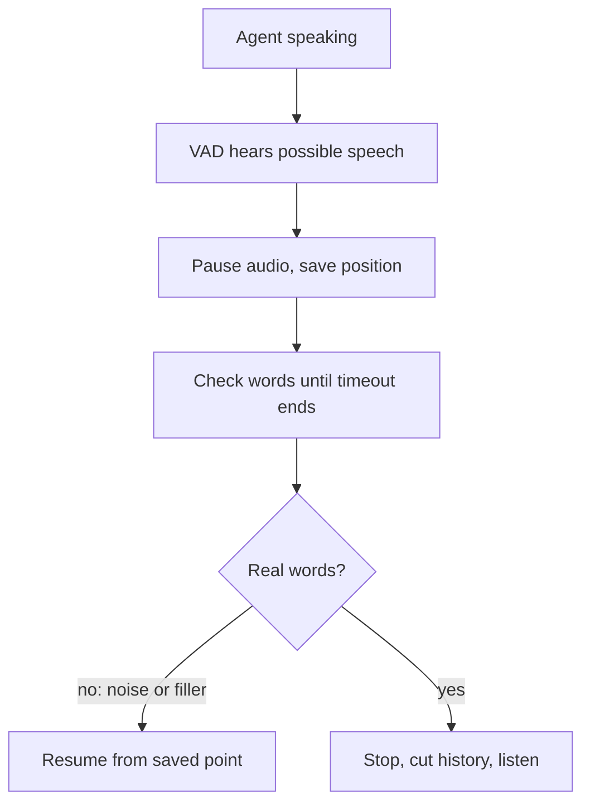

# How does a voice agent recover from a false interruption?

> **Step 16: AI Infrastructure, Deployment, and System Design** · ⏱️ 15 min read · [Read original](https://outcomeschool.com/blog/false-interruption-recovery)

## TL;DR
Coughs, "hmm", noise, or echo can look like barge-in. Instead of stopping and discarding its reply, the agent pauses, keeps the rest ready, waits a short timeout to see if real words follow, and either resumes from the exact paused point or converts the pause into a real stop.

## Key Concepts
- **False interruption** — agent thinks the user wants to take over, but they did not.
- **Pause vs stop** — pause keeps the rest of the reply waiting; stop discards it.
- **False interruption timeout** — post-sound wait before declaring it false (LiveKit Agents default: 2 s).
- **Backchannel** — "uh-huh", "okay", "hmm" filler meaning "continue".
- **Played position** — how much audio has been played, mapped to words via TTS timestamps.

## How It Works
### Without recovery
Bank agent: "...Then, tap on Reset PIN and..." user coughs, agent stops and discards the answer, user hears silence and says "Hello? Are you there?" Costs: lost steps, awkward silence, repeat question, extra generation cost.

### Evolution of approaches
1. Stop and throw away — a cough loses the answer.
2. Stop, then regenerate — slow, and repeats the start.
3. **Pause and hold** — pause audio instantly, keep the rest ready; resume if false, stop if real.

### Deciding it was false
During the timeout check:
1. Did speech continue (VAD)? A fraction of a second then silence is often not real.
2. Real words from STT? None suggests cough or bang.
3. Only filler? "uh-huh", "okay", "yeah", "hmm" means false; filler followed by more ("okay, but what about my old card?") means real.

Newer systems use a small audio model that classifies the sound without waiting for text.

### Continuing
Track played audio position, matched to words via TTS timestamps. Pause at "...Reset PIN and", resume with "...enter your new PIN twice." Nothing is regenerated. Optionally step back to the start of the sentence to avoid a half-cut word. Resuming requires output that supports pause; play/stop-only outputs (e.g. some avatar video setups) must fall back to stopping.

### If it is real
On real non-filler words ("Wait, I do not have the app"), no need to wait out the timeout: stop for good, discard the rest, cut history, listen, send to the LLM.

### History
False: full reply goes into history. Real: cut history at the stop point, else the LLM later says "As I mentioned, enter your PIN twice."

### Walkthrough (timeout 2 s)
Cough at 0.0 s, pause, ends 0.3 s, timeout starts, no words, ends 2.3 s, resume, save full reply.

### Tuning
Too short: resumes while the user is about to speak (rude). Too long: awkward silence after a cough. Also set a minimum speech length, minimum word count, and echo cancellation; test with real noise.

## Diagram

## Key Takeaways
- Pause, do not stop; stopping discards the whole reply.
- A short timeout plus VAD, STT words, and filler checks separates false from real.
- Resume from the tracked audio position without regenerating.
- A real interruption turns the pause into a stop and truncates history.
- Tune the timeout against real noise; too short is rude, too long feels frozen.
