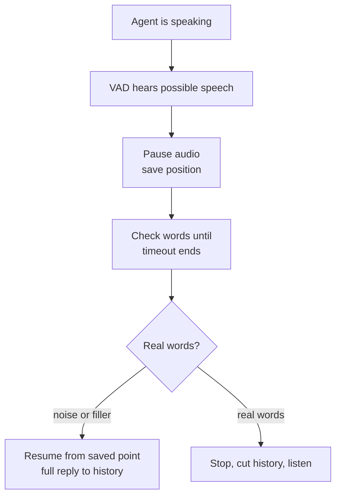

# How does a voice agent recover from a false interruption?

> **Step 16: AI Infrastructure, Deployment, and System Design** · ⏱️ 15 min read · [Read original](https://outcomeschool.com/blog/false-interruption-recovery)

## TL;DR
On any possible interruption the agent pauses (not stops), keeping the rest of its reply ready. It waits a short false interruption timeout, checks for real speech/words, and then either resumes from the saved position (false) or stops for good, trims history, and listens (real).

## Key Concepts
- **Barge-in** — user talks over the agent; agent keeps listening while speaking to support it.
- **False interruption** — agent thinks the user is taking over, but they didn't mean to. Causes: cough/sneeze/throat clear; "uh-huh", "okay", "hmm"; door/dog/car honk; someone else talking; TV/radio; the agent's own echo.
- **Pause vs stop** — stopping loses the rest of the reply; pausing keeps it waiting.
- **False interruption timeout** — wait after sound ends before declaring false (LiveKit Agents default 2 s).
- **Backchannel** — "uh-huh/okay/yeah/hmm" listening signals.

## How It Works
### What goes wrong without recovery
Bank agent: "...tap on Reset PIN and..." user coughs; simple agent stops and discards the rest; waits; silence; user says "Hello? Are you there?". Result: steps never heard, awkward silence, user repeats, extra time and cost to regenerate.

### Approaches
1. Stop and throw away — a cough loses the whole answer.
2. Stop then regenerate — slow, repeats the start of the old reply.
3. **Pause and hold** — pause audio on possible interruption, keep reply ready; false: continue; real: stop for good. (Analogy: reading a story aloud and a friend sneezes.)

### Deciding it was false (during the timeout)
1. VAD: did speech last only a fraction of a second then stop?
2. STT: any real words? None means cough/bang/noise.
3. Filler-only ("uh-huh", "okay", "yeah", "hmm")? Backchannel. But filler + more words ("okay, but what about my old card?") is real, hence the wait instead of deciding on the first word.
Newer systems use a small audio model separating real barge-in from coughs/backchannels without waiting for text. If quiet or filler only until timeout ends, mark false.

### Continuing from the right place
Agent tracks played audio position; many TTS models give per-word times so audio position maps to a word. Example: paused after "Then, tap on Reset PIN and", resumes "...enter your new PIN twice." No regeneration; user hears a short gap. Option: step back and repeat the start of the current sentence to avoid a half-cut word. Note: requires audio output that supports pausing; play/stop-only outputs (e.g. some talking-avatar video setups) must fall back to stopping.

### When it's real
"Wait, I do not have the app." Real non-filler words, so no need to wait the timeout: stop paused audio for good, discard rest, cut history at the stop point, listen to full message, send to LLM.

### History
False: full reply finished and saved. Real: cut reply to where it stopped; otherwise LLM later says "As I mentioned, enter your PIN twice". Played-position tracking serves both resume and history.

### Example (timeout 2 s)
t=0 user coughs, VAD flags possible speech; agent pauses at "...Reset PIN and"; t=0.3 s cough ends, start 2 s timeout; no words, quiet; t=2.3 s marked false; resume "...enter your new PIN twice."; full reply to history.

### Diagram

## Trade-offs & Pitfalls (tuning the timeout)
- Too short: resumes too quickly, talks over a user who breathes before or whose words take a moment to transcribe (rude).
- Too long: long silence after a cough; user thinks agent froze.
- Helpers: minimum speech length (taps on a table don't even pause); minimum word count (single filler isn't an interruption); echo cancellation (agent's own voice doesn't trigger pause).
- Test with real users and noise: quiet office vs busy street.

## Key Takeaways
- Pause, don't stop: keeps the reply and avoids regenerating.
- Decide via VAD duration, STT words, filler detection within a timeout.
- Track played position to resume and to keep history accurate.
- Real interruption: pause becomes stop, history cut.
- Timeout trade-off: rude interruptions vs awkward gaps.
- Some outputs cannot pause; need fallback.
- Use echo cancellation to avoid self-triggering.
