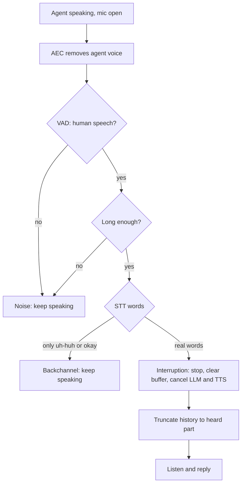

# How does a voice agent handle the user and agent talking at the same time?

> **Step 16: AI Infrastructure, Deployment, and System Design** · ⏱️ 17 min read · [Read original](https://outcomeschool.com/blog/overlapping-speech-in-voice-agents)

## TL;DR
Overlapping speech is both sides talking at once. A half-duplex STT/LLM/TTS agent ignores the user while speaking, so it must instead keep listening, cancel its own echo, classify the overlap, act, and fix its history. Full-duplex models learn all of this inside one model.

## Key Concepts
- **Half-duplex** — one side talks at a time; the baseline agent is deaf while speaking.
- **AEC** — subtracts the known agent audio from the mic signal.
- **Soft stop** — lower volume or pause first, cancel only if confirmed.
- **"User always wins"** — rule when both start together: agent stops, user gets the turn.
- **Full-duplex model** — one model, two parallel audio streams (Moshi, about 80 ms steps).

## How It Works
### Four kinds of overlap
| Kind | Example | Agent action |
|---|---|---|
| Interruption | "Wait, I already did that." | Stop and listen |
| Backchannel | "uh-huh", "okay" | Keep speaking |
| Noise and echo | Cough, TV, own voice | Ignore |
| Both start together | Collision | Stop, give user the turn |

### Five steps
1. **Keep listening while speaking** — output stream (to speaker) and input stream (mic) both flow; input goes to a detector.
2. **Remove the agent's own voice** — AEC (often provided by the phone platform or browser; make sure it is on). Imperfect due to room bounce.
3. **Classify in layers**:
   - VAD: any human speech?
   - Duration: minimum (e.g. 200-300 ms) so coughs and "hmm" are ignored.
   - Words: STT; backchannel words vs "wait", "no", "stop", or a sentence (adds delay).
   - Context: if the agent just asked "Is that correct?", "yeah" is a real answer.
4. **Act** — noise: continue. Backchannel: continue and do not add it as a user turn. Interruption: stop audio, clear buffer, cancel LLM and TTS, listen to the full sentence; aim for a stop within a few hundred ms. Soft stop avoids discarding the reply on false alarms.
5. **Keep history correct** — LLM wrote the full sentence, user heard part; cut saved reply to the played portion using word timestamps (e.g. headphones never heard), optionally note the interruption.

### Simultaneous start
User always wins: the user's words are new information while the agent can repeat itself. Waiting slightly longer after natural pauses before the next sentence gives the user an opening.

### Full-duplex
Moshi models user and its own audio as two streams at every step, so there are no explicit turns, no separate VAD or hand rules; it learns stopping, backchannels, and overlap from conversation data. Cost: harder to control and debug.

### Failure points
Weak AEC on loud speakerphones, other people talking, "yeah" as a real answer, mistuned minimum speech time (too high is slow, too low stops for coughs), and forgetting to cut history.

## Diagram

## Key Takeaways
- A deaf-while-speaking agent loses user words; keep the mic open.
- AEC is a prerequisite or the agent interrupts itself.
- Classify overlap by speech, duration, words, then context.
- On stop, clear buffers and cancel upstream, then truncate history.
- When both start at once, the user wins.
