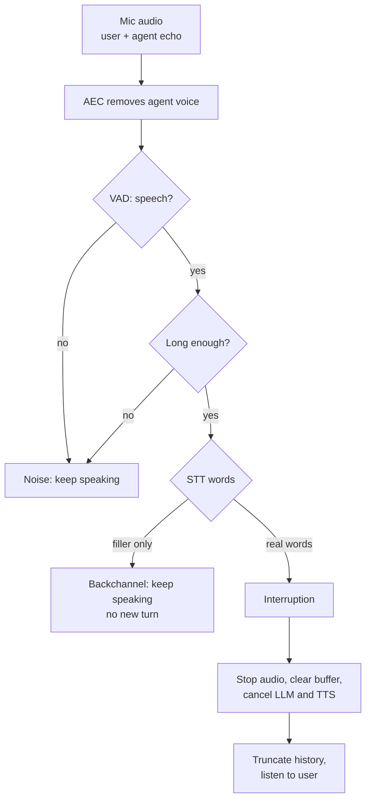

# How does a voice agent handle the user and agent talking at the same time?

> **Step 16: AI Infrastructure, Deployment, and System Design** · ⏱️ 17 min read · [Read original](https://outcomeschool.com/blog/overlapping-speech-in-voice-agents)

## TL;DR
The agent keeps listening while it speaks, removes its own voice with AEC, classifies the overlap (interruption, backchannel, noise/echo, simultaneous start) in layers, then acts: continue or stop-and-yield, trimming history to what was heard. Full-duplex models learn all this inside one model.

## Key Concepts
- **Overlapping speech** — user and agent speaking simultaneously (e.g. "...a charger" then "Wait, I want to cancel the charger").
- **Half-duplex relay race** — STT, LLM, TTS in turns; not listening while speaking, so user words are lost.
- **Input stream / output stream** — mic audio vs agent audio to speaker.
- **AEC** — subtract the known outgoing audio (predicted as it returns via mic).
- **Soft stop** — lower volume/pause first, cancel only if confirmed.
- **Full-duplex** — single model, both sides at once (Moshi, Kyutai).

## How It Works
Listening while speaking raises three problems: mic picks up the agent's voice; not every sound means stop; after stopping, must know what the user heard.

### Kinds of overlap
| Kind | Example | Action |
|---|---|---|
| Interruption (barge-in) | "Wait, I already did that." | Stop and listen |
| Backchannel | "uh-huh", "okay", "right" | Keep speaking |
| Noise and echo | cough, dog, TV, own voice | Ignore |
| Both start together | collide after a pause | Stop, give turn to user |

### Step 1: Keep listening
Mic open throughout; input stream feeds the detector while the output plays.

### Step 2: Remove own voice
Otherwise the agent stops itself mid-sentence. AEC subtracts the known copy; imperfect (room bounce) but removes most echo. Often provided by phone/calling platform or browser; make sure it's on.

### Step 3: Classify (layers)
1. VAD score per few-tens-of-ms piece (door slam/beep low).
2. Minimum duration (~200-300 ms) — coughs/short "hmm" ignored.
3. Words via STT: only "uh-huh/yeah/okay/right" = backchannel; "wait/no/stop"/real sentence = interruption (adds delay).
4. Context: small model on what agent said; after "Is that correct?", "yeah" is a real answer.
```
def classify_overlap(audio, agent_is_speaking):
    if not agent_is_speaking: return "normal_turn"
    if vad_score(audio) < 0.5: return "noise"
    if speech_duration(audio) < 0.3: return "noise"
    words = transcribe(audio).lower().strip()
    if words in ["uh-huh","yeah","okay","right","mm-hmm"]: return "backchannel"
    return "interruption"
```
Thresholds illustrative; layer 4 omitted from code.

### Step 4: Act
Noise: keep speaking. Backchannel: keep speaking, don't add as a user turn (LLM would reply). Interruption: stop audio and clear buffer, cancel LLM, cancel TTS, listen as new turn. Forgetting the buffer lets a few more words play; aim to stop within a few hundred ms. Soft stop: lower volume/pause on first speech; continue if cough/backchannel, cancel if real; waits for layer 3 words.

### Step 5: History
LLM wrote "...a phone case, a charger, and a pair of headphones." User heard to "a charger"; saving all makes the LLM later say "As I mentioned, the headphones...". Cut to played part using played audio tracking and per-word TTS timestamps; optionally note the agent was interrupted.

### Simultaneous start
Same detection as interruption. Rule: the user wins (user words are new info; agent can repeat; continue old point only if needed). Reduce collisions by waiting slightly longer after a natural pause before the next sentence, giving the user a window.

### Full-duplex models
Moshi models user and own audio as two parallel streams processed together every ~80 ms; no explicit turns, no separate VAD or hand rules; learns from conversation data when to stop, backchannel, or overlap.
| Point | Relay design | Full-duplex |
|---|---|---|
| Listening while speaking | Added with AEC and VAD | Built in |
| Stop or continue | Rules / small models | Learned |
| Backchannels | Word lists / model | Learned |
| Control | Easy to control and debug | Harder |

### Example (router)
AEC prevents self-stop; "okay" after "wait for thirty seconds" = backchannel, continue, not a turn; "Wait, which light should be green?" long enough with real question = interruption; stop, clear buffer, cancel LLM/TTS; save "First, unplug the router. Then, wait for thirty seconds. After that, plug it back in"; reply "The power light should be green."

### Diagram


## Trade-offs & Pitfalls
- Works: clean audio and good AEC; clear interruptions ("wait", "no, not that"); common backchannels.
- Fails: weak AEC (loud speakerphone) so agent stops itself; another person in the room mistaken for user; real "yeah" answer treated as backchannel; min speech time too high (slow stop) or too low (stops for coughs); forgetting to cut history.

## Key Takeaways
- Half-duplex agents can't hear overlap; must listen while speaking.
- AEC first, else the agent interrupts itself.
- Classify in layers: VAD, duration, words, context.
- Noise and backchannels continue; interruptions stop everything (speaker, buffer, LLM, TTS).
- User wins collisions.
- Truncate history to what was heard; never add backchannels as turns.
- Full-duplex models learn overlap handling end to end but are harder to control.

## FAQ
- Is "yeah" always a backchannel? → No; after "Is that correct?" it's an answer.
- Soft stop? → Lower volume/pause first, cancel only if real.
- How fast to stop? → Within a few hundred ms; clear buffer.
