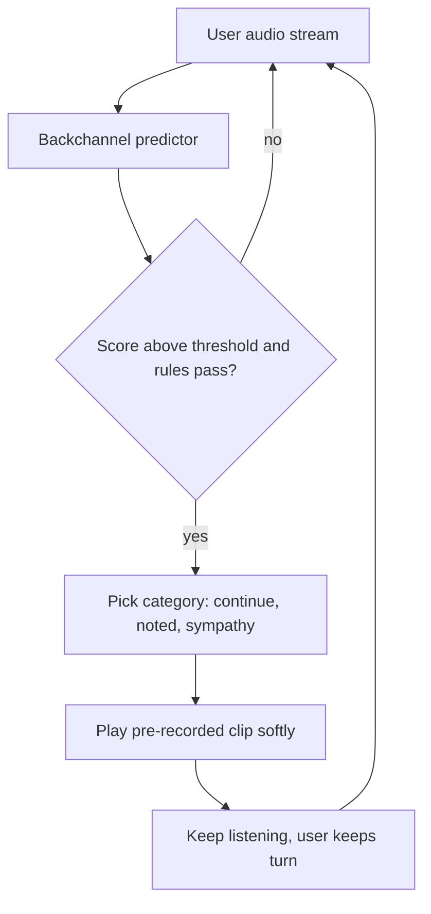

# How does a voice agent add its own backchannels like "okay" and "got it"?

> **Step 16: AI Infrastructure, Deployment, and System Design** · ⏱️ 17 min read · [Read original](https://outcomeschool.com/blog/agent-side-backchannels)

## TL;DR
A silent agent feels like a dead line. Agents add listening signals via a fast side path next to the main STT/LLM/TTS chain: a predictor picks the moment, rules pick the sound, pre-recorded clips play it softly without taking the turn. Quick acknowledgments after the user finishes cover lookup latency.

## Key Concepts
- **Backchannel** — short listener sound that does not take the turn ("mm-hmm", "okay", "got it").
- **Continuer** — "mm-hmm"/"uh-huh", which invite the speaker to continue.
- **Acknowledgment** — "Got it, let me check" after the user finishes; strictly not a pure backchannel since the agent takes the turn.
- **Backchannel predictor** — small model scoring each audio slice 0 to 1 for "good moment."
- **Pre-recorded clips** — instant playback, several variants per sound, same TTS voice.

## How It Works
### Two kinds
| Property | While user talks | After user finishes |
|---|---|---|
| Example | "mm-hmm", "okay" | "Got it.", "Okay, let me check." |
| Meaning | Continue | Answer coming |
| Turn | User keeps it | Agent takes it |
| Challenge | Timing without interrupting | Covering wait |

### Side path (3 jobs, runs continuously)
The main chain is too slow; a "mm-hmm" two seconds late sounds odd.
1. **When** — cues: pitch drop at phrase end, very short pause (under about 0.5 s), complete chunk of meaning. Predictor scores (e.g. 0.82 after "arrived yesterday", 0.03 after "but"); threshold such as 0.7. Trained on recorded human conversations (some models predict who speaks next). Rules: not too often, not too early (1-2 s of speech), not at the end of a question.
2. **What** — by context: story gets "mm-hmm"; number or name gets "got it"; bad news gets a soft "oh, I see". Word rules or a small classifier (continue, noted, sympathy). Use pre-recorded clips with variants, not LLM+TTS.
3. **How to play** — listening never stops; turn does not change; low volume; usually not added to LLM history.

### Not interrupting itself
Barge-in monitors audio, including during its own clip. On speakerphone the clip echoes back. Fixes: echo cancellation, raise the speech bar during the clip window, and strip STT text that matches the clip.

### Acknowledgment after user finishes
A lookup may take 2-3 s. Way 1: fixed pre-recorded phrase on end-of-turn ("Got it."), and "Let me check that." while a tool runs. Way 2: instruct the LLM to start with a short acknowledgment so streaming TTS speaks it while the rest is generated. Keep it neutral ("Okay, one moment") if unsure; never promise understanding then ask for repeats.

### Full-duplex
Moshi-like models decide at each step between silence, "mm-hmm", or speech; natural timing and tone, but harder to control (no simple "once per 4 s" rule).

### Failure modes
Mistimed mid-sentence "mm-hmm", too frequent, wrong tone, echo, thinking pauses causing early backchannel or turn-taking, false "Got it".

## Diagram

## Key Takeaways
- Without small sounds, a phone call feels dead.
- Backchannels run on a separate fast path, not through LLM and TTS.
- Predictor finds the moment; context picks the sound; rules limit frequency.
- Playing a backchannel must not change the turn, stop listening, or enter history.
- Post-turn acknowledgments mask latency but must stay truthful.
