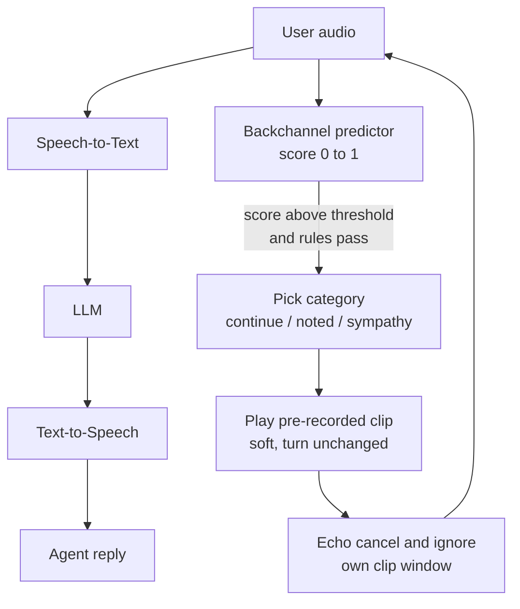
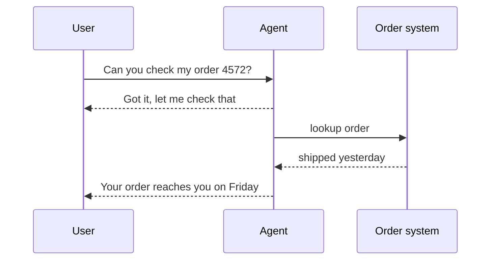

# How does a voice agent add its own backchannels like "okay" and "got it"?

> **Step 16: AI Infrastructure, Deployment, and System Design** · ⏱️ 16 min read · [Read original](https://outcomeschool.com/blog/agent-side-backchannels)

## TL;DR
A voice agent runs a fast, separate path next to the main STT → LLM → TTS chain. It predicts the tiny moments where a listener would say "mm-hmm" and plays a pre-recorded clip without taking the turn. It also says a quick "Got it" right after the user finishes, so the user knows they were heard while the real answer is still being prepared. A silent agent feels like a dead line.

## Key Concepts
- **Backchannel** — short sound or word ("mm-hmm", "uh-huh", "yeah", "okay", "right", "got it") said while the other person talks, to show listening without taking the turn.
- **Continuer** — research term for "mm-hmm"/"uh-huh": they ask the speaker to continue.
- **Backchannel predictor** — small model scoring every audio slice 0–1 for "good moment for a backchannel?".
- **Acknowledgment** — "Got it, let me check" after the user finishes; the agent takes the turn, so strictly not a pure backchannel.
- **Barge-in** — user speaks while the agent talks, so the agent stops and listens.
- **Echo cancellation** — subtracts the agent's own played audio from the microphone signal.
- **Full-duplex model** — listens and speaks at the same time on parallel audio streams (e.g. Moshi from Kyutai).

## How It Works

### Why silence feels broken
- On a phone call there is no face or nodding, so small sounds are the only proof of listening.
- Example: user talks 15 s about a cracked phone screen and a missing charger. With no response the user asks "Hello? Are you there?". A soft "mm-hmm" after "the box arrived yesterday" and "okay" after "the screen was cracked" fixes it.

### Two kinds of backchannels
| Property | While user talks | After user finishes |
|---|---|---|
| Example | "mm-hmm", "uh-huh", "okay" | "Got it.", "Okay, let me check." |
| Meaning | Please continue | I heard you, answer is coming |
| Turn owner | User | Agent takes the turn |
| Volume/length | Soft, very short | Normal voice, short phrase |
| Main challenge | Timing without interrupting | Covering the waiting time |

### The separate backchannel path
The main chain (STT → LLM → TTS) takes time per step, and a "mm-hmm" two seconds late sounds strange. So a fast path runs continuously while the user talks, with three jobs: decide when, decide what, play it without disturbing the conversation.

### Job 1: when to say "mm-hmm"
- Voice clues at a good moment: pitch drops at end of phrase, a very short pause (under half a second), a complete piece of meaning.
- The predictor scores each slice. Example: "I ordered a phone" 0.05, "last week," 0.40, "and the box" 0.08, "arrived yesterday," 0.82, "but" 0.03. Threshold e.g. 0.7, so it fires after "arrived yesterday".
- Trained on recorded human conversations where real "mm-hmm" positions are known. Some models predict who speaks in the next couple of seconds; a short listener burst means a backchannel moment.
- Rules on top of the score:
  - Do not repeat if one was said in the last few seconds.
  - Do not fire too early (user has spoken only 1–2 s).
  - Do not fire at the end of a question; the user expects a real answer.

### Job 2: which sound
- Long story → "mm-hmm"/"uh-huh" (just continue).
- Important fact, e.g. order number → "okay"/"got it" (noted).
- Bad news → soft "oh, I see", not a cheerful "okay".
- Chosen by rules over latest STT words (number or name → "got it", else "mm-hmm") or a small classifier on words plus tone: continue / noted / sympathy. Some research models predict timing and type together.
- Sound source: pre-recorded clips generated earlier with the agent's own TTS voice, several versions each (continue: mm-hmm x3, uh-huh x2; noted: okay x3, got it x2; sympathy: oh I see x2), so it never repeats the same clip. Held in memory, played instantly. Never goes through LLM+TTS (too slow).

### Job 3: playing without losing the turn
- STT and the predictor keep running during the clip.
- Turn state still says "user is speaking"; the clip starts no reply.
- Played softer so it sits under the user's speech.
- Usually not added to LLM history (noise).

### Avoiding self-interruption
The agent's own "mm-hmm" can leak from speaker to mic (speakerphone) and look like user speech, triggering false barge-in. Fixes:
- Echo cancellation (agent knows what it just played, subtracts it).
- Raise the speech-detection bar during the clip's time window.
- Remove "mm-hmm" from the transcript if STT wrote it while the clip played.

### Kind 2: "Got it" after the user finishes
Example: "Can you check the status of my order 4572?" → STT, LLM, order lookup, TTS can take 2–3 s or more. The agent immediately says "Got it, let me check that for you." while work continues, then "Your order was shipped yesterday and will reach you on Friday." Two ways:
1. **Fixed phrase** from a small list, played as soon as end of turn is detected ("Okay.", "Got it."). Later, when the LLM triggers a lookup, another phrase ("Let me check that.") covers the tool wait.
2. **LLM starts with a short acknowledgment.** TTS speaks the first words as tokens arrive ("Sure, let me check.") while the rest generates.

The acknowledgment must never promise something false. If unsure the request was understood, use neutral "Okay, one moment".

### Full-duplex models
- Work directly on audio with two parallel streams (user, own) in small time steps; at each step the model outputs silence, a soft "mm-hmm", or speech.
- Learn backchannels from real two-person conversations, no separate predictor.
- Pro: timing and tone come from the same model that understands the conversation, often more natural.
- Con: harder to control. A separate path allows explicit rules ("not more than once every 4 seconds"); a full-duplex model's behavior comes from training, so changing it often needs more training.

### Diagram: two paths

### Diagram: acknowledgment timeline

## Trade-offs & Pitfalls
Works well: long explanations, collecting details (order numbers, addresses), slow lookups.
Fails when:
- Wrong timing (mid-sentence "mm-hmm" feels like interruption; user stops).
- Too many backchannels (every 2 s sounds fake).
- Wrong sound for the mood (cheerful "okay" after bad news).
- Poor echo cancellation (hears own "mm-hmm" as user).
- Thinking pauses (predictor or full-duplex model may backchannel or take the turn too early).
- False acknowledgments ("Got it" then asking to repeat everything loses trust).

## FAQ
- Does "mm-hmm" go through the LLM? → No, too late; pre-recorded clips in the agent's TTS voice are played instantly.
- Add backchannels to history? → No, they don't change the turn and only add noise.
- How often? → Not often: wait after a recent one, stay quiet in the first 1–2 s.
- "Okay, one moment" vs "Got it"? → Neutral is safer when understanding is uncertain.

## Key Takeaways
- A backchannel is not a turn; the speaker keeps talking.
- Backchannels need a fast separate path, not the full STT-LLM-TTS chain.
- A predictor scores slices from pitch drop, short pause, and complete meaning; thresholds plus anti-repeat rules gate it.
- Sounds are pre-recorded, multi-version clips matched to context (continue, noted, sympathy).
- Echo cancellation and clip-window handling prevent false barge-in.
- A quick, truthful "Got it/let me check" masks the wait after the user finishes.
- Full-duplex models learn backchannels end to end: more natural, less controllable.
