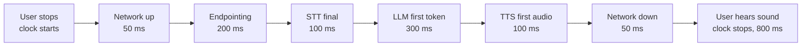
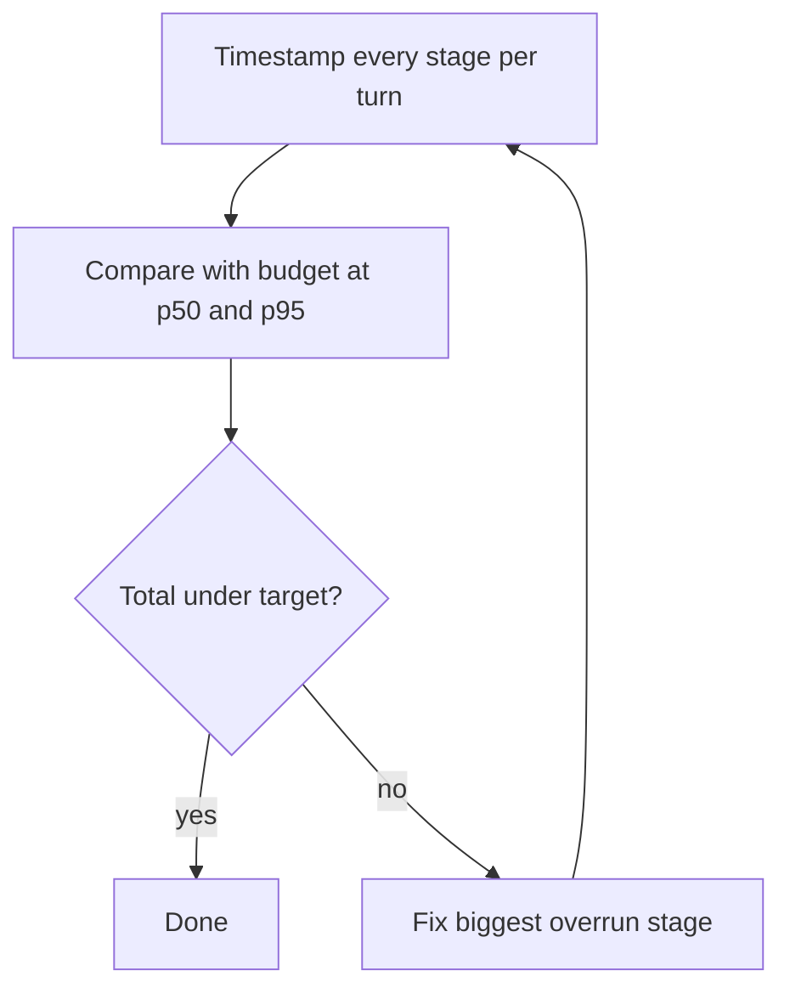

# How do you build a latency budget for a voice AI agent?

> **Step 16: AI Infrastructure, Deployment, and System Design** · ⏱️ 17 min read · [Read original](https://outcomeschool.com/blog/voice-agent-latency-budget)

## TL;DR
A latency budget splits the total wait you allow before the agent starts replying into per-stage milliseconds (network, endpointing, STT, LLM, TTS). Pick a target (about 800 ms voice-to-voice), measure each stage per turn at p50 and p95, and fix the biggest overrun first. Streaming lets stages overlap so only the first token and first audio chunk count.

## Key Concepts
- **Latency** — wait between asking and getting.
- **Voice-to-voice latency** — from user stopping speaking to the user hearing the first sound of the reply (not the full answer).
- **Latency budget** — fixed total time split across stages, like a monthly money budget (30,000 rupees = 12,000 rent + 8,000 food + 3,000 travel + 7,000 savings) but in ms.
- **Endpointing** — deciding the user finished their turn (short silence wait or a turn-prediction model).
- **Time to first token (TTFT)** — LLM delay before the first token.
- **Time to first audio/byte** — TTS delay before the first audio chunk.
- **Cascaded pipeline** — separate STT, LLM, TTS models (vs a single speech-to-speech model).
- **p50 / p95** — time that 50% / 95% of replies stay under.

## How It Works

### Why a budget is needed
- Human turn gaps average about 200 ms (study of 10 languages). A 2–3 s silence feels broken: "Hello? Are you there?", people talk over the agent.
- The agent is a chain of steps. If each is built "fast enough" alone, the sum is too slow. The budget gives each a number to stay under.

### Step 1: Total target
- 200 ms is very hard (several models plus network). Many teams aim for about 800 ms or less; well over 1 s feels slow. The blog uses 800 ms.
- Clock starts when the user stops speaking; stops when the first sound reaches their ear.

### Step 2: Stages
Network up, endpointing, STT final text, LLM first token, TTS first audio, network down. Easy to forget network and endpointing, but the user feels them.

### Step 3: Example split (illustrative)
| Stage | Budget |
|---|---|
| Network up | 50 ms |
| Endpointing | 200 ms |
| STT final text | 100 ms |
| LLM time to first token | 300 ms |
| TTS time to first audio | 100 ms |
| Network down | 50 ms |
| Total | 800 ms |

- LLM biggest (only first token, rest generates while user listens); endpointing next (pure waiting).
- STT only 100 ms because streaming STT transcribes while the user talks.
- Start with stages you can't change (network), give the rest to ones you control.

### Step 4: Measure real numbers
- Timestamp every stage boundary on every turn; compare with budget (see AI Agent Observability: traces, spans, metrics).
- Pattern: `BUDGET_MS` dict per stage, `mark(name)` stores `time.monotonic()*1000`, `report()` diffs consecutive marks and prints OK or OVER BUDGET. Sample: endpointing 210/200 OVER, stt 85/100 OK, llm_first_token 520/300 OVER (220 over, biggest), tts 95/100 OK.
- Network is hard to see from the server alone: record on the user's device or measure from a test call capturing both sides.
- **Percentiles**: p50 = normal, p95 = slow cases. p50 750 ms but p95 2000 ms means 5 in 100 replies take 2 s+, and a long call will hit some. Budget for p95 too.
- Summing per-stage p95s does not give total p95 (slow moments don't coincide in one turn), so measure total voice-to-voice p95 directly.

### Step 5: Cut the biggest delay first
Saving 20 ms of network is pointless when the LLM is 220 ms over. Measure after every fix; repeat until total (including p95) is under target.
| Stage | Fix |
|---|---|
| Endpointing | Turn-detection model instead of always a long silence |
| STT | Streaming STT |
| LLM | Smaller/faster model, short prompt, prompt caching, run near user |
| TTS | Streaming TTS that starts from the first short phrase |
| Network | Region close to users, keep connection open |

### Streaming changes the budget
- Sequential (slow) example: endpoint wait 800 + STT 500 + LLM full answer 2000 + TTS full 1000 = 4300 ms before any sound (without network).
- Streaming: STT transcribes while user talks; first LLM phrase goes to TTS; first TTS chunk goes to user; later sentences continue meanwhile. Assembly line, not queue.
- Hence only LLM first token and TTS first chunk count (TTS needs a short phrase, so the first few tokens must be fast). See time-to-first-audio blog.

### Tool calls
- Adds: LLM tool request, tool run (database/outside service), second LLM call. Can add a few hundred ms to seconds.
- Give tools their own budget: keep them fast with timeouts; say a short phrase first ("Let me check that for you") while the tool runs; preload commonly needed data at call start.

### Diagram: budget flow

### Diagram: tuning loop

## Trade-offs & Pitfalls
- Endpointing: long wait rarely cuts users off but feels slow; short wait feels fast but interrupts people pausing to think. Find the smallest wait that doesn't cut off too often; measure latency and interruptions together.
- LLM: bigger model gives better answers but slower TTFT; smaller is faster with more mistakes. The budget shows how many ms you can spend on quality.
- Forgetting network/endpointing; trusting p50 only; summing p95s; tool calls blowing the budget.

## FAQ
- Biggest share? → LLM (300 of 800 ms, first token only), then endpointing.
- Why p95 not just p50? → p50 hides awkward slow replies.
- Sum stage p95s? → No; measure total directly.
- Measure network? → Device-side timing or two-sided test call.

## Key Takeaways
- Voice-to-voice clock stops at the first sound, not the full answer.
- About 800 ms is a practical target; humans expect about 200 ms.
- List every stage, including network and endpointing.
- Measure per stage per turn and track p95 plus total p95 directly.
- Fix the biggest overrun first, then re-measure.
- Streaming overlaps stages so only first token and first audio chunk count.
- Tool calls need their own budget and a filler phrase.
