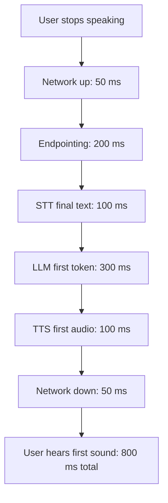

# How do you build a latency budget for a voice AI agent?

> **Step 16: AI Infrastructure, Deployment, and System Design** · ⏱️ 17 min read · [Read original](https://outcomeschool.com/blog/voice-agent-latency-budget)

## TL;DR
A latency budget fixes a total time for one reply (e.g. 800 ms voice-to-voice) and assigns each pipeline stage a share. Measure every stage per turn, fix the biggest overrun first, use streaming so stages overlap, and accept the endpointing and model-size trade-offs.

## Key Concepts
- **Voice-to-voice latency** — from the user stopping speech to hearing the first sound of the reply.
- **Latency budget** — total allowed time split across stages, like a monthly money budget in ms.
- **Time to first token (TTFT)** — LLM delay before output starts.
- **Time to first byte / first audio** — TTS delay until the first audio chunk.
- **p50 / p95** — time half / 95 percent of replies stay under.
- **Cascaded pipeline** — separate STT, LLM, TTS models.

## How It Works
Why it is needed: human turn gap is about 200 ms on average (study across ten languages); 2-3 s silence feels broken. "Fast enough" stages sum to a slow reply.

### Step 1: Pick the total
200 ms is unrealistic for chained models plus network; many teams target about 800 ms or less. Clock starts when the user stops and stops at the first sound heard, not when the full answer is ready.

### Step 2: List all stages
Network up, endpointing, STT final text, LLM first token, TTS first audio, network down. Do not forget network and the endpointing wait.

### Step 3: Allocate (illustrative)
| Stage | Budget |
|---|---|
| Network up | 50 ms |
| Endpointing | 200 ms |
| STT final | 100 ms |
| LLM first token | 300 ms |
| TTS first audio | 100 ms |
| Network down | 50 ms |
| Total | 800 ms |

LLM is largest but counts only first token. Streaming STT makes 100 ms feasible since it transcribes while the user talks.

### Step 4: Measure
Timestamp each stage boundary on every turn; compare to budget (example: endpointing 210 vs 200 over, LLM 520 vs 300 over by 220 ms). Network needs client-side or test-call measurement. Track p50 and p95; e.g. p50 750 ms but p95 2000 ms means 5 percent of turns feel awkward. Summed stage p95s do not equal total p95, so track total directly.

### Step 5: Cut the biggest first
- Endpointing: turn detection model instead of long silence.
- STT: streaming.
- LLM: smaller/faster model, short prompt, prompt caching, run close to users.
- TTS: streaming from the first phrase.
- Network: nearby region, persistent connections.
Re-measure and repeat, to p95.

### Streaming
Sequential example: 800 + 500 + 2000 + 1000 = 4300 ms. Streaming overlaps stages like an assembly line, so only first token and first audio chunk count.

### Tool calls
Add LLM tool-request time, tool run time, and a second LLM call (hundreds of ms to seconds). Mitigate: fast tools with timeouts, a filler like "Let me check that", preload data at call start.

### Trade-offs
Short endpointing wait feels fast but cuts people off; measure latency and interruption rate together. Bigger LLM gives better answers but slower first token; the budget makes the cost explicit.

## Diagram

## Key Takeaways
- Budget the time-to-first-sound, not the time to finish the answer.
- Typical target is about 800 ms voice-to-voice (humans gap about 200 ms).
- Measure each stage per turn and fix the biggest overrun first.
- Budget for p95, and measure the total directly.
- Streaming overlaps stages; tool calls need their own budget or a filler phrase.
