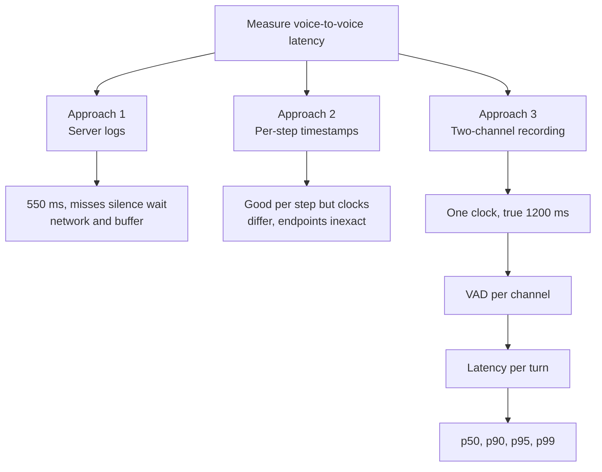
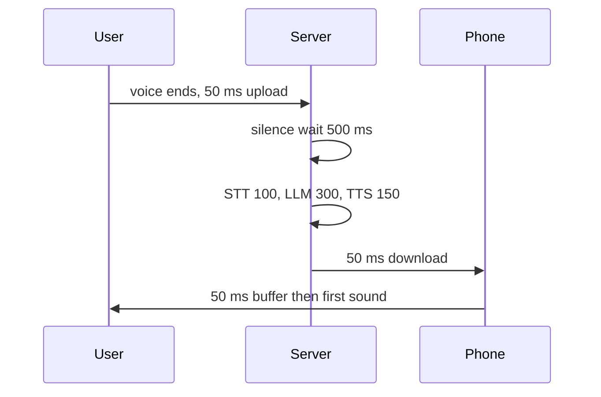

# How does the voice-to-voice latency of a voice agent get measured?

> **Step 16: AI Infrastructure, Deployment, and System Design** · ⏱️ 17 min read · [Read original](https://outcomeschool.com/blog/voice-to-voice-latency)

## TL;DR
Voice-to-voice latency is the gap from the user's voice ending to the first sound of the agent's reply reaching the user's ear. Server logs and mixed-clock timestamps give wrong numbers; the right way is a two-channel recording on one timeline, with a VAD finding the end of user speech and start of agent speech, then subtracting. Summarise over many turns with percentiles (p50, p95, p99), not the average.

## Key Concepts
- **Voice-to-voice latency** — user stops speaking to user hears first sound of reply. Example: pizza order, the silent gap between "pizza" and "Sure".
- **Endpointing** — agent's decision, after some silence, that the user is done; often one of the biggest delays.
- **Jitter buffer** — small phone-side buffer of audio pieces to smooth uneven arrival; adds a little delay.
- **VAD (Voice Activity Detector)** — labels small slices (e.g. 20 ms) as speech or no speech.
- **Percentile** — value below which a given percentage of measurements fall.

## How It Works

### Why it matters
Human turn gap is about 200 ms (study in ten languages). A long gap makes users say "Hello?" or talk again, so both talk at once and the conversation breaks.

### Where the time goes (example, total 1200 ms)
| Step | Time |
|---|---|
| Audio phone to server | 50 ms |
| Silence wait (endpointing) | 500 ms |
| STT final text | 100 ms |
| LLM first part of reply | 300 ms |
| TTS first audio | 150 ms |
| Audio server to phone | 50 ms |
| Phone buffer | 50 ms |

$50+500+100+300+150+50+50 = 1200$ ms. It is the sum of everything, not just the AI models. The start point is the real end of the user's voice (not when the agent decided), the end point is the sound reaching the ear (not when the reply was made).

### Approach 1: Server logs (wrong)
Log "end of user turn detected 10:15:02.300" and "first reply audio sent 10:15:02.850" gives 550 ms. It misses the 500 ms silence wait, the 50 ms upload, the 50 ms download and the 50 ms phone buffer. Real is 1200 ms, so logs hide over half the wait.

### Approach 2: Timestamps at every step (partial)
- Phone and server timestamps show per-step cost (spot a slow LLM at once).
- Problem: phone and server clocks differ by tens of ms or more (phone 80 ms ahead gives 80 ms hidden error when subtracting across devices).
- Even the phone-only total is inexact: the phone's own silence detector marks the end early/late, and the audio system adds delay after the app hands audio to the speaker.

### Approach 3: Two-channel recording (right)
- Record the call as the user hears it: left channel = user, right = agent. One file, one clock.
- Steps: find user's voice end on left; find agent's voice start on right; subtract. Example: 4.20 s and 5.40 s gives 1.20 s = 1200 ms.
- Done after the call, so audio before and after is visible, giving more accurate end-of-speech than the live agent had.
- Captures both network directions, silence wait, all models, phone buffer.
- Get recordings by recording on the user's device or by test calls from a computer that plays a recorded user voice and records what returns.

### Automating with a VAD
Run VAD on each channel; for each user segment find the first agent segment starting after it ends:
```python
def measure_latencies(user_speech, agent_speech):
    latencies = []
    for user_start, user_end in user_speech:
        for agent_start, agent_end in agent_speech:
            if agent_start > user_end:
                latencies.append(round(agent_start - user_end, 2))
                break
    return latencies
```
Input user [(0.5,2.1),(6.0,8.3)], agent [(3.0,5.2),(9.1,11.0)] gives [0.9, 0.8] (900 ms, 800 ms). A real version joins user segments with a short mid-sentence gap into one turn, and skips turns where the user interrupted the agent (no clean gap).

### Percentiles not average
Ten turns (ms): 700, 750, 800, 800, 850, 900, 950, 1000, 1100, 2400. Average = 1025 ms, making a normal turn look slower than it is while hiding the 2400 ms user.
- p50 (median) = (850+900)/2 = 875 ms: typical.
- p90 = 1100 ms (9 of 10 at or below).
- p95, p99: need many more turns to be reliable; show slowest turns.
- Good p50 with bad p99 still makes some users feel ignored; track p50 plus a high percentile and push both down.

### Diagram: three approaches


### Diagram: timeline


## Trade-offs & Pitfalls
Works well: measures real user experience; single clock; works for cascaded or speech-to-speech agents; combine with Approach 2 for true total plus per-step breakdown.
Fails when:
- VAD is imperfect (soft last word or breath shifts end by tens of ms).
- Background noise on the user channel looks like speech.
- A filler like "Hmm" before the real answer: must decide what counts as reply start.
- Test calls on clean networks are better than real weak mobile networks.

## FAQ
- Clock start/stop? → Real end of user voice to first sound at the ear.
- Biggest part? → Often the silence wait, which wrong measurements miss most.
- Phone clock plus server clock? → No, unsynced, hidden error.
- Speech-to-speech models? → Yes, two-channel works the same.
- Test vs real numbers? → Real usually worse.

## Key Takeaways
- Total = network both ways + endpointing + STT + LLM + TTS + phone buffer.
- Server logs undercount (550 vs 1200 ms in the example).
- Cross-device timestamps carry clock-skew error.
- Two-channel recording on one clock is the most faithful measurement.
- VAD per channel automates it across thousands of turns.
- Report p50 and p95/p99, never just the average.
