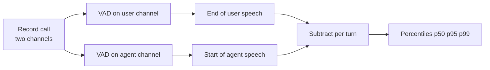

# How does the voice-to-voice latency of a voice agent get measured?

> **Step 16: AI Infrastructure, Deployment, and System Design** · ⏱️ 17 min read · [Read original](https://outcomeschool.com/blog/voice-to-voice-latency)

## TL;DR
Voice-to-voice latency is the time from the moment the user stops speaking to the moment they hear the first sound of the agent's reply. The most faithful way to measure it is a two-channel recording on one clock, then subtracting the end of user speech from the start of agent speech, automated with a VAD and summarized with percentiles.

## Key Concepts
- **Voice-to-voice latency** — gap between the end of the user's voice and the first agent sound reaching the user's ear.
- **Endpointing** — the agent's silence wait to be sure the user is done; often one of the biggest parts of the total.
- **Jitter buffer** — small buffer on the phone that smooths uneven audio arrival, adding a little delay.
- **VAD (Voice Activity Detector)** — labels small audio slices (e.g. 20 ms) as speech or no speech.
- **Percentile (p50, p90, p95, p99)** — value below which that percentage of measurements fall.

## How It Works
**Where time goes (example):** 50 (upload) + 500 (silence wait) + 100 (STT) + 300 (LLM) + 150 (TTS) + 50 (download) + 50 (phone buffer) = 1200 ms. It is the sum of the whole journey, not just the models.

**Three approaches**

| Approach | Idea | Problem |
|---|---|---|
| 1. Server logs | Time between "end of turn detected" and "first audio sent" | Misses silence wait, network, buffer; says 550 ms vs real 1200 ms |
| 2. Timestamps at every step | Phone and server both log times | Different clocks (offset of tens of ms), inexact start/end points; good for per-step breakdown only |
| 3. One-timeline recording | Two channels: left = user, right = agent as played to user | Best; one clock, captures everything |

**Two-channel measurement:** find end of user speech on the left, start of agent speech on the right, subtract (e.g. 5.40 - 4.20 = 1.20 s). Post-call analysis can look ahead, so the user's true end is found accurately.

**Automation:** run a VAD on each channel, then for each user segment find the first agent segment starting after it ends.
```python
for user_start, user_end in user_speech:
    for agent_start, agent_end in agent_speech:
        if agent_start > user_end:
            latencies.append(agent_start - user_end); break
```
Real versions must merge mid-sentence pauses into one turn and skip interrupted turns.

**Percentiles over average:** for 700, 750, 800, 800, 850, 900, 950, 1000, 1100, 2400 the mean is 1025 ms, hiding both the typical turn and the 2400 ms outlier. p50 = 875 ms, p90 = 1100 ms. Track p50 plus a high percentile such as p95.

## Diagram


## Key Takeaways
- Start the clock at the end of the user's voice and stop at the first sound the user hears.
- Server logs undercount badly because they skip silence wait, network, and phone buffer.
- Cross-device timestamps suffer clock skew; a single-clock two-channel recording avoids it.
- Report percentiles, not averages; a good p50 with a bad p99 still frustrates users.
- Weaknesses: imperfect VAD, background noise, filler sounds ("Hmm") ambiguity, and clean test networks that flatter real numbers.
