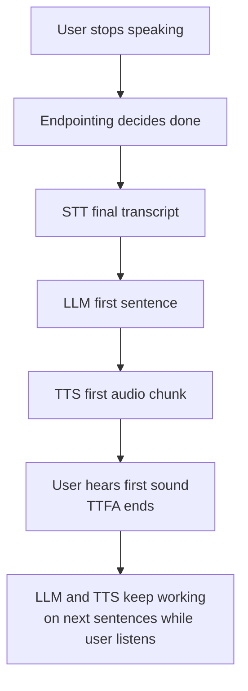
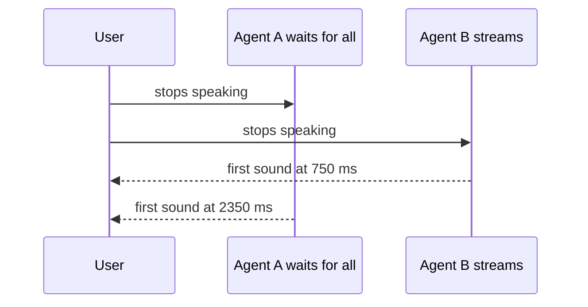

# Why does the time-to-first-audio matter more than total response time?

> **Step 16: AI Infrastructure, Deployment, and System Design** · ⏱️ 14 min read · [Read original](https://outcomeschool.com/blog/time-to-first-audio)

## TL;DR
On a voice call the user only feels the silence before the agent starts speaking. Once audio starts, the user is busy listening while the rest of the reply is generated in the background, so streaming makes time-to-first-audio (TTFA) depend only on the first small piece, not on the whole reply. Total response time still matters for tool calls, long replies, interruptions and cost.

## Key Concepts
- **Voice AI agent** — STT (voice to text) → LLM (reply text) → TTS (text to voice).
- **Time-to-first-audio** — user stops speaking to first sound of reply; same as voice-to-voice latency. Example: 700 ms.
- **Total response time** — user stops to agent finishing the complete reply (full text and audio). Example: 1500 ms. Always at least TTFA.
- **Streaming** — each step passes small pieces on as soon as ready.
- **Chunk** — small piece of audio.
- **Real-time factor (RTF)** — time to produce audio divided by audio length; must be below 1.
- **TTFT** — LLM time to first token.

## How It Works

### Why people feel only TTFA
- Human turn gap is about 200 ms (ten-language study). Brain expects near-instant reply.
- A voice call has no spinner or typing dots; silence means "did it hear me? did the call drop?". After 2–3 s users say "Hello?" and talk over the agent.
- Once the agent speaks, the waiting is over. Directions analogy: you start speaking while still thinking of the next road; the friend doesn't notice.
- Speed gap: speech is about 150 words/min (2–3 words/s); LLMs write tens of tokens/s; good TTS makes 1 s of audio in much less than 1 s. So the system stays ahead of playback.

### Two agents, same 5 s answer (50 ms network assumed)
| Event | Agent A (waits for all) | Agent B (streams) |
|---|---|---|
| Final transcript | 300 ms | 300 ms |
| LLM writes reply | 300–1500 ms | first sentence at 600 ms |
| TTS | 1500–2300 ms | first chunk at 700 ms |
| User hears first sound | 2350 ms | 750 ms |
| Full audio ready | 2300 ms | about 2000 ms |
| User hears last word | 7350 ms | about 5750 ms |

Total times are similar (about 2 s), but A's user sits in 2.35 s of silence and may think the call dropped; B's hears sound at 0.75 s. B's remaining work is hidden inside listening time.

### How streaming brings first audio early
- STT transcribes while the user talks.
- LLM emits tokens; the agent collects only the first sentence/short phrase.
- TTS converts it immediately and sends chunks; chunk 1 plays while later chunks are made.
- While user hears sentence 1, LLM writes sentence 2 and TTS processes it: all steps work simultaneously.

### What decides TTFA
Only the first-piece path:
1. Endpointing (waiting too long adds silence; too early cuts the user off).
2. Final transcript (last few words).
3. LLM TTFT (longer prompt or bigger model is slower).
4. First sentence/phrase tokens.
5. TTS first audio chunk.
6. Network to the user.

Full reply length is not in the list: 10 words vs 100 words give nearly the same TTFA. Speeding up the rest helps little if the first piece is slow.
Ways to cut it: servers near user with model kept loaded; short prompt; send the first short phrase to TTS rather than a long sentence; TTS that starts from small text; tune endpointing.

### Condition: the rest must keep up
After the first sound, audio must never run out (a mid-sentence gap sounds like a broken call):
- LLM must write tokens faster than they are spoken (usually easy).
- TTS must run faster than real time: $\text{RTF} = \dfrac{\text{time to produce audio}}{\text{audio length}} < 1$.

### Diagram: path of the first piece

### Diagram: waiting vs streaming

## Trade-offs & Pitfalls
Total response time still matters when:
- The agent must act first (tool call, e.g. account balance). A filler like "Let me check that for you" brings first audio early but the real answer still waits.
- Replies are very long: user must hear the last word. Keep voice replies short, main answer in the first sentence.
- User interrupts: agent stops and discards the rest; the work was wasted but still cost server time and money.
- Cost and capacity: servers do full work per reply, which decides calls per machine and cost per call.
- If audio or tokens fall behind, mid-reply gaps destroy trust.

## FAQ
- TTFA = voice-to-voice latency? → Yes.
- Longer reply raises TTFA? → No, if everything streams.
- RTF? → Production time / audio length, needs below 1.
- Why "Let me check that for you"? → Tool needed first; fills silence.
- Main answer in first sentence? → Long replies make total time matter again.

## Key Takeaways
- Users feel the silence before the first sound, not the total time.
- Speaking is slow versus generation, so the system stays ahead after starting.
- Streaming at STT, LLM and TTS makes TTFA depend only on the first piece.
- TTFA path: endpointing, STT, LLM TTFT, first phrase, TTS first chunk, network.
- Keep TTS RTF below 1 and LLM faster than speech to avoid gaps.
- Total time still drives tool waits, long replies, interruption waste and cost.
