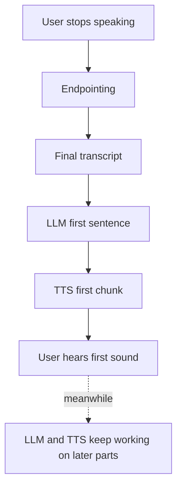

# Why does the time-to-first-audio matter more than total response time?

> **Step 16: AI Infrastructure, Deployment, and System Design** · ⏱️ 14 min read · [Read original](https://outcomeschool.com/blog/time-to-first-audio)

## TL;DR
On a voice call, the only waiting the user feels is the silence before the first sound. Time-to-first-audio (TTFA) therefore decides whether an agent feels fast, while the remaining work hides behind playback when every stage streams.

## Key Concepts
- **Time-to-first-audio** — time from user stops speaking to first sound of the reply; same as voice-to-voice latency.
- **Total response time** — time until the full reply text and audio are produced; always at least TTFA.
- **Streaming** — each stage passes small pieces onward as soon as ready.
- **Real-time factor** — audio production time divided by audio length; must be below 1.
- **TTFT** — LLM time to first token.

## How It Works
**Why users feel only TTFA.** Humans expect turn gaps of about 200 ms. A call has no spinner, so silence is ambiguous (did it hear me? dropped call?). Once sound starts, waiting is over. Speech is also slow (about 150 words per minute) compared with LLM and TTS speed, so the system stays ahead of playback.

**Two agents, same answer (5 s of speech):**

| | Agent A (waits for all) | Agent B (streams) |
|---|---|---|
| First sound | 2350 ms | 750 ms |
| Full audio ready | 2300 ms | about 2000 ms |
| Last word heard | 7350 ms | about 5750 ms |

Total response times are close, yet A's user sits in silence far longer.

**What sets TTFA** (only the first piece's path): endpointing, final transcript, LLM TTFT, first sentence or phrase, TTS first chunk, network. Reply length is not on the list, so a 10-word and a 100-word reply have nearly the same TTFA.

**Ways to cut it:** servers near the user with models kept loaded, short prompts, send the first short phrase to TTS, a TTS that starts from little text, tuned endpointing.

**Condition:** the rest must keep up. LLM must write faster than speech, TTS real-time factor below 1, otherwise mid-reply gaps sound like a broken call.

**When total time still matters:** tool calls before answering (filler like "Let me check that"), very long replies (put the answer first), interruptions (wasted work), and cost/capacity.

## Diagram

## Key Takeaways
- The user feels the silence before the first sound, not the total compute time.
- Streaming makes TTFA depend on the first small piece, not the full reply.
- Optimize the first-piece path, not the full reply.
- Streaming only works if LLM and TTS stay ahead of playback.
- Total time still matters for tool calls, long replies, interruptions, and cost.
