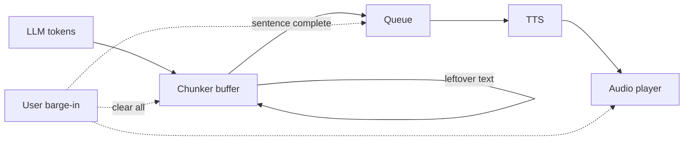

# How does sentence chunking feed LLM output into TTS faster?

> **Step 16: AI Infrastructure, Deployment, and System Design** · ⏱️ 18 min read · [Read original](https://outcomeschool.com/blog/sentence-chunking-for-tts)

## TL;DR
Sentence chunking collects streamed LLM tokens, cuts them into complete sentences as soon as each ends, and sends each to the TTS in order. The user then waits only for the first sentence instead of the whole reply, while LLM and TTS work in parallel.

## Key Concepts
- **Chunker (aggregator)** — code that buffers tokens and emits sentences.
- **Buffer** — holding area for text not yet sent.
- **Prosody** — rise and fall of the voice; needs sentence context.
- **Barge-in** — user speaks while the agent is talking.
- **Max / min length** — fallback cut at commas for long sentences; merging tiny sentences like "Ok." to avoid choppiness.

## How It Works
**Why sentences?** Sending the full reply is natural but slow; sending every token is fast but broken ("read" as "reed" vs "red" depends on later words; questions rise at the end). A sentence is short enough to be ready fast and has enough context.

**Chunker loop:** add token to buffer, check for a complete sentence, if yes cut and send to TTS and keep leftover, else wait; when the LLM finishes, flush the remainder. Finished sentences queue so speech stays in order.

**Finding sentence end:** a `.`, `?` or `!` followed by a space/newline/end. Waiting for the next character avoids cutting "3." before "3.5".

**Tricky cases:** abbreviations ("Dr.", "a.m."; use an abbreviation list or check for a capital next word), decimals and URLs (handled by the space rule), ellipsis (group dots), very long sentences (cut at comma, semicolon, colon after max length).

**First chunk smaller:** the user waits only until the first audio starts, so cut the first chunk early (at a comma or few words, e.g. "Sure,") and use full sentences afterward. Cost: less context for the first piece.

**Numbers example:** LLM first token at 0.3 s, 10 tokens per 0.1 s, TTS start 0.2 s. Without chunking a 3-sentence reply starts at 0.8 s; with chunking at 0.6 s. For ten sentences, 1.5 s vs 0.6 s, so wait no longer grows with reply length.

**Interruption:** clear the buffer, cancel pending TTS requests, stop the player. Because replies are split into sentences, only the fully played ones are saved to history so the LLM knows what the user heard.

## Diagram

## Key Takeaways
- Sentence chunking makes time-to-first-audio depend on the first sentence, not reply length.
- Sentence is the sweet spot between context for natural prosody and speed.
- Handle abbreviations, long sentences, markdown symbols, and non-Latin punctuation (e.g. Chinese).
- Make the first chunk smaller; later chunks can be full sentences.
- On barge-in, flush buffer, TTS requests, and audio, and record only what was heard.
