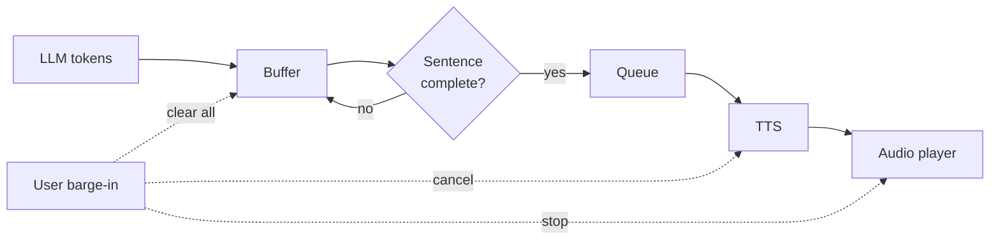
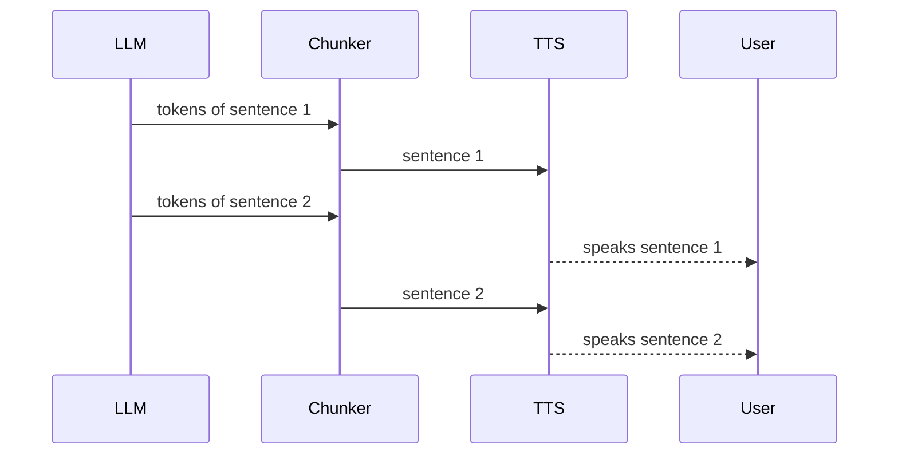

# How does sentence chunking feed LLM output into TTS faster?

> **Step 16: AI Infrastructure, Deployment, and System Design** · ⏱️ 18 min read · [Read original](https://outcomeschool.com/blog/sentence-chunking-for-tts)

## TL;DR
A chunker collects streaming LLM tokens in a buffer, cuts out each complete sentence the moment it ends, and queues it to the TTS. The voice starts after sentence 1 instead of after the full reply, so the wait no longer grows with reply length. The first chunk is cut even smaller (e.g. at a comma) for faster start; edge cases (abbreviations, decimals, long sentences, interruptions) need extra rules.

## Key Concepts
- **Token / streaming** — LLM emits small text pieces one by one.
- **Chunker (aggregator, sentence tokenizer)** — code that groups tokens into sentences for the TTS.
- **Buffer** — holding area for text not yet sent.
- **Prosody** — rise and fall of the voice (question goes up, statement goes down); needs sentence context.
- **Barge-in** — user speaks while the agent is talking.
- **Max / min length** — fallback cut size and merge threshold for chunks.

## How It Works

### The problem
Pipeline STT → LLM → TTS. If the full 3-second reply is awaited before TTS, the user hears nothing for 3 s plus TTS time. But sentence 1 ("Sure, I can help with that.") is ready after a fraction of a second.

### Why sentences, not tokens
- TTS needs context. "read" sounds "reed" in "I read books every day" and "red" in "I read that book yesterday"; the deciding word comes later. Tone: "Is it ready?" rises, statements fall.
- Full reply: natural but slow. Every token: fast but broken. A sentence is short enough to be quick yet has enough context.
- Finished sentences wait in a queue so TTS speaks them in order, while the LLM keeps writing the next one (all stages concurrent).

### Chunker algorithm
1. Token arrives, append to buffer.
2. Check if buffer holds a complete sentence.
3. If yes, cut it, send to TTS, keep leftover.
4. If no, wait for next token.
5. When LLM finishes, send remaining buffer as the last chunk even without a full stop.

```python
def chunk_sentences(token_stream):
    buffer = ""
    for token in token_stream:
        buffer += token
        while True:
            end = find_sentence_end(buffer)
            if end == -1: break
            sentence = buffer[:end].strip()
            buffer = buffer[end:]
            yield sentence
    if buffer.strip():
        yield buffer.strip()
```

### Finding the sentence end
- Rule: `.`, `?`, `!` followed by whitespace (wait one more character, since "3." may become "3.5"). Returns index after punctuation, or -1 to wait.
- Example: after "that." arrives, no cut; when " Your" arrives the space confirms the end, so "Sure, I can help with that." is sent and " Your" starts sentence 2.

### Tricky cases
| Case | Example | Handling |
|---|---|---|
| Abbreviations | "Dr. Sharma will call you." | List: dr., mr., mrs., ms., etc.; skip cut after them |
| Decimals | "3.5 dollars" | No space after dot, simple rule works |
| Short forms | "10 a.m. tomorrow" | Abbreviation list / capital-letter check |
| URLs/emails | "example.com" | No space after dot, handled |
| Ellipsis | "Well... let me check." | Treat dots as one punctuation |

- Also: wait for next word starting with a capital letter before cutting.
- **Max length**: if no sentence end for too long (long comma lists), cut at last comma, semicolon or colon (natural pauses).
- **Min length**: join short ones like "Ok." with the next; many tiny pieces make speech choppy.

### Smaller first chunk
User waits only until the first audio; later chunks just need to be ready before the previous audio ends. Long first sentence "Sure, I checked your account and I can see..." can be cut at the first comma ("Sure," goes immediately). Rule: first chunk cut early (comma or few words); later chunks cut at full sentences. Cost: less context, slightly less natural tone on the first piece.

### Walkthrough with numbers
Assume LLM first token at 0.3 s, then about 10 tokens per 0.1 s; TTS needs 0.2 s to start audio per chunk; reply 3 sentences of about 10 tokens.
| Case | First sound |
|---|---|
| No chunking (30 tokens done at 0.6 s) | 0.6 + 0.2 = 0.8 s |
| Chunking (sentence 1 at 0.4 s) | 0.4 + 0.2 = 0.6 s |
| 10 sentences, no chunking (100 tokens done at 1.3 s) | 1.5 s |
| 10 sentences, chunking | still 0.6 s |

Wait depends only on the first sentence. As long as the LLM writes faster than the voice speaks, TTS never runs dry and there are no gaps.

### Interruption (barge-in)
Stop speaking at once and clear three places: chunker buffer, pending TTS requests, audio already made but unplayed (forgetting the buffer leaks the old reply into the new turn). Chunking lets the agent record which sentences were fully played and save only those to history so the LLM knows what the user heard.

### Diagram: pipeline with chunker


### Diagram: overlap over time


## Trade-offs & Pitfalls
Works well: long replies; TTS models that need a full sentence rather than live text.
Fails/pitfalls:
- Abbreviations, numbers, URLs, code: odd pauses.
- Very long sentences with no stop: wait or fall back to commas.
- Markdown symbols (* and #) must be cleaned before TTS or they are read aloud.
- Languages with other full stops (Chinese/Japanese use 。 with no following space): per-language rules needed.
- Each chunk spoken alone, so tone between sentences can feel disconnected.
- Newer streaming-text TTS models keep context across chunks, allowing smaller pieces; the principle (start as soon as there is enough text) stays.

## FAQ
- Why wait for a space after a full stop? → "3." may become "3.5".
- Leftover buffer at end? → Sent as the last chunk.
- Prosody? → Pitch rise/fall needing sentence end knowledge.
- Still needed with streaming TTS? → Same idea, smaller pieces.

## Key Takeaways
- Chunker turns token stream into sentences sent to TTS immediately.
- Sentence is the sweet spot between context and speed.
- First-sound wait depends on the first sentence only, not on reply length.
- Use a smaller first chunk and sentence-level later chunks.
- Handle abbreviations, ellipsis, max/min length, markdown, other languages.
- On barge-in, flush buffer, TTS queue and player; save only played sentences to history.
